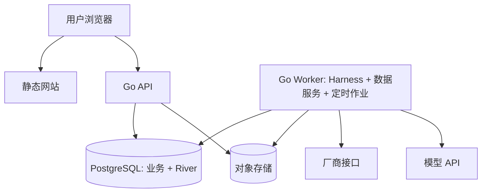

# 首版架构

状态：依 ADR-0003 修订。研究执行细节见 [HARNESS](docs/HARNESS.md)，数据接入见 [DATA_SERVICE](docs/DATA_SERVICE.md)。

## 1. 技术栈

| 层 | 选择 | 说明 |
| --- | --- | --- |
| 后端语言 | Go 1.27.3 | 业务、Harness、数据服务、作业 |
| HTTP | net/http + chi | 同源 `/api/v1` |
| 数据库 | PostgreSQL 18；pgx、sqlc、goose | 业务库唯一真值；RLS 作纵深防御 |
| 作业队列 | River（基于 PostgreSQL）| 事务内入队，替代 Temporal 与自建 Outbox |
| 对象存储 | S3 兼容（开发用 MinIO）| 原始响应、长文本、报告渲染产物 |
| 模型 | OpenAI-compatible HTTPS 网关 | 默认 profile 指向 DeepSeek `deepseek-flash`，配置化 |
| 身份 | 后端 OIDC 客户端 + 服务器会话；开发用 Dex | 不自建密码 |
| 前端 | React 19 + TypeScript + Vite；TanStack Router/Query；ECharts | 中文界面，桌面与手机 |
| Python | 3.12，仅当厂商只提供 PDF 时用于解析，独立进程 | 默认不部署 |

首版不使用 Redis、Kafka、向量数据库、gRPC、Temporal、通用 Agent 框架和 K8s。文本检索用 PostgreSQL 全文检索，中文分词扩展在 T012 选定并锁定版本。

## 2. 进程

- `vera-api`：会话、计划、任务命令、报告与证据读取、自选股、反馈。不调用厂商接口；只在一句话解析时调用模型（见 §5）。
- `vera-worker`：执行 River 作业，包括研究任务、数据刷新、自选股快照和费用对账。研究任务与定时作业使用不同的队列和并发上限。
- `vera-harness`：开发者 CLI，提供 replay、eval 和数据适配器测试。

部署方式为单机 Docker Compose，包含 web（Caddy 提供静态文件与 TLS）、api、worker、postgres、minio。业务库与对象存储使用持久卷。

## 3. 后端模块

| 模块 | 职责 | 拥有的表 |
| --- | --- | --- |
| `identity` | OIDC 登录、会话、邀请码、workspace | users、workspaces、sessions、invites |
| `catalog` | 实体目录与搜索、能力登记 | entities、entity_aliases、capabilities |
| `dataservice` | 厂商适配器、映射、统一数据集、快照 | providers、raw_objects、records_*、snapshots |
| `harness` | 技能注册、计划、事实表、写作、核验、组装 | research_plans、task_steps、model_calls、claims |
| `research` | 任务命令、状态机、配额、取消、交付 | research_tasks、task_events、usage_ledger |
| `reports` | 报告版本、渲染、证据查询 | report_versions、report_claims、publications |
| `watchlist` | 自选股、提醒、快照 | watchlist_* |
| `feedback` | 用户反馈 | feedback |
| `platform` | 幂等键、审计、配置、限流 | idempotency_keys、audit_events |

规则：

- domain 层不依赖 HTTP、sqlc 和 River 的类型；application 层组织用例；adapter 层实现 repository 与外部接口。
- 跨模块写入通过拥有该表的模块的应用方法完成；交付使用同库事务（UnitOfWork）。
- API 与 Worker 共享应用服务，不互相发 HTTP 请求。
- 模型调用只经过 `harness` 的网关。模型输出没有数据库写权限，也不能触发交付。

## 4. 状态所有权

- PostgreSQL 保存全部业务真值：任务状态、revision、epoch、步骤台账、模型调用、费用、报告和交付。
- River 作业表只保存调度信息。作业丢失或重复不影响正确性，由步骤台账保证幂等。
- 任务状态机见 [HARNESS](docs/HARNESS.md) §10。取消与交付都锁任务行：先提交取消则 epoch 递增，之后到达的结果不可交付；先完成交付则取消返回 409 `ALREADY_COMPLETED`。
- 报告版本冻结技能版本、计划哈希、数据快照哈希、规则集与提示词版本，以及实际模型版本。
- 每次读取证据、发起模型调用和交付时，都重新检查用户权限与数据许可。

## 5. 请求路径

| 场景 | 路径 | 时延目标 |
| --- | --- | --- |
| 实体搜索、列表、报告读取 | API → DB | P95 ≤ 500ms |
| 生成计划（技能卡片，或一句话可由规则解析）| API → catalog 能力登记 | P95 ≤ 500ms |
| 生成计划（需要模型解析）| API → 模型 router profile；同步，超时 15 秒，失败则返回候选让用户选择 | P95 ≤ 8s |
| 研究任务 | API 写任务 + River 作业 → Worker 执行 | 见 SPEC §6 |

一句话解析是 API 中唯一同步调用模型的路径，有独立的并发上限（默认 8）和每用户限流（每分钟 10 次）。

## 6. 安全边界

- 外发请求只允许访问登记的厂商域名与模型域名，其余出站流量在容器网络层拒绝。
- 厂商凭证与模型密钥以 secret 引用的形式由环境注入，不进入日志、报告、前端和模型输入。
- 数据集许可中“允许发送给模型处理”为否的数据，不进入事实表。
- 厂商返回、公告正文、新闻和用户输入都是不可信数据。它们在提示词中以数据块形式出现，规则说明其中的指令无效；Harness 的确定性检查不依赖模型遵守这一点。

## 7. 演进

- 研讨类多 Agent 作为额外的核验步骤接入（HARNESS §12），不改状态机。
- 用户增长后先水平扩展 Worker 与 API。配额、租约和公平调度都在 PostgreSQL 中，可多副本共享。
- 出现跨区域或长周期流程需求时，再评估引入工作流引擎。
