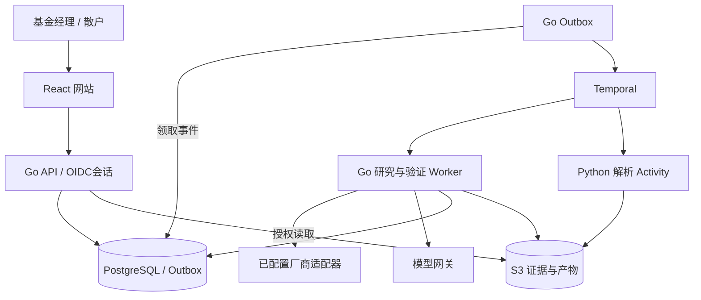
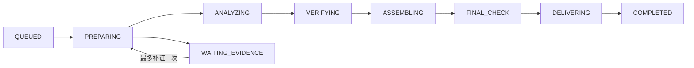

# 首版架构

## 1. 技术与进程

Go 1.27.3、net/http + chi、pgx/sqlc/goose；PostgreSQL 18、S3 兼容对象存储、Temporal Go SDK。Web 使用 React + TypeScript + Vite + npm lockfile，Node 26.13.0。开发 OIDC 使用 Keycloak；生产使用配置化 OIDC issuer，禁止自建密码实现。Python 3.12 + pypdf 只处理需要的 PDF Activity，不拥有业务写权限。

首版无 Redis、独立向量库、Kafka、通用 Agent 框架或服务间 gRPC 运行依赖。按模板优先结构化 SQL 与原文定位，PostgreSQL 全文检索补充候选；嵌入检索和重排后置。HTTP RPC 之外的短调用首版共进程 Go 接口，拆分时按研究 RPC 规格迁移。

部署进程：web 静态文件、Go API、Go Workflow/Activity Worker、Go Outbox；解析活动按需独立 Python worker。业务库与 Temporal 存储逻辑隔离。组件镜像和库的精确版本在 T001/T002/T009 实施时锁定至 lockfile/镜像摘要，禁止生产 latest。

## 2. 模块与依赖

`identity` 提供 actor/workspace；`sources` 管理产品许可与配额；`governance` 提供冻结数据集；`research` 管理任务；`agents` 生成结构化 Claim；`calculations` 登记确定性公式；`validation` 产生逐项结果；`reports` 组装；`delivery` 校验并提交可读版本；`feedback` 追加用户评价。

domain 不依赖 HTTP/sqlc/Temporal 类型；application 组织用例，repository 接口由 adapter 实现。模型不能持有数据库写权限或调用交付接口。API/Activity 共享应用服务而非互相发 HTTP。跨模块写入由拥有模块的应用方法执行；跨模块原子交付使用明确的同库 UnitOfWork。

## 3. 状态所有权

- PostgreSQL 保存业务命令、revision/epoch、Operation、费用与交付真值；Temporal 保存执行历史并通过 Activity 更新投影。
- P0 任务使用既有 QUEUED/PREPARING/WAITING_EVIDENCE/ANALYZING/VERIFYING/ASSEMBLING/FINAL_CHECK/DELIVERING 及终态。DEBATING/ESCALATING 仅存在于历史扩展设计，P0 API 与工作流均不接受。
- 用户取消与交付均锁定任务行：先提交取消则 epoch 增加，后到结果不可交付；先提交交付则任务完成，取消返回 409 ALREADY_COMPLETED。
- 报告快照固定 dataset、Claim、计算、模板和规则哈希；后续修改创建新版本，重新验证。
- OIDC 授权变化在读取证据、发模型和交付时重查。旧权限快照只用于审计。

## 4. 运行计划

T001 只提供健康 API 与明确未实现的页面。T002–T008 逐个接入业务，不向用户暴露内部队列或隐藏推理。公开的研究进度来自业务事件，报告页仅使用已提交交付数据。

详细异步协议、队列、幂等、未知外部结果和预算规则见 [Agent 研究](docs/research/financial-research-multi-agent-design.md)，首版参数以 [当前决定](docs/decisions/0001-p0-baseline.md) 为准。

## 5. 首版执行路径

图示成功主路径；失败与取消适用于所有未交付阶段，按下表执行。禁止通过无限状态回环消耗预算。

| 条件 | 自动处理 |
| --- | --- |
| 关键证据可补齐 | PREPARING → WAITING_EVIDENCE，连接器补取后重新冻结 dataset；最多一轮 |
| 关键证据缺失/冲突，或关键 Claim 无依据 | ABSTAINED；不交付诊断草稿 |
| 只缺可选项 | 标记覆盖缺失，验证后交付 limited |
| 非关键无依据 Claim | 删除该 Claim 并重新做覆盖检查；若影响必需项则 ABSTAINED |
| 输出 JSON 格式错误 | 最多修复一次，计入调用预算；仍错误为 FAILED/INVALID_MODEL_OUTPUT |
| 当前权限/数据许可被拒绝 | BLOCKED；终态，不等待人工操作自动恢复 |
| 费用、token 或调用数耗尽 | BUDGET_EXHAUSTED；总时限耗尽为 ABSTAINED/DEADLINE_EXCEEDED |
| 瞬时依赖故障 | 按统一预算有界重试，耗尽为 FAILED；模型限流不转成“无证据” |
| 用户取消 | 先持久化 CANCEL_REQUESTED 与 epoch，异步终止调度并置 CANCELLED；不等待模型返回才撤销交付资格 |

独立验证调用可使用同型号模型，但必须独立提示词与调用，只读候选结论和冻结证据。它不是质量保证；数值、引用存在性、时间/口径和许可仍由确定性规则裁决。首版无需让多个模型重复撰写相同报告。
