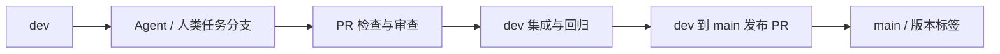

# 分支、集成与发布规范

状态：2026-11-06 开始采用。长期分支只有 dev 与 main；人类和 Agent 使用相同门槛。

| 分支 | 基线 | 目标 | 生命周期 |
| --- | --- | --- | --- |
| main | 稳定发布线 | 版本标签/部署 | 长期；当前仍是工程骨架，并不代表业务可上线 |
| dev | 初次从 main 建立 | main | 长期；可构建、可联调 |
| agent/<actor>/<task> | 最新 dev | dev | 一任务一分支，集成后删除 |
| feat/<task>、fix/<task>、docs/<task> | 最新 dev | dev | 人类任务分支，集成后删除 |
| hotfix/<issue> | 实际生产标签/提交 | main，随后同步 dev | 紧急修复，验收后删除 |

默认保留 main 为仓库默认分支；日常开发显式使用 origin/dev。无需常驻 test/staging/release 分支。环境绑定明确 commit/镜像摘要，不等同于分支。以后需要并行稳定版本时另行引入临时 release 分支。

## 日常工作

1. git fetch origin 后，从 origin/dev 建独立 worktree。一个任务一位负责人，不设长期个人大分支。
2. 将 TASKS 领取记录作为小 PR 合入 dev 后，再开始可能冲突的公共契约或迁移工作；无冲突的准备工作可先进行。并发领取以 dev 首次合入记录为准。
3. 小步提交并更新规范/测试。PR 目标 dev，列出实际命令、结果、未验证项、迁移和回滚。
4. 合并前用 merge 同步最新 origin/dev，不强推共享任务分支；解决冲突后重新执行受影响检查。
5. 任务 PR 使用 squash merge；合入 dev 后执行集成检查。发现回归立即修复或 revert 对应提交，禁止带着已知失败继续发布。
6. 确认提交已集成后删除远端任务分支；清理 worktree 前确认无未提交文件。交接记录永久保留。

## dev 到 main

dev 必须保持可构建，未完成功能使用默认关闭的功能开关，不伪造成功行为。发布以一个明确候选 SHA 为单位，短暂冻结 dev 合并，验证 PR 的最终合并结果。任何代码或基线变化均使受影响的检查失效，不能沿用旧 SHA 的通过记录。

任务到 dev 用 squash；dev 到 main 用普通 merge commit，保留长期分支的共同历史。发布后将 main merge 回 dev，纳入发布记录与修复。禁止 squash 整个长期 dev 分支，禁止 force push/reset 清理共享历史。

main 更新不自动等于上线。发布记录保存 main SHA、标签、镜像摘要、迁移版本及测试证据；部署与回滚推广同一构建产物。应用回滚不自动执行破坏性数据库回退。

hotfix 从实际生产版本建立，先同步检查 main 中未发布修改，明确此次发布是否包含它们，不能默默带入。修复经 PR 和必要测试合入 main；若需仅修复旧版本则先制定临时维护分支方案。修复完成后将 main 合回 dev，解决冲突并回归。

## 检查与保护

| 关口 | 必须执行 |
| --- | --- |
| 任务 PR → dev | 当前 Verify 检查、受影响模块测试、差异审查 |
| dev 推送 | 当前 Verify；随 T002–T007 实现增加迁移、数据库/Worker、关键 E2E |
| dev → main | 上述检查及已实现的完整业务回归；涉及模型/容量/恢复时增加对应实测 |

当前 CI 仅有工程骨架校验，不能称完整业务验收。不得创建空测试或永远成功的 release gate。T008/T009 完成真实评测及发布流水线后，才将其真实 job 名加入保护规则。

建议 dev/main 禁止直接推送、删除和 force push，要求 PR、最新基线的必需检查与已解决讨论。main 仅接受 dev 发布或 hotfix；该来源约束由 CI Branch policy 检查。dev 仅接受表中任务分支，以及从 main 同步。

GitHub 配置路径：Settings → Rules → Rulesets（或 Branches）。待实际工作流运行后，选择 Verify 的 bootstrap 与 Branch policy 的 branch-policy 状态检查；不要求线性历史，因为发布使用 merge commit。不应允许 Agent 为通过检查临时关闭保护。具体可用功能取决于仓库套餐和管理员权限。

当前这些是要求及配置说明，不能据此推断远端保护已启用。启用后记录配置者、时间、作用分支及观察到的规则。

## 工程审查身份

契约、迁移、权限、预算变更由另一 Agent 或维护者独立检查，记录准确 commit 和发现。共用 GitHub 账号不构成两个独立账号审批；不得自批 PR 或冒用用户身份声称人工审查。只有具备独立审查账号时才配置可满足的账号审批门槛；缺少身份时保留可追溯工程审查记录，由维护者按授权集成，不伪造 GitHub approval。

## 本次迁移

用户已要求落实分支规范。本次从现有 main 创建 dev，并直接写入分支规范与 CI，作为一次性流程初始化；不代表业务发布或独立审查完成。之后执行上述 PR 流程。既有 agent/codex/p0-research-scope 保留，下一步以 dev 为目标提交 PR并完成契约审查；不静默合入该范围变更。

## 合并后自动清理

[Cleanup merged task branch](../.github/workflows/cleanup-merged-branch.yml) 在 PR closed 且 merged=true、目标为 dev 时执行，仅删除本仓库的 agent/*、feat/*、fix/*、docs/* 分支。hotfix/* 留待 main/dev 修复同步完成后手动清理；main、dev、当前默认分支以及其他命名空间不删除。

工作流重新读取 PR，检查是否有其他打开的 PR 将来源分支作为 head 或 base，并核对分支 SHA。删除通过 Git 的明确 SHA lease 完成，若检查后又有新提交，远端拒绝删除。仅此维护作业申请 contents:write 和 pull-requests:read；不检出或执行任务分支的文件。删除被权限/保护规则拒绝时作业失败并保留分支，不修改保护配置。分支已不存在时跳过。

流程使用 pull_request/closed，随合并后的 dev 工作流生效；不会追溯清理历史分支，首次合并需查看 Actions 确认触发和仓库权限。不要将这个合并后作业设为合并前的 required check，也不需要额外开启 GitHub 全仓库的自动删分支选项。

自动化只删除远端任务引用。开发机仍需 git fetch origin --prune，随后确认 PR 已合并、没有新增本地提交和未提交文件，再移除对应 worktree 并删除本地分支。squash 后 git branch --merged 不能证明全部已合入；应结合 PR 记录和本地内容确认。一个任务分支合入后不再复用，新任务从 dev 新建分支。

依据：[GitHub 合并事件说明](https://docs.github.com/en/actions/reference/workflows-and-actions/events-that-trigger-workflows)。
