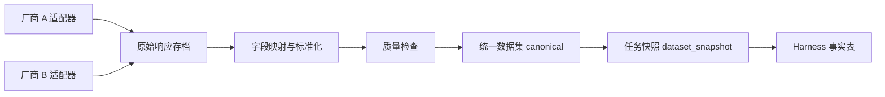

# 数据服务：多厂商接入与统一

状态：当前实施规范（ADR-0003 D4）。数据服务是 Harness 唯一的数据入口：聚合多家已授权厂商，把不同接口和字段统一成内部数据集，并为每个数值保留可追溯的证据版本。研究流程不能直接访问厂商接口，也不能联网搜索。

厂商名单、接口文档与凭证由用户后续提供。本文定义的接口与数据集目录先用 fixture 适配器实现，厂商资料到位后只需新增适配器和映射，不改 Harness。

T027 的单股实时简报沿用该边界：HTTP 确认登记不可变取数意图，Go worker 调用数据服务的 Choice 适配器；数据服务归档、映射、发布并冻结记录后，Harness 只读该任务快照。MCP 可以作为以后某个厂商适配器的传输方式，但不应让模型直接调用厂商工具，或绕过归档、时点、用途及快照约束。当前接线范围仅覆盖 `mkt.intraday_quote`；完整财报、行业、资金数据覆盖仍是独立任务，不能由此推断已完成。

## 1. 分层



| 层 | 内容 | 存储 |
| --- | --- | --- |
| 原始层 | 每次请求的原始响应，带请求指纹、厂商请求 ID、接收时间、哈希 | 对象存储 |
| 统一层 | 按数据集目录标准化后的记录，带来源、口径、时点和版本 | PostgreSQL |
| 快照层 | 某任务冻结使用的记录集合及其哈希 | PostgreSQL（清单）+ 对象存储（大内容）|

## 2. 适配器接口

```go
type Provider interface {
    // 能力声明：支持的数据集、市场、历史深度、更新频率、限流、许可用途
    Describe() ProviderManifest
    // 按统一查询取数，返回原始页；不做语义转换
    Fetch(ctx context.Context, q DatasetQuery) (RawPage, error)
}

type Mapper interface {
    // 纯函数：原始页 → 统一记录；不访问网络，不调用模型
    Normalize(raw RawPage, spec MappingSpec) ([]Record, []QualityIssue, error)
}
```

- `DatasetQuery`：`dataset_id`、`subjects`（entity_id 列表）、`period` 或 `window`、`as_of`、`fields`、`cursor`。
- `RawPage`：`request_fingerprint`、`provider_request_id`、`received_at`、`status`、`body_ref`、`body_sha256`、`next_cursor`。
- 错误分类：`RATE_LIMITED`（可退避重试）、`AUTH_FAILED`（不重试，置 BLOCKED）、`NOT_COVERED`（该厂商不覆盖此对象或时间）、`SCHEMA_CHANGED`（映射失败，告警并隔离）、`UPSTREAM_UNAVAILABLE`（可重试）、`EMPTY_VALID`（确认无数据，例如当日无龙虎榜）。
- 适配器只能访问配置中登记的域名；凭证以 secret 引用读取，不写日志。
- 每个适配器必须附带录制样本与映射单元测试；`fixture` 适配器只在 development 和 test 模式可用，production 启动时检测到即拒绝启动。
- `fixture` 适配器的数据按 [demo-universe](../tests/fixtures/demo-universe.json) 清单以固定种子生成：12 只演示证券、2 个演示行业，覆盖亏损、缺数据、金融类、次新与停牌、无报表、会计更正、成分调整，以及注入与诱导评级的对抗样例。

## 3. 数据集目录

统一数据集按 `dataset_id` 登记，版本化。字段级定义（字段名、类型、单位、必填、财务科目代码）见机器可校验的 [contracts/datasets/catalog.json](../contracts/datasets/catalog.json)，适配器与公式都以它为准。首版需要以下数据集（标注所属技能：S=个股分析，F=资金动向，D=深度研究，W=自选股）。

| dataset_id | 内容 | 粒度 | 技能 | 必需性 |
| --- | --- | --- | --- | --- |
| `ref.security` | 证券代码、简称、交易所、上市日期、状态、曾用名 | 证券 | 全部 | 必需 |
| `ref.industry` | 申万行业分类（一/二/三级）与成分、生效区间 | 证券×日期 | S F D | 必需 |
| `ref.trading_calendar` | 交易日历 | 日 | 全部 | 必需 |
| `mkt.intraday_quote`、`mkt.intraday_index_quote` | 个股或指数行情快照、事件时间及延迟性质 | 标的×行情事件时间×厂商 | S F D | T027 仅接通单股 `stock_analysis/1.1.0-demo.3`；其他技能、指数覆盖与完整数据集仍待实现 |
| `mkt.daily_bar` | 日线：开高低收、成交量、成交额、换手率、复权因子 | 证券×交易日 | S F D W | 必需 |
| `mkt.index_bar` | 指数与申万行业指数日线 | 指数×交易日 | S F D | 必需 |
| `mkt.valuation_daily` | 总市值、流通市值、PE(TTM)、PB(MRQ)、PS(TTM)、股息率 | 证券×交易日 | S D W | S 必需 |
| `fin.statement` | 三大报表关键科目，合并/母公司，含报告期、公告日、更正版本 | 证券×报告期 | S D | 必需 |
| `fin.indicator` | 厂商计算的财务指标（ROE、毛利率等），仅作对账参考 | 证券×报告期 | S D | 可选 |
| `fin.segment` | 分产品、分地区收入与毛利 | 证券×报告期 | S D | 可选 |
| `fin.forecast_express` | 业绩预告、业绩快报 | 证券×公告 | S D | 可选 |
| `corp.holder` | 前十大股东、前十大流通股东、股东户数 | 证券×报告期 | S D | 可选 |
| `corp.pledge` | 股权质押比例 | 证券×日期 | S | 可选 |
| `corp.insider_trade` | 董监高及大股东增减持 | 证券×公告 | S F | 可选 |
| `corp.dividend` | 分红送转、回购 | 证券×公告 | S D | 可选 |
| `corp.unlock` | 限售股解禁计划 | 证券×日期 | S F | 可选 |
| `doc.announcement` | 公告元数据与正文（定期报告、临时公告）| 证券×公告 | S D | D 必需 |
| `doc.periodic_text` | 定期报告正文分段（经营讨论、风险因素、主营业务）| 证券×报告期×段落 | S D | D 必需 |
| `doc.call_transcript` | 业绩说明会、投资者关系活动记录 | 证券×活动 | D | 可选 |
| `flow.margin` | 融资融券：融资余额、融资买入额、融券余量（交易所披露）| 证券×交易日 | S F | F 必需 |
| `flow.dragon_tiger` | 龙虎榜：上榜原因、营业部/机构专用席位买卖额（交易所披露）| 证券×交易日 | F | 可选 |
| `flow.block_trade` | 大宗交易：价格、成交额、买卖营业部 | 证券×交易日 | F | 可选 |
| `flow.connect_holding` | 陆股通持股（交易所按季披露）| 证券×季度 | S F | 可选 |
| `flow.connect_turnover` | 陆股通成交总额与十大成交活跃股（交易所每日披露）| 市场/证券×交易日 | F | 可选 |
| `flow.order_size` | 按单笔成交额分档的资金流（超大/大/中/小单），厂商加工口径 | 证券/行业×交易日 | S F | 可选 |
| `fund.holding` | 公募基金持仓（季报前十大、半年报/年报全部）| 证券×报告期 | S F D | 可选 |
| `research.consensus` | 一致预期（EPS、营收、覆盖机构数）| 证券×年度 | S D | 可选 |
| `research.report_meta` | 券商研报元数据与摘要（标题、机构、日期、评级原文）| 证券×报告 | D | 可选 |
| `news.item` | 授权新闻（标题、来源、时间、正文或摘要）| 证券×条 | S D | 可选 |

`research.report_meta` 中的评级与目标价只能作为归属陈述引用（“某机构在某日给出某评级”），不能成为本系统的结论，且不进入个股分析的事实表（见 [个股分析](skills/stock-analysis.md) §5）。

## 4. 统一记录

每条统一记录包含以下信封字段，载荷按数据集定义：

| 组 | 字段 |
| --- | --- |
| 标识 | `record_id`、`dataset_id`、`dataset_version`、`record_version` |
| 主体 | `entity_id`、`security_code`（交易所代码，如 `600519.SH`）|
| 时间 | `period_start`、`period_end` 或 `trade_date`；`published_at`（原始发布时间）、`available_at`（本系统可用时间）、`ingested_at` |
| 来源 | `provider_id`、`provider_dataset`、`origin`（`exchange`、`company_filing`、`regulator`、`vendor_derived`、`media`、`broker`）、`origin_ref`（公告编号、原始 URL 或厂商记录 ID）|
| 口径 | `basis`（合并/母公司、复权方式、分类体系版本、厂商口径说明）、`unit`、`currency` |
| 修订 | `revision_of`（被更正的记录）、`is_latest` |
| 血缘 | `raw_ref`、`raw_sha256`、`raw_locator`（JSON 路径或页码）、`mapping_version` |
| 治理 | `source_tier`（L1–L5）、`quality_state`（PASS/WARN/QUARANTINED/REJECTED）、`license_ref`、`allowed_uses` |

数值统一用十进制字符串存储，金额单位为元，比例为小数（展示时转为 %），股数为股。未知值存 NULL 并附原因，不写 0。

## 5. 字段映射

每个“厂商数据集 → 统一数据集”的映射是一个 `MappingSpec`，以 YAML 存在仓库 `backend/internal/dataservice/mappings/<provider>/<dataset>.yaml`：

```yaml
provider: vendor_a
provider_dataset: daily_quote
target: mkt.daily_bar
version: 1
fields:
  - target: close
    source: $.close_px
    unit: CNY
    transform: decimal
  - target: amount
    source: $.turnover
    unit: CNY_10K        # 厂商以万元返回，显式声明
    transform: scale_to_base
  - target: trade_date
    source: $.dt
    transform: date_yyyymmdd
basis:
  adjust: none
samples:
  - raw: samples/vendor_a/daily_quote_600519_20251231.json
    expect: samples/expect/mkt.daily_bar_600519_20251231.json
```

规则：

- 单位必须显式声明，禁止猜测；`transform` 只能使用白名单函数。
- 映射变更升级 `version`，已冻结快照不受影响。
- 每个映射至少一个样本对，CI 运行全部映射测试。

## 6. 多厂商路由与对账

- 每个数据集按优先级配置厂商列表。主厂商返回 `NOT_COVERED` 或可重试错误耗尽时，才切换到下一家；切换只在口径相同的厂商之间进行，口径不同的厂商作为不同的 `provider_dataset` 登记。
- 交易所或公司披露类数据（日线、财务报表、融资融券、龙虎榜）可配置对账：两家厂商的同一记录比较，差异超过原始精度的半个最小单位时生成冲突记录。必需字段冲突未解决时，该记录 `quality_state=QUARANTINED`，不进入快照。
- 厂商加工口径数据（如 `flow.order_size`）不做跨厂商对账，也不合并。每个厂商的口径各自登记，报告中注明所用厂商口径。
- 限流、并发与日配额按厂商账户统一控制，不随 Worker 副本数倍增。

## 7. 来源等级

| 等级 | 含义 | 示例 |
| --- | --- | --- |
| L1 | 交易所、监管机构、公司正式披露的原始记录 | 定期报告、交易所融资融券与龙虎榜数据、陆股通季度持股 |
| L2 | 授权厂商对 L1 的整理，可追溯到原始记录；或本系统对 L1/L2 的确定性计算 | 厂商标准化报表、行情、估值倍数 |
| L3 | 有署名的二手信息、授权媒体、券商研报观点 | 新闻、研报摘要、一致预期 |
| L4 | 厂商私有模型或口径加工的数据，无法由原始记录复算 | 大小单资金流、主力资金、情绪指标 |
| L5 | 来源未知或疑似被污染 | 不进入快照 |

用途规则：

- `fact`、`computed` 结论只能引用 L1–L2 事实。
- L3 只能用于 `attributed` 结论。
- L4 只能用于 `fact` 结论，且文本必须写明“按某厂商口径”（Harness 规则 R-07）；L4 不得作为 `inference` 的唯一依据。

## 8. 时点与新鲜度

以下为 ADR-0004 的时间约束。T027 已在单股 demo.3 实现行情部分；旧 v1.0.0、财报及其他低频数据仍须按版本分别实现和验收，不能从单股接线推断完整实时研究覆盖。

- 计划 `as_of` 为预览时点；新版本任务在采集、持久化及归档完成后设置一次不可变的 `snapshot_as_of`。历史 v1.0.0 任务继续使用既有 `as_of`，不得在迁移时重算。重试与恢复重用已冻结截止与快照。
- 数据服务只允许 `event_at`（或披露时间）、`received_at`、实际 `available_at` 均不晚于 `snapshot_as_of` 的数据进入新快照；`available_at` 不能早于数据及其血缘真实持久化完成时点。财报须同时有可靠公告时间和修订版本关联，无法证明历史时点时不能声称 PIT 正确。
- 日线、融资融券和其他收盘统计以厂商实际发布的最近可用收盘交易日为准，盘中行情采用独立 `mkt.intraday_quote` 或 `mkt.intraday_index_quote`，禁止把盘中快照伪装成完整日线。基金持仓和公告按各自披露周期披露实际时间。
- 实时行情需记录交易事件时间、接收时间、提供方、货币/单位、交易状态和延迟性质；时间语义、授权和延迟未确认时不可标成实时。新鲜度阈值须按厂商产品与市场在受控配置中明确，不使用观察到的单次延迟作为 SLA。
- 报告展示快照截止与各来源实际事件、披露或期间及接收时间；盘后、停牌、延迟、限流、无权限和时点未知均明示。必需数据 stale → 章节 unavailable，触发弃权；可选数据 stale → 相应章节 limited。不能用旧值、0 或 fixture 伪造实时数据。

## 9. 快照与复用

- COLLECTING 阶段按技能的数据需求组装查询，先查统一层；统一层缺失或不新鲜时调用厂商，写原始层和统一层后再查。
- 快照清单列出每条记录的 `record_id@record_version` 和选取理由，清单哈希写入任务；报告版本绑定快照哈希。
- 公共数据（行情、财务、资金统计）在统一层跨用户共享，按数据集和交易日缓存；用户私有内容（自选股、研究问题）不进入统一层。

## 10. 实体目录

- 实体：A 股证券（`stock`）、申万行业（`industry`，绑定分类版本）、市场（`market`，即 A 股全市场）。实体 ID 为 UUID，代码与名称为别名。
- 搜索支持代码、简称、拼音首字母、曾用名；返回实体类型、上市状态和各技能的可用性。
- 模型不得生成实体 ID 或代码；一句话解析时由实体目录做最终匹配。

## 11. 待厂商资料确认

以下内容需要用户提供厂商资料后填写，T014 实施：

| 项目 | 需要的信息 |
| --- | --- |
| 厂商与产品清单 | 每家厂商覆盖的数据集、历史深度、更新时间 |
| 接口规范 | 认证方式、限流、分页、错误码、字段字典 |
| 许可 | 是否允许存储、展示给试用用户、发送给第三方模型 API 处理 |
| 口径 | 资金流分档阈值、复权方式、行业分类版本、主力资金定义 |
| 对账 | 哪些数据集有第二厂商可对账 |

许可中“发送给第三方模型 API”一项直接决定哪些数据可以进入事实表；未确认前，相关数据集在 production 模式默认禁用。
