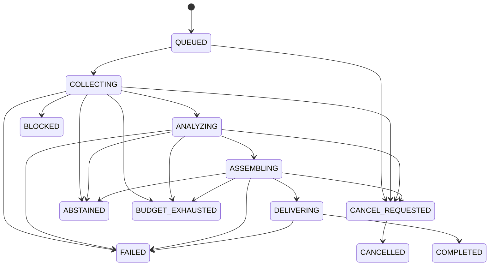

# 投研 Harness 设计

状态：当前实施规范（ADR-0003）。Harness 是 Vera 的研究执行引擎：接收已确认的研究计划，按技能定义取数、计算、写作、核验、组装，并交付标准格式研报。

## 1. 设计目标

| 目标 | 做法 |
| --- | --- |
| Flash 级模型可完成 | 模型只做窄任务：每次写一个章节、核验一组结论。输入是预计算好的结构化事实，输出受 JSON Schema 约束。数据集小、规则明确，不要求模型规划或计算 |
| 结论可信 | 事实与数字只能来自冻结数据集或确定性计算。模型写出的每个数字必须能匹配到引用的事实；不能匹配的句子删除，必需章节因此失效时任务弃权 |
| 性能 | 章节并行；取数和计算无模型参与；共享前缀利用服务端缓存；同一数据快照的公共事实跨用户复用 |
| 可维护 | 技能是声明式定义加 Go 实现的少量钩子。新增技能不改引擎；提示词、Schema、规则都有版本号并随报告冻结 |
| 可替换模型 | 网关只依赖 OpenAI-compatible Chat Completions 和 JSON 输出；每个 profile 单独配置模型 |

Harness 不是通用 Agent 框架。它不提供开放工具集，不允许模型决定访问哪些数据，也不运行模型生成的代码或 SQL。

## 2. 总体流程


1. 计划：把用户输入解析为技能、对象和参数（§3）。
2. 取数：按技能的数据需求调用数据服务，得到不可变的数据集快照 `dataset_snapshot`（见 [DATA_SERVICE](DATA_SERVICE.md)）。
3. 计算：执行技能声明的公式，生成事实表 `FactSheet`。每个事实有稳定的短 ID（如 `F12`），绑定证据版本或计算记录。
4. 写作：每个章节一次模型调用，输入是该章节需要的事实子集和写作要求。
5. 核验：先跑确定性检查，再对通过的结论做一次语义核验调用；结果只能删除或降级结论，不能新增内容。
6. 组装：从已核验的章节中由模型挑选并改写摘要要点（只能引用已存在的结论），模板渲染固定格式。
7. 交付：最终检查通过后，在一个事务里写报告版本和任务完成状态。

## 3. 入口与计划

### 3.1 解析顺序

1. 用户选择了技能卡片并通过实体搜索选定对象：直接生成计划，不调用模型。
2. 一句话输入：先用规则解析，依次匹配证券代码、实体名称与别名（来自实体目录）、技能关键词（“资金”“北向”“主力”→ capital_flow，“研究”“调研”“行业分析”→ deep_research，“看看”“分析”“财务”→ stock_analysis）和时间词（“近一个月”“今年以来”）。
3. 规则无法确定技能或对象时，调用一次 router profile。模型输出受 Schema 约束：`skill`（枚举）、`entity_mentions`（原文片段）、`params`。实体片段仍由实体目录解析，不接受模型给出的代码或 ID。
4. 仍有歧义：返回候选项让用户选择，不猜测。

### 3.2 计划内容

`ResearchPlan` 字段：`plan_id`、`skill_id`、`skill_version`、`subject`（entity_id 与类型）、`params`（技能参数，经 Schema 校验）、`as_of`（v1.0 为固定截止；ADR-0004 新版本中仅为计划预览时点）、`sections`（每章的可用性：available / limited / unavailable 及原因）、`estimated_budget`、`quota_cost`、`expires_at`、`plan_hash`。新版本计划还须绑定“采集后冻结最新可用数据”的策略；任务在数据和血缘持久化完成后原子记录 `snapshot_as_of` 与快照，恢复时不可重选。其 API、迁移及代码支持完成前不得宣称该行为已实现。

章节可用性由能力登记计算：某章节的必需数据集当前没有已启用、已授权的厂商时，标为 unavailable。技能的必需章节不可用时，计划直接返回不可执行和原因，不创建任务。

### 3.3 用户确认

计划展示给用户确认；用户可以调整参数（如资金动向的时间窗）或取消可选章节，但不能增加系统未列出的章节。确认请求携带 `plan_id` 与 `plan_hash`，服务端校验未过期、未被修改，然后原子地预留配额并创建任务。

## 4. 技能定义

技能由 Go 代码注册，结构如下（字段名即实现时的类型字段）：

```go
type Skill struct {
    ID          string            // "stock_analysis"
    Version     string            // "1.0.0"，任何章节、提示词、规则或公式变更都升级版本
    Subjects    []SubjectKind     // 允许的研究对象类型
    Params      ParamSchema       // 参数 JSON Schema 与默认值
    Data        []DataRequirement // 数据集需求，含 required/optional、时间窗、所属章节
    Formulas    []FormulaRef      // 公式 ID 与版本
    Sections    []SectionSpec     // 章节定义，顺序即报告顺序
    Summary     SummarySpec       // 摘要规则：条数、必须覆盖的章节
    Budget      BudgetSpec        // 时限、调用、token、费用上限
    Rules       RulePackRef       // 确定性检查规则集与禁用表达表
}

type SectionSpec struct {
    ID          string   // "S3"
    Title       string
    Required    bool     // 必需章节失效则任务弃权
    Facts       FactSelector // 从 FactSheet 选取本章节事实（按事实组、对象、时间窗）
    Writer      *WriterSpec  // nil 表示纯模板章节（表格、数据说明），不调用模型
    ClaimKinds  []ClaimKind  // 本章节允许的结论类型
    MaxClaims   int
    MaxChars    int
}
```

首版四个技能的章节、数据与公式见 [skills/](skills/)：

- [个股分析](skills/stock-analysis.md)
- [资金动向](skills/capital-flow.md)
- [深度研究](skills/deep-research.md)
- [自选股](skills/watchlist.md)

## 5. 事实表

`FactSheet` 是模型能看到的唯一信息来源。

| 字段 | 说明 |
| --- | --- |
| `fact_id` | 任务内短 ID，`F` + 序号，按事实组稳定排序生成 |
| `group` | 事实组，如 `fin.income`、`flow.margin`、`val.pe_ttm` |
| `subject` | 实体名称与代码 |
| `label` | 中文指标名，如“营业收入（合并）” |
| `value` | 十进制字符串或文本；数值同时给出 `display`（按显示规则舍入后的字符串）|
| `unit` | 元、亿元、%、个百分点、倍、股、手 |
| `period` | 报告期、交易日或时间窗 |
| `kind` | `reported`（披露值）、`market`（行情/交易所统计）、`vendor_derived`（厂商口径加工值）、`computed`（本系统公式）、`text`（原文片段）|
| `basis` | 口径说明，如“归属于母公司股东”“申万一级 2021 版”“厂商 X 大单定义：单笔成交额≥50 万元” |
| `refs` | 证据版本 ID 或计算记录 ID |
| `flags` | `small_base`、`sign_change`、`not_applicable`、`restated`、`stale` 等 |

规则：

- 时间序列不整段塞给模型。计算层先提取摘要事实：区间累计、区间涨跌幅、最大/最小值及日期、连续天数、历史分位、与对比对象的差值。原始序列只给前端画图。
- 文本类事实（年报经营讨论、公告、电话会议纪要）以段落为单位，每段一个 fact_id，截断长度在技能中配置；超长内容由选证规则挑选，不让模型通读全文。
- `vendor_derived` 事实必须带 `basis`，写作时必须说明口径（见 §7.3 规则 R-07）。

## 6. 章节写作

### 6.1 提示词结构

为了命中服务端前缀缓存，消息按“越稳定越靠前”排列：

1. system：通用写作规则（输出边界、禁用表达、引用格式、JSON 格式要求）。全技能共用，带版本号。
2. system：技能级规则与章节定义。同一技能的所有章节共用。
3. user：本任务的对象信息与全部事实表（同一任务内所有章节共用，命中缓存）。
4. user：本章节的写作要求、可用事实 ID 列表、字数和条数上限。

单章节调用的典型输入为 6k–15k token，输出 0.5k–2k token。

### 6.2 输出结构

模型输出必须是 JSON，用 JSON Output 模式请求；Harness 再用 Go 侧的 JSON Schema 严格校验，不依赖厂商的 strict 能力。Schema 见 [contracts/model/](../contracts/model/)：section-output、verify-output、summary-output、plan-parse-output。这些 Schema 限定在厂商 strict 模式支持的子集内（对象封闭、所有字段必填、不用长度和 null 类型，不需要的字段填空字符串或空数组），以便将来切换 strict 模式；长度、条数上限由 Harness 规则检查。结论编号 `S3.1` 由 Harness 按顺序分配，模型不输出编号。

```json
{
  "section_id": "S3",
  "claims": [
    {
      "kind": "computed",
      "text": "2025 年营业收入 120.00 亿元，同比增长 33.33%。",
      "refs": ["F12", "F15"],
      "numbers": [{"text": "120.00", "fact": "F12"}, {"text": "33.33", "fact": "F15"}],
      "scenario": {"trigger": "", "watch": [], "invalidation": ""}
    }
  ],
  "omitted": [{"reason": "insufficient_facts", "topic": "分产品毛利率"}]
}
```

`kind` 取值：`fact`、`computed`、`inference`、`attributed`、`scenario`。`scenario` 结论必须填写非空的 `trigger`、`watch`、`invalidation`，其他类型三者为空；不得给出概率或价格。

`numbers` 由模型声明，但校验器会独立从 `text` 中提取所有数字，两边不一致即判为失败（§7）。

### 6.3 修复与重试

- JSON 解析或 Schema 校验失败：带错误摘要重试一次，计入预算。仍失败则该章节失效。
- 返回空内容（DeepSeek 文档说明 JSON 模式下可能返回空 content）：视同格式失败。
- 输出被截断（`finish_reason=length`）：视同格式失败，不拼接续写。
- 网络错误、429、5xx：网关层按 §9 重试；模型返回 4xx 参数错误不重试。

## 7. 核验

### 7.1 确定性检查（逐条结论）

| 规则 | 内容 | 失败处理 |
| --- | --- | --- |
| R-01 引用存在 | `refs` 全部存在于事实表，且属于本章节可用事实 | 删除结论 |
| R-02 数字溯源 | 从 `text` 中提取的每个数字（含百分比、倍数、日期中的数值除外项按规则表）必须等于某个被引用事实的 `display` 值，或等于被引用事实之间的已登记派生关系（如单位换算）| 删除结论 |
| R-03 单位与口径 | 数字后的单位与事实单位一致；“百分点”与“%”不可混用；归母与合并不可混用 | 删除结论 |
| R-04 时间 | 文中出现的期间或日期必须属于被引用事实的期间；不得出现晚于 as_of 的日期 | 删除结论 |
| R-05 结论类型 | `kind` 在本章节允许的范围内；`fact`/`computed` 必须至少引用一个事实；`scenario` 结构完整 | 删除结论 |
| R-06 禁用表达 | 命中禁用表（评级、操作建议、目标价、概率、“低估/高估”、绝对化表述等，表随规则集版本化）| 删除结论；同一章节累计 3 条命中则章节失效 |
| R-07 厂商口径 | 引用 `vendor_derived` 事实的句子必须包含口径说明或厂商名称提示，如“按厂商大单口径” | 删除结论 |
| R-08 方向一致 | “增长/下降/流入/流出/上升/下滑”等方向词与被引用事实的符号一致 | 删除结论 |
| R-09 长度 | 章节字数与条数不超上限 | 截断多余结论，不截断句子 |

数字匹配规则写成独立的、带单元测试的 Go 包，规则表随规则集版本冻结。

### 7.2 语义核验（每章节一次调用）

通过确定性检查的结论，由 verifier profile 用独立提示词核验。输入是结论文本和其引用事实的原文，不包含写作提示词和其他章节。输出每条结论的判定：

- `supported`：引用事实足以支持该表述。
- `overstated`：方向正确但程度、因果或确定性超出事实，附建议的弱化改写。
- `unsupported`：事实不支持。
- `wrong_kind`：例如把归属陈述写成事实。

处理：`supported` 保留；`overstated` 采用改写后重新跑确定性检查，通过则保留，否则删除；`unsupported` 删除；`wrong_kind` 按建议类型重跑 R-05，不通过则删除。语义核验只能删除或弱化，不能增加新结论或新数字。

核验调用失败（格式错误两次或预算不足）时，该章节所有 `inference`、`scenario` 结论删除，`fact`/`computed` 结论保留（已通过确定性检查）。

### 7.3 章节与任务判定

- 章节在删除失败结论后，剩余结论数低于技能规定的最小值，章节失效。
- 必需章节失效 → 任务 ABSTAINED，原因 `REQUIRED_SECTION_UNSUPPORTED`，展示失效章节和原因。
- 可选章节失效 → 报告标为 limited，在“数据与限制”中说明。
- 所有被删除的结论及原因保存在运行记录中，用于评测，不展示给用户。

## 8. 组装与报告格式

摘要（S1）由一次模型调用生成：输入为全部已核验结论，输出为 3–5 条要点，每条必须引用一条或多条已核验结论的 ID，文本经过同样的确定性检查。摘要不得引入新事实。摘要调用失败时，按章节顺序取各必需章节的首条结论作为摘要。

报告格式统一为：

| 位置 | 内容 |
| --- | --- |
| 抬头 | 标题、研究对象、技能、数据截止时点、报告版本、full/limited、AI 生成标识 |
| S1 核心要点 | 摘要 |
| S2…Sn | 技能章节 |
| 数据与限制 | 数据来源列表（厂商与数据集、更新时间）、缺失的可选数据、被删除的章节、口径说明 |
| 证据附录 | 引用编号到证据版本与计算记录的对照 |
| 声明 | 固定文案：基于已接入数据的自动研究，不构成投资建议 |

前端用 `[n]` 显示引用，点开显示事实的值、口径、来源、时点和原文片段或计算过程。

## 9. 模型网关

```go
type ModelGateway interface {
    Complete(ctx context.Context, req CompletionRequest) (CompletionResult, error)
}

type CompletionRequest struct {
    Profile     string          // writer / verifier / router
    OperationID uuid.UUID       // 步骤台账 ID，用作幂等与费用归属
    Messages    []Message
    JSONSchema  *jsonschema.Schema // Go 侧校验用
    MaxOutput   int
    Thinking    ThinkingMode    // off / on，按 profile 配置
}
```

- Profile 配置：`base_url`、`model_id`、`api_key_ref`、`price_table_version`、`thinking`、`temperature`、`max_output`、`timeout`、`concurrency`。没有价格表的 profile 不允许真实调用。
- 记录：请求哈希、响应中的模型版本、`prompt_cache_hit_tokens`、`prompt_cache_miss_tokens`、输出与思考 token、时延、费用（按调用时刻所处的高峰或非高峰价）。
- 超时：单次 HTTP 90 秒；网络错误、429、5xx 最多重试 2 次，指数退避并遵守 Retry-After；4xx 不重试。
- 并发：平台级信号量（默认 32），按用户轮询分配，单任务最多同时 6 个调用。
- 预算：调用前按 `MaxOutput` 与输入 token 预留费用，返回后按实际 usage 核销。请求已发出但结果未知（超时、连接中断）时，按最大值计费，直到对账或 24 小时后释放。
- 录制回放：开发和 CI 可使用 `replay` 适配器，按请求哈希返回录制的响应；production 模式禁止启用。

## 10. 状态机

### 10.1 任务



| 状态 | 含义 | 退出条件 |
| --- | --- | --- |
| QUEUED | 已创建，等待调度 | Worker 领取 |
| COLLECTING | 取数、冻结快照、计算事实表 | 必需数据齐全 → ANALYZING；必需数据缺失或冲突 → ABSTAINED；授权拒绝 → BLOCKED |
| ANALYZING | 章节写作与核验，章节并行 | 必需章节全部有效 → ASSEMBLING；任一必需章节失效 → ABSTAINED |
| ASSEMBLING | 摘要、渲染、最终检查 | 通过 → DELIVERING |
| DELIVERING | 事务内写报告版本与任务完成 | 成功 → COMPLETED |
| CANCEL_REQUESTED | 用户取消已持久化；epoch 已递增，旧执行的结果不可交付 | 正在执行的步骤停止后 → CANCELLED |

所有非终态都受截止时限约束：超时后，如果必需章节已全部有效，进入 ASSEMBLING 并以 limited 交付（未完成的可选章节标注）；否则 ABSTAINED，原因 `DEADLINE_EXCEEDED`。预算耗尽的处理相同，原因为 `BUDGET_EXHAUSTED`，状态 BUDGET_EXHAUSTED 仅用于必需章节未完成的情况。

DELIVERING 只能由交付步骤在一个事务中完成：锁任务行，校验 epoch、计划哈希、快照哈希、全部必需检查结果和当前用户权限，写 `report_versions`、`publications`，把任务置为 COMPLETED。先完成交付的任务，取消请求返回 409 `ALREADY_COMPLETED`。

### 10.2 步骤

任务内每个可重试单元是一个步骤（`task_steps`）：`collect`、`compute`、`write:<section>`、`verify:<section>`、`summary`、`render`、`deliver`。

步骤状态：PENDING → RUNNING → SUCCEEDED | FAILED | SKIPPED。唯一键 `(task_id, epoch, step_key, input_hash)`。

- 步骤开始时以条件更新领取（`status=PENDING` 或租约过期），写入租约到期时间。
- 步骤成功时保存输出引用与哈希；重复执行同一步骤（Worker 重启、River 重投）先读已有结果，不再调用模型。
- 模型调用在步骤内部，通过 `model_calls` 表记录每次尝试；已有成功的调用记录时直接复用。
- 前端进度来自步骤列表：显示章节名称和状态，不显示百分比，不显示模型思维内容。

### 10.3 River 作业

| 作业 | 作用 | 唯一性 |
| --- | --- | --- |
| `research.run` | 推进任务：按状态执行下一批步骤，可并行章节；每批结束后重新入队自身 | 按 task_id + epoch |
| `research.cancel` | 处理取消：停止调度、等待在途步骤结束或超时、置 CANCELLED | 按 task_id |
| `research.deadline` | 截止时刻触发，执行超时规则 | 按 task_id |
| `data.refresh` | 定时刷新公共数据（行情日线、资金统计）| 按数据集 + 交易日 |
| `watchlist.snapshot` | 收盘后计算自选股快照与提醒 | 按交易日 |
| `usage.reconcile` | 对账结果未知的模型调用 | 按调用 ID |

任务创建在同一事务中写任务行和 `research.run` 作业。River 的 at-least-once 投递由步骤台账保证幂等。

## 11. 观测与回放

- 每个任务有运行追踪：步骤时间线、每次模型调用的输入哈希、输出、usage、费用、被删除结论及原因。追踪对用户不可见，开发者通过内部页面或 CLI 查看。
- `vera-harness replay --task <id>`：用冻结的快照、事实表和录制的模型响应重放任务，用于回归测试和定位问题。
- `vera-harness eval --suite <name>`：在评测集上运行技能（真实模型或录制），输出结论存活率、数字溯源失败率、章节失效率、成本和时延，见 [TESTING](../TESTING.md)。

## 12. 多 Agent 研讨的预留

P1 研讨实验以“额外的核验步骤”接入：对 `inference` 结论增加反方审查调用（只看反面事实），输出仍只能删除或弱化。不改变任务状态机，不引入投票。是否启用取决于 T020 的对比评测：与单核验基线比较结论存活率、错误放行、成本和时延。
