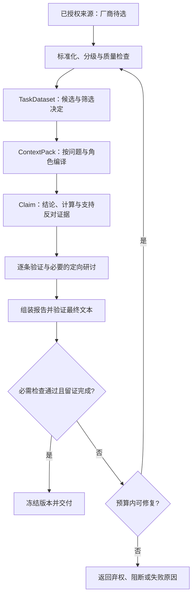

# 金融投研平台设计文档

> 范围更新（ADR-0003，2026-11-06）：首版为研报生成、个股分析、资金动向与自选股，由自建 Harness 在已接入数据上执行，调度使用 River。本文中的 Temporal、多角色研讨/投票、T2 路由、gRPC、Redis、向量检索、K8s 等设计均不是首版任务。当前规则见 [SPEC](../../SPEC.md)、[HARNESS](../HARNESS.md)、[DATA_SERVICE](../DATA_SERVICE.md) 与 [ADR-0003](../decisions/0003-product-harness-runtime.md)。

> **历史研究档案**：完整保留原文供溯源。当前首版以 [SPEC](../../SPEC.md) 和 [已冻结决定](../decisions/0001-p0-baseline.md) 为准；旧待确认表、机构内部定位、模型价格及后续阶段不直接作为上线配置。

> 修订：2026-11-05 · 文档整理版 1.3 · 用途：方案研究、需求确认与开发任务输入

平台按“治理数据 → 形成结论 → 验证证据 → 交付报告”的顺序工作。本目录规定目标行为和实现方案，尚未证明代码已实现、模型效果达标或生产容量满足要求。

## 1. 文档导读与阅读顺序

### 1.1 文档总览

本目录包含产品要求、首版范围、工程实现和研究评测四类内容。下面的摘要帮助确定阅读范围；字段、状态和算法的完整定义仍由对应专项维护。

| 文档 | 主要用途 | 在开发中的作用 |
| --- | --- | --- |
| [产品与开发规格](financial-research-agent-development-spec.md) | 定义平台目标、可信性要求、用户功能与自动交付行为 | 确定开发范围、产品验收与开发 Agent 输入 |
| [首版业务范围与报告模板](financial-research-mvp-report-spec.md) | 把通用平台收敛为单公司年度财报点评 | 确定首版支持什么、需要哪些证据、何时允许交付 |
| [模拟报告与证据样例](financial-research-mvp-report-example.md) | 展示报告正文、原文引用、公式及失败变体 | 供界面设计、模板实现与测试预期参考 |
| [后端业务模块与技术栈](financial-research-backend-design.md) | 定义模块、语言分工、存储、事务、资源与部署 | 指导后端代码组织、基础设施和 CI/CD 实现 |
| [多厂商数据治理](financial-research-data-governance-design.md) | 定义来源接入、规范化、清洗、分级与任务数据集 | 规定数据如何变为 Agent 可使用且可追溯的证据 |
| [Agent 研讨与模型研究](financial-research-multi-agent-design.md) | 定义角色、状态机、异步执行和质量/成本实验 | 指导研究执行、并发恢复、多角色协作和模型评测 |
| [服务间通信与 RPC 契约](financial-research-rpc-contract.md) | 定义进程内、短 RPC 与长任务通信边界 | 指导服务拆分后的协议、鉴权、超时和兼容实现 |
| [决策登记与实施计划](financial-research-decisions.md) | 集中管理未决参数、规则归属和阶段映射 | 在开发前确定假设、工作包与上线前置条件 |
| [变更记录](CHANGELOG.md) | 记录设计变化与文档校验 | 核对本轮修改、历史决定和验证范围 |

### 1.2 各文档的内容与使用方式

**[产品与开发规格](financial-research-agent-development-spec.md)** 是产品要求的入口。它区分历史事实、计算结果、分析推断和未来预测各自需要的证据，规定数据治理、研究、验证和交付必须遵守的约束。还包含前端功能、HTTP 接口能力、安全要求、报告生命周期、AC 验收清单及可复制的开发任务提示词。

重点读 §2–8 理解产品行为，§9–12 查看界面、接口和验收，§13–15 确定阶段和开发输入。本文不再维护完整数据字段或 Agent 调度细节；开发时需要继续阅读对应专项。

**[首版业务范围与报告模板](financial-research-mvp-report-spec.md)** 将平台能力收敛为可交付的年度财报点评。建议基线是单家公司、指定年度、固定截止时点，以可比两期财务数据解释收入利润、毛利率、现金流和财务结构变化。文档明确首版非目标、请求校验、S0–S6 章节、R01–R08 必需证据、O01–O02 可选证据、F01–F08 公式与 MVP 验收项。

重点读 §1–3 确定范围和报告结构，§4–6 实现证据覆盖与完整/受限/弃权判定，§7–8 拆分页面与开发任务。市场和用户适用范围仍是待确认建议，不能把模板形成等同于业务决定已批准。

**[模拟报告与证据样例](financial-research-mvp-report-example.md)** 展示用户最终看到的报告，而不只是描述字段。正文覆盖摘要、核心指标、现金流、财务结构和研究限制；附录提供虚构原文片段、引用定位、计算记录，以及完整、可选项缺失、必需项缺失三类测试预期。

先读 §1 检查报告是否易读，再用 §2–4 核对引用、算术与失败行为。所有材料均为模拟，适合模板和界面测试，不能代替真实年报解析、供应商接入或模型质量验收；具体规则以首版模板为准。

**[后端业务模块与技术栈](financial-research-backend-design.md)** 描述 M01–M13 的职责和数据边界，覆盖身份、来源、治理、证据、研究任务、模型网关、计算、结论验证、报告和交付。实现方向是 Go 主导的模块化后端与独立 Worker，Python 用于约定的专用能力；文档同时规定跨语言 Activity 契约、核心表约束、授权检索、代码目录和资源上限。

重点读 §3–7 进行模块与数据设计，§10–13 组织代码和性能验证，§14–15 实现 CI/CD、兼容迁移、Worker 版本管理及 D0–D3 部署演进。这里列出平台完整能力，首版按报告模板裁剪；无需先将所有模块拆为微服务。

**[多厂商数据治理](financial-research-data-governance-design.md)** 说明如何将不同厂商的字段和语义统一为内部记录，并保留原始响应、变换及修订关系。它分别定义 L1–L5 来源资格、事实/观点/预测类型、质量状态和任务用途，避免用一个总分代替所有判断。清洗方案涵盖单位与期间检查、同源去重、多源冲突、异常检测、相关性筛选与反证保留，并说明哪些步骤适合规则、统计或可选 AI 判断。

重点读 §3–7 实现接入与标准化，§8–10 选择治理算法，§11–13 实现持久化、Redis 回源、数据集冻结和撤权影响。ContextPack 的字段与编译规则只在 §12.5–12.6 完整定义；Agent 文档负责如何使用它。厂商槽位仍留空，真实接入验收见 §15–16。

**[Agent 研讨与模型研究](financial-research-multi-agent-design.md)** 同时承担执行设计和模型可行性研究。工程部分定义 Go RoleRunner、ModelGateway、ToolRegistry、Claim 契约，区分研究任务、结论和 Operation 状态，说明独立提交、定向质询、裁决、补证与弃权。异步部分覆盖 Temporal 队列、并行依赖、幂等、取消、外部调用结果未知、多租户公平调度和费用核销。

重点读 §4–8 实现角色与研讨，§9–12 实现 Worker 和并发恢复，§13–16 设计成本与质量实验，§17–18 查阅论文和工程参考。目前方案自行实现投研业务逻辑、复用 Temporal 等基础组件，没有选定通用开源 Agent 框架作为核心依赖。Flash 级模型承担多数任务是待验证假设，文中的价格与容量算例不能当作效果承诺。

**[服务间通信与 RPC 契约](financial-research-rpc-contract.md)** 规定同进程使用 Go 接口、拆分服务的短请求使用 gRPC/Protobuf、长任务使用 Temporal。它列出服务接口能力和 Protobuf 示例，并明确身份委托、租户校验、deadline 传播、重试责任、错误码、写幂等、连接复用、服务发现和兼容发布要求。

重点读 §1–3 确定通信方式与接口，§4–7 实现调用行为，§8 制定契约与故障测试。RPC 规则不能替代 Agent 的业务操作恢复规则；涉及 Activity 包装的 RPC 时必须结合阅读，避免重复重试或误判超时结果。首版共进程模块无需为了符合文档而新增网络层。

**[决策登记与实施计划](financial-research-decisions.md)** 是唯一的待定参数填写位置，集中记录 Q-01–Q-24，包括市场、用户、来源许可、模型、预算、质量阈值、身份、部署、恢复及缓存策略。文档还列明每类规则由哪份专项维护，并将后端、Agent、数据治理步骤映射到 P0–P2。

开始某个开发任务前先看 §1 找出依赖的未决项，再按 §2 找到完整规则，最后用 §3 确认交付阶段。真实来源接入和上线容量验证属于首版上线条件；专项编号靠后不代表可以推迟到首版上线之后。

**[变更记录](CHANGELOG.md)** 记录每轮新增、迁移和调整的内容，以及 Markdown、链接、JSON、图表和样例算术的检查结果。它保留历史版本的背景，方便判断本轮修改影响了哪些文件。

恢复开发或升级设计输入时先查看最新记录，再读取当前专项定义。历史描述不覆盖现行规则，文档静态检查通过也不代表服务、模型或生产部署已经验收。

### 1.3 按任务选择阅读路径

| 当前任务 | 建议阅读顺序 | 阅读后应能确定 |
| --- | --- | --- |
| 快速了解项目 | 本页 → 产品规格 → 首版模板 → 模拟样例 | 平台目标、首版范围、用户最终得到的内容 |
| 开始首版开发 | 决策登记 → 产品规格 → 首版模板/样例 → 后端设计 → 对应专项 | 本次范围、未决依赖、模块责任和验收编号 |
| 实现数据治理 | 首版证据矩阵 → 数据治理 → 后端存储与权限 | 必需数据、统一口径、筛选、留证和读取契约 |
| 实现 Agent/Worker | 首版模板 → 数据治理 ContextPack → Agent §4–12 → 后端资源与部署 | 上下文来源、角色步骤、状态、重试和资源边界 |
| 拆分服务或实现 RPC | 后端模块边界 → RPC → Agent 异步与 Operation 规则 | 服务所有权、身份、时限、幂等和恢复方式 |
| 实现前端与报告 | 首版模板/样例 → 产品 §8–10 → 对应 API 契约 | 输入、任务阶段、报告结构、引用及失败展示 |
| 评估模型与研究论文 | Agent §1–3、§13–18 → 数据治理 §15、§18 | 对照组、质量/成本指标、适用任务和研究局限 |
| 准备上线 | 决策与阶段映射 → 后端 §12–15 → 各专项验收 | 真实来源、容量、恢复、版本与权限是否满足条件 |

阅读路径只用于导航。发现冲突时应修正规则维护位置及其引用方，不根据文件顺序或版本号自行选择一套实现。

## 2. 已确认的设计约束

| 主题 | 约定 |
| --- | --- |
| 实现语言 | Go 实现核心业务和工作流；Python 负责约定的解析、专用 SDK、科学计算和离线评测 |
| 初始部署 | 模块化后端与独立 Worker；领域服务按隔离和扩容需求逐步拆分 |
| 通信 | 同进程 Go 接口；跨服务短请求 gRPC + Protobuf；持久化长任务 Temporal；前端 HTTP/JSON 与轮询或 SSE |
| 在线处理 | 数据治理、研究、检查、留证和交付全自动执行，不设置后台人员审核、签署或等待批准的状态 |
| 失败处理 | 补证、修订、重试与模型升级均有预算和时限；耗尽后返回受限报告、弃权、阻断或失败原因。受限报告仅允许缺少模板声明的可选项 |
| 数据厂商 | 留空待选，连接器默认禁用；文献中的厂商例子不构成采购或接入决定 |
| 持久化 | PostgreSQL 保存业务记录与版本关系，对象存储保存原文和大产物；Redis 仅缓存可重建数据，不作为证据唯一存储 |
| 结论验证 | 事实、数值和权限由证据与规则检查，不能通过多数投票或模型综合分数放行 |
| 低成本模型 | Flash 级为主是待验证方案；以本地质量、覆盖率、延迟和合格报告成本决定适用范围 |

离线数据标注、开发配置评审和基础设施故障恢复属于研发与运维，不是单次用户研究的前置审核步骤。所有在线等待状态必须有明确的自动恢复条件、截止时间和终止出口。

## 3. 数据与结果如何衔接

这是依赖关系概览。补证与修订只重做受影响的数据或结论，最后仍检查整份报告的一致性；不要求每次失败从头执行。完整与受限报告共用最终检查，通知送达另行记录。

## 4. 术语和状态由谁定义

### 4.1 主要实体

| 名称 | 含义 | 定义位置 |
| --- | --- | --- |
| CanonicalRecord | 统一主体、指标、单位和时点语义后的记录 | 数据治理 §4 |
| EvidenceVersion | 带来源、版本和原文定位的证据 | 数据治理 §11–12 |
| TaskDataset | 某次任务的候选版本及纳入、排除、隔离决定清单 | 数据治理 §12 |
| ContextPack / EvidencePack | 从任务数据集中为特定问题与角色编译的上下文包；本文档组两者指同一类产物 | 数据治理 §12.5–12.6；角色使用见 Agent §4 |
| Claim | 可单独验证的事实、计算、推断或预测结论 | Agent §7；产品 §6 规定行为 |
| Operation | 可恢复、可重试的业务操作，关联一个或多个执行尝试 | Agent §9–10 |
| DeliveryGateDecision | 绑定报告、证据和规则版本的自动检查决定；保留代码实体名 | 产品 §8、后端 §7 |
| Publication | 报告交付记录；表示授权用户可读，不表示软件部署或通知已送达 | 产品 §10、后端 §6–7 |

正文使用“交付”描述用户获得报告，“发布”按上下文指软件、配置或数据版本生效。代码实体和状态枚举保留原名，避免仅为文字润色引入协议变更。

### 4.2 状态边界

| 对象 | 典型路径 | 成功意味着什么 | 状态定义 |
| --- | --- | --- | --- |
| 研究任务 | QUEUED → PREPARING → … → DELIVERING → COMPLETED | 报告已对授权用户可读 | Agent §6 |
| 任务数据集构建 | PLANNED → … → COMPILING → READY / PARTIAL | 必需数据就绪；PARTIAL 仅缺允许的可选项 | 数据治理 §12 |
| Claim | PROPOSED → CHECKING → SUPPORTED / QUALIFIED | 当前证据支持，或仅在限定条件下成立 | Agent §7 |
| Operation | SCHEDULED → RUNNING → COMPLETED | 该操作结果已持久化 | Agent §9.4–10 |
| 报告版本 | draft → automated_validation → delivery_ready → delivering → delivered | 冻结结果已交付 | 产品 §8 |

这些状态属于不同对象，不能直接映射为一个通用 `status`。例如 Operation 完成不会自动完成研究任务，READY 数据集也不意味着报告可交付。报告交付成功后，工作流记录研究完成；进程在两步之间故障时，通过幂等交付结果恢复。通知失败不回退已完成的交付。

`L1–L5` 是来源等级，`T0–T2` 是模型/工具层级；两者均不是正确概率。`P0–P2` 表示产品阶段，`D0–D3` 表示部署阶段，`A1–A5` 和 `DQ0–DQ4` 是专项实施步骤，不按数字互相对应。

## 5. 如何用于开发

1. 在 [统一决策表](financial-research-decisions.md#decisions) 填写本次范围依赖的 Q 编号；专项不再维护重复参数。
2. 根据 [阶段映射](financial-research-decisions.md#phases) 确定工作包。真实来源接入与上线容量验证不能因专项编号靠后而延后。
3. 使用产品规格 §15 的提示词，明确 AC、AG、DG、DIST、MVP 编号和 RPC 验收项；按决策文件的规则归属表阅读完整定义，不能只读取产品概要。
4. 实施时锁定 schema、规则、提示、模型策略、依赖和构建版本；示例值不能直接当作生产阈值。
5. 按范围提交实现与验证结果。文档中未勾选的验收项始终表示待验证目标。

## 6. 变更与验证记录

本轮及历史变更、文档检查结果统一见 [CHANGELOG](CHANGELOG.md)。模型与价格信息仍是 2026-11-03 的研究快照；实施前复核相关依赖和采购信息。论文用途、局限与撤稿排除记录保留在各专项参考章节。
