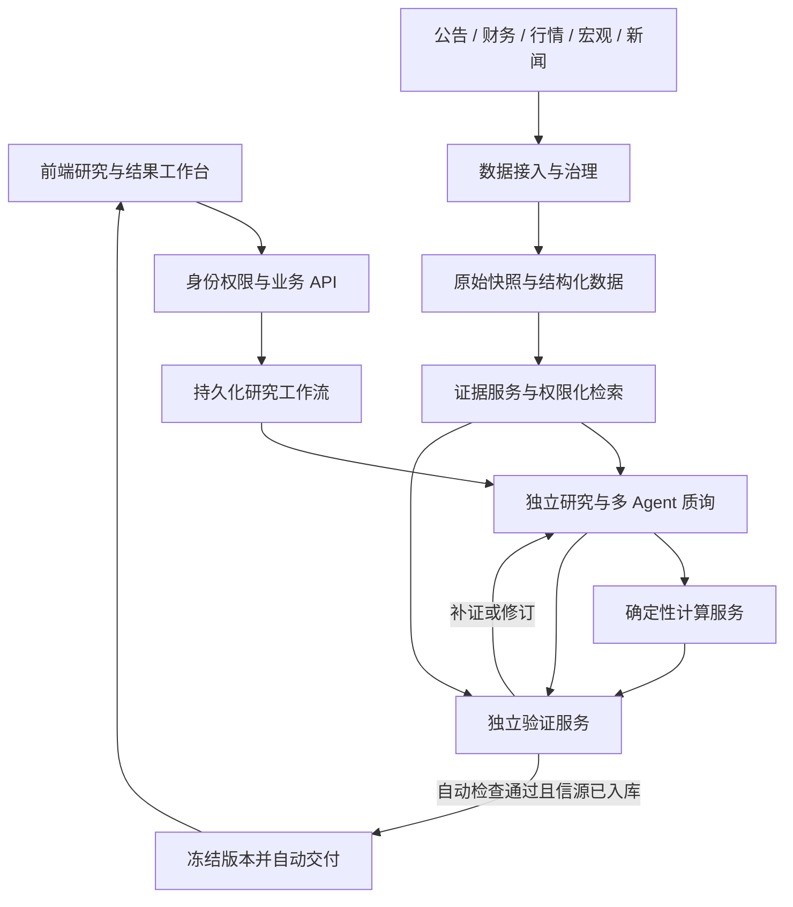

# 可信金融投研平台：研究整理与 Agent 开发规格

> 范围更新（ADR-0003，2026-11-06）：首版为研报生成、个股分析、资金动向与自选股，由自建 Harness 在已接入数据上执行，调度使用 River。本文中的 Temporal、多角色研讨/投票、T2 路由、gRPC、Redis、向量检索、K8s 等设计均不是首版任务。当前规则见 [SPEC](../../SPEC.md)、[HARNESS](../HARNESS.md)、[DATA_SERVICE](../DATA_SERVICE.md) 与 [ADR-0003](../decisions/0003-product-harness-runtime.md)。

> **历史研究档案**：完整保留原文供溯源。当前首版以 [SPEC](../../SPEC.md) 和 [已冻结决定](../decisions/0001-p0-baseline.md) 为准；旧待确认表、机构内部定位、模型价格及后续阶段不直接作为上线配置。

> 版本：0.7.0 · 修订：2026-11-05 · 状态：设计草案，待实现与验证\
> 范围：产品需求、架构约束、前端功能与验收；开发任务从本文确定范围。\
> [文档索引与统一约定](README.md)

本文规定产品必须具备的行为。实现细节分别由后端、数据治理、Agent 和 RPC 专项维护；阅读顺序与术语见文档索引。

| 阅读目的 | 章节 |
| --- | --- |
| 确定产品范围与架构约束 | 2–4 |
| 理解证据、结论与交付条件 | 5–8 |
| 设计用户界面与接口 | 9–11 |
| 拆分开发任务与验收 | 12–15 |
| 核查研究依据 | 16 |

## 1. 文档使用约定

### 1.1 给开发 Agent 的执行说明

1. 开始开发前，阅读本文件及目标仓库适用的 `AGENTS.md`，检查现有实现、接口和测试；优先复用已有能力。
2. 本文件的存在不构成启动开发、对外发布或部署的指令；只有收到开发任务后才进入实现。
3. 开发时先列出需求与现有实现的差异、拟修改范围和验收方式，再按阶段交付。
4. 不把研究建议、待确认事项或示例参数当作已经验证的事实。
5. 不通过模拟数据、硬编码通过结果或伪造引用满足验收。演示数据必须明确标记，并与正式数据隔离。
6. 如业务范围未确认，优先实现不依赖该决定的通用组件；涉及监管适用性、数据授权或发布权限的功能不得假定已获批准。
7. 交付时报告实现范围、测试证据、未完成项和已知限制；不要声称已证明预测正确或已获得全面合规认证。

### 1.2 规范词与标记

| 标记 | 含义 |
| --- | --- |
| MUST / 必须 | 本方案要求的实现约束；用户修订后可调整 |
| SHOULD / 建议 | 默认设计方向，可在记录依据后采用替代方案 |
| TBD / 待确认 | 不能视为已确定的产品或技术决策 |
| 示例 | 仅说明结构，不是上线阈值或实际业务数据 |

本文描述的是目标设计。所有实现状态均为未核验；不能据此推断仓库已具备相关能力。

## 2. 产品目标与边界

### 2.1 核心目标

构建包含前端、后端和 Agent 组件的金融投研服务，使研报的重要结论具备可核查的证据、可复现的计算、明确的假设及可追溯的自动校验与信源记录。

可信性必须拆分为四类目标：

| 结论类型 | 系统应证明的内容 | 不应承诺的内容 |
| --- | --- | --- |
| 历史事实 | 来源可追溯、引用准确、口径与时间一致 | 来源本身绝对无误 |
| 计算结果 | 输入、公式、代码版本固定且可复算 | 使用错误输入仍能得到真实结论 |
| 分析推断 | 证据支持、替代解释与反证得到处理 | 推断必然成立 |
| 未来预测 | 假设、情景、区间和失效条件明确 | 未来结果必然实现 |

### 2.2 范围决定

市场、用户、首个报告模板与 JEV 指代见 [决策表 Q-01–Q-06](financial-research-decisions.md#decisions)。未确认项保持假设状态；全自动交付按文档索引的已确认约束执行。

首版的建议执行范围、年度点评章节和缺证策略见 [首版模板](financial-research-mvp-report-spec.md)；该专项补充本文通用要求，具体确认状态仍由决策表维护。

### 2.3 首版非目标

- 自动交易或自动执行投资指令。
- 面向个人投资者的个性化投资建议。
- 不受约束的开放式 Agent 自主浏览和无限轮次讨论。
- 以单个模型分数宣称研报真实、合规或预测准确。
- 首期覆盖所有市场、资产类别与高频回测场景。

## 3. 核心架构决策

| 编号 | 决策 | 原因 |
| --- | --- | --- |
| ADR-01 | 以证据和原子结论 Claim 为核心实体 | 支持逐条验证、修改与审计 |
| ADR-02 | 先形成可核验的结论，再组织报告文本 | 降低写作阶段补造依据的风险 |
| ADR-03 | 数值计算由确定性服务执行 | 支持复现并减少模型算术错误 |
| ADR-04 | Agent 独立提交后再研讨 | 降低跟随和过早共识 |
| ADR-05 | 事实与硬性约束不通过多数投票决定 | 一致性不能替代证据 |
| ADR-06 | 研究、自动校验和交付服务分权 | 防止生成模型绕过后端确定性门禁 |
| ADR-07 | 数据、证据、计算和报告均版本化 | 支持追溯、更正和历史时点研究 |
| ADR-08 | 首版采用模块化后端与独立异步 Worker | 控制复杂度，后续按负载拆分 |

## 4. 总体架构



### 4.1 实现边界

模块职责、存储与语言分工由 [后端设计 §3–4](financial-research-backend-design.md) 维护。产品要求证据、研究、验证和交付可分别授权，模型无法自行改变交付状态；所有报告都能追溯至数据、计算与检查记录。

## 5. 数据治理与证据要求

1. 来源等级、内容类型、质量状态和用途分别记录。正式来源中的预测仍是预测；转载不增加独立信源数量。
2. 数据标准化必须处理主体、单位、期间、币种、报表范围和复权口径；缺失不能变成零，冲突与异常不能静默覆盖。
3. 任务固定“当时公开可知”或“本系统当时已获取”的时点语义；时间未知不能默认合格，修订保留旧版本。
4. 原始响应、治理记录、候选筛选决定与报告引用均可定位；任务冻结数据版本后再供角色读取。

具体规则见 [数据治理 §3–12](financial-research-data-governance-design.md)，字段见 [证据契约](financial-research-data-governance-design.md#evidence-contract) 和 [ContextPack 契约](financial-research-data-governance-design.md#context-pack-contract)。厂商保持留空；S4/S5 仅为早期研究资料。

血缘必须贯通“原始快照 → 规范化数据 → 计算 → Claim → 报告 → 自动检查 → 交付”，建模参考 W3C PROV。[S6]

## 6. 研究行为与结论要求

结论至少区分事实、计算、推断与预测。每条 Claim 关联支持与反对证据、假设、失效条件和版本；[Claim 契约与状态机](financial-research-multi-agent-design.md#claim-contract) 由 Agent 专项维护。

多角色启用时先独立提交，再针对实质分歧质询，保留初稿、判断依据、工具调用和修订记录。角色配置、消息和轮次协议见 Agent §5–7。

事实与计算依靠证据核验；推断可使用经离线校准且考虑相关性的权重；预测必须保留情景与限制，票数不代表发生概率。关键缺证、重大反证未处理或预算耗尽时允许弃权。写作新增断言必须重新验证。

权重、角色数和研讨轮次由实验决定。多 Agent 的收益必须与单 Agent 基线比较，不能由一致率推断可靠性。[S1]

## 7. 结论验证与自动策略检查

### 7.1 确定性验证

- 引用存在、原文位置可访问、哈希与版本匹配。
- 主体、单位、时间、期间和口径一致。
- 计算输入、代码及依赖可追溯，结果在定义的数值容差内可复现。
- 不包含截止时间之后的信息。
- 当前用途符合数据授权与访问权限。

### 7.2 语义与研究质量验证

- 引用是否支持具体结论，而非仅主题相关。
- 是否遗漏关键限定条件和重要反证。
- 是否混淆相关性与因果关系。
- 是否将预测或假设写成事实。
- 文本表达是否比证据更确定。

### 7.3 Jev 的使用边界

Jev 官方文档描述其接收状态和类型化问题，并建议把复杂判断分解成原子问题。[S2]

建议输入：单条 Claim、必要证据片段、上下文及明确问题。

示例问题：

- 证据对结论是支持、反驳还是不足？
- 结论是否省略关键限定条件？
- 预测是否被写成确定事实？

必须满足：

- 通过适配层调用，不把供应商协议散布到业务模块。
- 记录模型版本、输入摘要或受控快照、题目版本和结果。
- 独立保存证据定位及自动校验说明；分数本身不是解释。
- 在中文金融数据上评估准确率、校准性和抗注入能力。
- 超时、异常、低置信或版本变化触发备用验证、有限补证或自动弃权。
- 不将多个相关问题的概率直接相乘为“报告可信概率”。
- 模型评分不能单独放行；后端自动检查证据、权限、版本和落库状态后交付。

### 7.4 自动策略校验与留痕

根据已配置的业务范围、地区、报告用途和接收对象，后端自动检查来源使用权限、敏感数据限制、必要风险提示、利益冲突披露字段和分发权限。结果为通过、自动修订、受限输出或阻断，不转交后台审核人员。

所有使用的原始来源、数据版本、Claim 引用、计算产物、规则版本和检查结果必须持久化。仅保存来源链接而不保存其版本、定位和使用关系，不足以满足本方案的可追溯要求；也不能将留证本身当作结论正确的证明。

S3/S7 保留为早期法规研究资料，不作为本产品中设置人工节点的依据；本设计也不把自动策略检查称为全面合规认证。实际支持场景由部署前的业务策略配置确定，单次用户请求不等待人工确认。

## 8. 状态机与自动交付

本节描述报告版本的生命周期。研究任务、Claim、数据集与操作的状态分别由专项文档定义，不能共用一个 status 字段。对应关系见 [文档索引](README.md)。

```text
draft → automated_validation → delivery_ready → delivering → delivered

校验失败 → needs_evidence / needs_revision → 有界自动补证/修订 → automated_validation
仅可选项缺失且模板允许 → 自动校验 → delivering → delivered（result_kind=limited）
关键缺证或无法解决 → abstained / budget_exhausted / blocked / failed（自动返回原因）
已交付且依赖变化 → 新版本自动重验 → corrected / withdrawn
```

- `delivery_ready` 是短暂机器状态，信源和自动检查结果入库后自动触发交付，不等待人。
- 自动检查绑定报告哈希、Claim 版本、证据清单和规则版本；任一内容变化需重新校验。
- 必需证据不足时不伪装成完整研报；模板允许时只返回已验证的受限结果，否则返回证据不足说明。
- 交付事务检查当前权限、任务 epoch 与目标哈希，原子写交付记录及 Outbox；失败按有界策略重试，耗尽后返回明确状态。
- `delivered` 表示授权用户可以读取冻结结果；通知送达是独立状态，不因消息渠道重试重复创建报告。
- 研究 Agent 无直接交付权限，后端交付服务在检查通过后执行。
- 关键来源修订触发依赖分析和自动更正/撤回；保留旧版本及原因，无法保证收回已下载文件。

## 9. 前端功能规格

| 页面 | 必备功能 |
| --- | --- |
| 研究工作台 | 输入问题、标的、截止时间、用途；查看阶段、取消与失败原因 |
| 报告阅读页 | 区分事实、推断与预测；逐条展示引用、状态、限制与数据时点 |
| 证据浏览页 | 原文定位、版本、指标口径、计算公式、来源冲突和授权展示 |
| 争议面板 | 初始观点、支持与反对材料、修订记录和未解决问题 |
| 结果与溯源页 | 查看自动检查结果、版本差异、数据来源、限制、更正和撤回状态 |

不要只显示含义模糊的综合可信度分数。应分别展示关键事实覆盖、引用支持结果、计算复现状态、重大争议和自动检查与交付状态。

交互验收示例：点击“毛利率同比提高 2 个百分点”，可以查看两期数据、原文位置、单位、公式、计算运行和口径说明。

## 10. 接口与持久化契约

以下为接口能力草案，路径可按现有仓库约定调整：

| 方法与路径 | 目的 |
| --- | --- |
| `POST /research-tasks` | 创建任务，包含范围、用途、时点和预算 |
| `GET /research-tasks/{id}` | 查询阶段、失败原因与产物 |
| `POST /research-tasks/{id}/cancel` | 取消任务 |
| `GET /reports/{id}/versions/{version}` | 读取特定报告版本 |
| `GET /claims/{id}` | 读取结论及其证据与验证结果 |
| `GET /evidence/{id}` | 读取授权范围内的证据 |
| `GET /calculations/{id}` | 读取输入、公式、产物和复算状态 |
| `GET /reports/{id}/validation` | 查看自动校验结果与来源清单 |
| `POST /internal/reports/{id}/deliver` | 工作流服务自动调用，校验门禁、信源入库、权限与幂等键；无用户批准步骤 |
| `POST /reports/{id}/withdraw` | 撤回并记录原因 |

所有写操作应支持幂等或并发版本检查。接口必须返回可区分的权限不足、证据不足、版本冲突、供应商失败和验证失败信息。

除 Evidence 和 Claim 外，应明确以下实体：

- `ResearchTask`：范围、截止时间、权限快照、预算、状态。
- `CalculationRun`：输入版本、公式或代码哈希、依赖、输出和容差。
- `AgentRun`：角色、模型与提示版本、工具调用、成本和产物。
- `ValidationResult`：检查项、目标版本、结果、依据、验证器版本。
- `ReportVersion`：文本、Claim 清单、证据清单、哈希。
- `DeliveryGateDecision`：自动检查结果、规则版本、报告/证据哈希、输出类型与原因，无审核人字段。
- `Publication`：报告交付记录，包含版本、渠道、对象、可读时间、更正或撤回关系；沿用实体名，不表示软件发布。

## 11. 安全、可观测性与故障处理

- MUST：检索前执行租户、授权、用途和时间过滤，不能仅在返回结果后过滤。
- MUST：将外部文档视为不可信数据，其内容不能覆盖系统指令或授予工具权限。
- MUST：供应商凭证由后端管理，不写入模型上下文、前端或普通日志。
- MUST：计算环境隔离，限制网络、文件、执行时长和资源。
- MUST：供应商不可用、验证器异常和来源缺失不能自动视为通过。
- MUST：保留任务状态和已完成产物，支持恢复而非重复发布。
- SHOULD：按任务、模型、数据源和验证阶段统计错误率、耗时及成本。
- TBD：数据保留、删除、脱敏、备份、恢复目标及日志访问策略。

可复现性指数据、计算和自动校验过程可追溯，不承诺非确定性模型重跑生成完全相同文本。

## 12. 评测设计与验收标准

### 12.1 对照实验

实验组、数据划分与消融统一见 [Agent §15](financial-research-multi-agent-design.md) 和 [数据治理 §15](financial-research-data-governance-design.md)。产品验收要求在相同数据与预算下区分数据治理、确定性工具、多角色和 Jev 的贡献；不能只比较最终一致率。离线标注不进入在线任务流程。

### 12.2 效果指标

| 维度 | 指标 |
| --- | --- |
| 事实 | 关键事实错误率、无依据断言率 |
| 引用 | 引用存在率、引用实际支持率 |
| 数值 | 数值正确率、复现成功率 |
| 风险 | 高风险漏检率、错误放行率 |
| 弃权 | 不同覆盖率下的错误率 |
| 运营 | 自动修订率、受限结果率、弃权率、延迟、单报告成本 |

阈值必须由实际数据与业务风险要求确定，本文不预设未经校准的分数。

### 12.3 可执行验收清单

- [ ] AC-01：每条关键事实能够定位到确切证据版本和原文位置。
- [ ] AC-02：虚构 evidence ID 或不匹配的引用触发阻断。
- [ ] AC-03：主题相关但不支持结论的引用被单独识别，不计为支持通过。
- [ ] AC-04：缺失值不转为零，单位与期间冲突可被检测。
- [ ] AC-05：截止日期之后的数据及修订值不会泄漏到历史任务。
- [ ] AC-06：关键计算可用固定输入与代码版本在容差内复现。
- [ ] AC-07：同一来源的转载不会增加独立信源数量。
- [ ] AC-08：Agent 初始独立判断、质询和修订均可追溯。
- [ ] AC-09：重大证据缺失或分歧未解时可自动补证、弃权或阻断，并返回原因。
- [ ] AC-10：Jev 不可用时不会默认放行，也不能绕过自动交付门禁。
- [ ] AC-11：自动检查通过后修改内容导致原门禁结果失效并重新校验。
- [ ] AC-12：越权用户、跨租户请求和研究 Agent 无法执行发布。
- [ ] AC-13：来源文档中的恶意指令无法改变工具权限。
- [ ] AC-14：写作新增断言进入验证，不能直接进入发布版本。
- [ ] AC-15：任务恢复与请求重试不会重复发布。
- [ ] AC-16：依赖数据修订能够定位受影响的报告。
- [ ] AC-17：演示数据与正式报告隔离且标识清楚。
- [ ] AC-18：任务在没有任何后台人员操作或批准信号的情况下自动交付或进入可查询终态；信源、版本与检查结果已持久化。

上述清单是待实现和验证的目标，不是已通过的测试结果。

## 13. 分阶段交付

### P0：证据到报告

范围：一个市场、一种 [年度财报点评模板](financial-research-mvp-report-spec.md)、少量授权来源；季度、估值预测与多公司研究暂不纳入建议基线。

交付：数据治理、原文引用、Claim、确定性计算、报告生成、自动校验与交付、权限和基本审计。

完成条件：关键结论可追溯到证据和计算；无依据结论可阻断；交付版本与运行记录完整。优先验证 AC-01 至 AC-06、AC-11、AC-12、AC-14、AC-17。

### P1：验证多 Agent 的实际收益

范围：反证 Agent、有限研讨、Jev 影子评估。

交付：独立判断记录、争议流程、弃权、对照实验和评分校准。

完成条件：证明新增组件相对基线的质量与成本收益后，再决定是否影响正式门禁。

### P2：扩容、更正与撤回

范围：更多来源与市场、复杂规则、修订影响分析和正式分发。

交付：容量优化、授权策略扩展、更正撤回、完整运维与恢复机制。

完成条件：对应业务的授权、合规、容量与运维要求得到验证；不以功能存在代替实测。

## 14. 待确认的产品决定

统一在 [决策与实施计划](financial-research-decisions.md#decisions) 更新 Q-01–Q-11。当前假设、确认状态和待补参数只在该表维护；本文不保留第二份填写区。

## 15. 开发任务提示词模板

以下代码块可在完成本文评审后复制给开发 Agent；先填写方括号内容。

```text
请基于 docs/financial-research-agent-development-spec.md 的已确认版本，
以及配套 financial-research-backend-design.md、financial-research-multi-agent-design.md
以及 financial-research-data-governance-design.md、financial-research-rpc-contract.md，
先阅读 docs/README.md 的规则归属，以及 docs/financial-research-decisions.md
中的决定与阶段映射；实现首版时另读 financial-research-mvp-report-spec.md
及 financial-research-mvp-report-example.md（后者只作模拟预期），再在 [目标仓库]
实现 [P0 / P1 / P2 或明确功能范围]。
后端采用 Go 主导，Python 仅用于约定适配能力；遵守双语言契约及版本发布约束。

业务决定与覆盖项：
- 适用的 Q 编号、已确认值及本次覆盖决定：[引用决策表，不另写一套参数]
- 尚未确认但不阻塞本次范围的 Q 编号：[填写]
- 本次修改的需求或非目标：[填写]

执行要求：
1. 阅读适用仓库指令及索引中的规则主定义文件，检查现有实现与测试；不可只读本文概要。
2. 列出本次范围、复用点、缺口、待确认项和对应 AC/AG/DG/DIST/MVP 编号和 RPC 验收项。
3. 保持证据、计算、Claim、报告与自动检查的版本关系。
4. 实现前端、后端及必要 Agent 能力，完成范围内的端到端流程。
5. 编写与风险对应的测试，明确真实供应商验证与模拟测试的边界。
6. 不伪造引用、校准结果、合规结论或测试通过记录。
7. 输出变更说明、运行方式、测试结果及剩余限制。
```

## 16. 研究来源与证据边界

以下来源来自前序研究检索，整理日期为 2026-11-03；本次文档化未重新验证页面更新、接口权限或法规有效性。开发前对实际依赖和适用规则再次核验。

| 编号 | 来源 | 支持的内容 | 使用限制 |
| --- | --- | --- | --- |
| S1 | [When and Why Does Multi-Agent Debate Fail and Does It Really Underperform?](https://arxiv.org/abs/2510.20963) | 辩论协议影响结果，多 Agent 不天然可靠 | 预印本；不能将实验收益直接外推到本产品 |
| S2 | [TypeSafe Jev 官方介绍](https://docs.typesafe.ai/introduction) | 类型化判断与原子问题设计 | 产品能力和版本可能变化；金融场景仍需评测 |
| S3 | [发布证券研究报告暂行规定修订文本](https://www.sse.com.cn/lawandrules/regulations/csrcannoun/c/10117255/files/3bf4b304076849538eff00d61940125f.pdf) | 来源、合理依据、质量控制与合规审查 | 需核对有效版本与业务适用性 |
| S4 | [Tushare 数据接口说明](https://tushare.pro/document/1?doc_id=108) | 早期研究中的接口能力示例；不构成当前厂商名单 | 不等于获得存储、模型处理或再分发授权 |
| S5 | [SEC EDGAR APIs](https://www.sec.gov/search-filings/edgar-application-programming-interfaces) | 早期研究中的披露/XBRL 接口示例；不构成当前选型 | 需遵守访问政策并处理口径与修订 |
| S6 | [W3C PROV-DM](https://www.w3.org/TR/prov-dm/) | 数据血缘概念模型 | 是建模参考，不强制特定数据库 |
| S7 | [证券公司合规管理有效性评估指引](https://www.sac.net.cn/zlgl/zlgz/202512/t20251231_69856.html) | 研究报告审核、来源与留痕要求 | 需确认适用主体、有效版本与条款解释 |

本文中的模块划分、数据结构、接口、阶段和验收条件是基于研究提出的工程方案，不是上述来源直接规定的技术实现。
