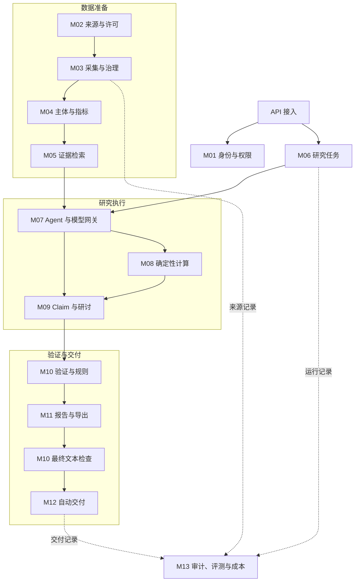
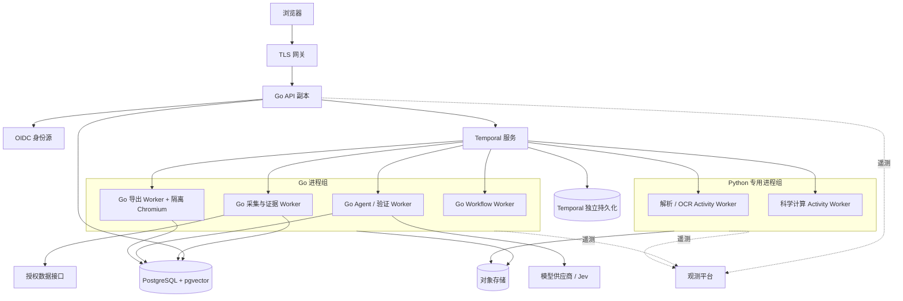
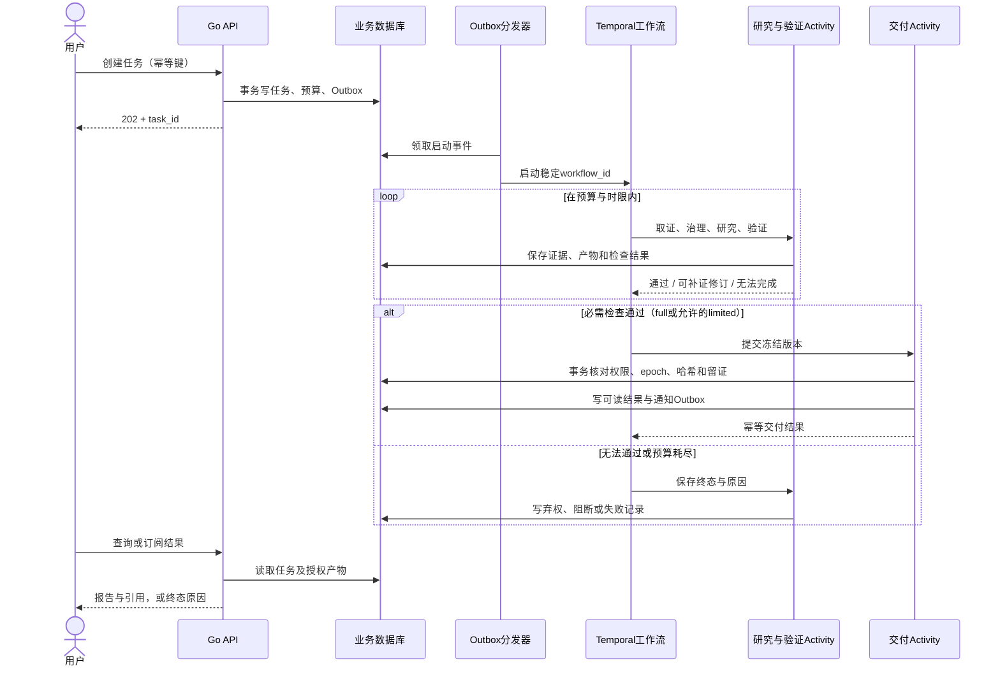
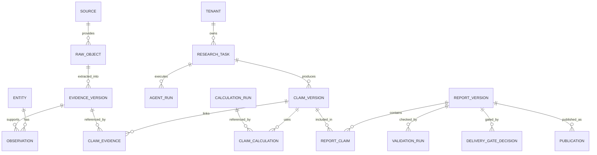
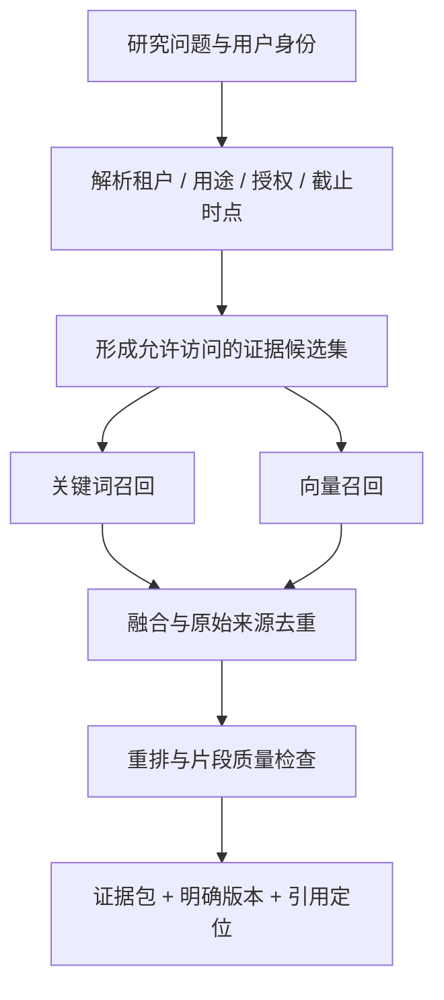
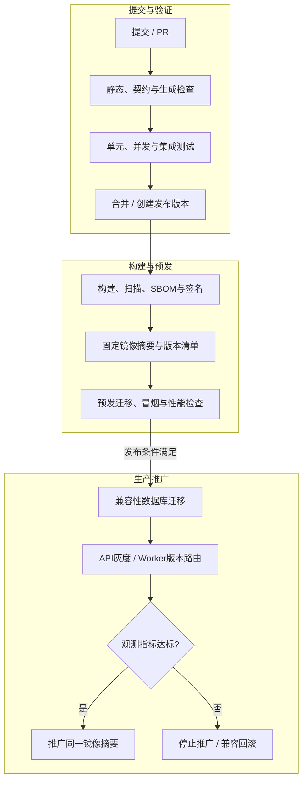
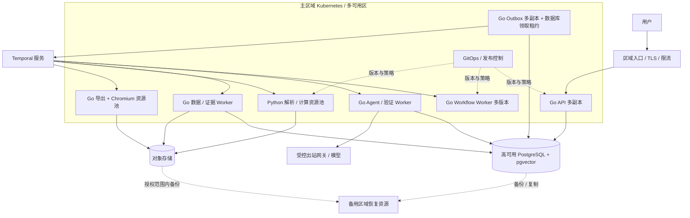

# 可信金融投研平台：后端业务模块与技术栈

> **历史研究档案**：完整保留原文供溯源。当前首版以 [SPEC](../../SPEC.md) 和 [已冻结决定](../decisions/0001-p0-baseline.md) 为准；旧待确认表、机构内部定位、模型价格及后续阶段不直接作为上线配置。

> 版本：0.6.0 · 修订：2026-11-05 · 状态：设计草案，待实现与验证\
> 范围：后端模块、Go/Python 分工、存储、CI/CD 与部署演进。\
> [文档索引与统一约定](README.md)

## 阅读导航

| 阅读目的 | 对应章节 |
| --- | --- |
| 理解业务职责 | 第 2–3 节 |
| 确认 Go/Python 分工与技术栈 | 第 4 节 |
| 查看部署、时序、数据与权限 | 第 5–9 节 |
| 安排开发与性能验证 | 第 10–13 节 |
| 实现 CI/CD、发布与回滚 | 第 14 节 |
| 规划分布式与容灾部署 | 第 15 节 |
| 评审未决事项与参考依据 | 第 16–18 节 |

## 1. 设计结论与使用说明

推荐 **Go 模块化后端 + Temporal 工作流 + PostgreSQL/pgvector + 对象存储 + 分组 Worker**，组件用途和 Python 边界见 §4。首版按负载隔离进程，服务拆分由资源和权限需求决定。

Go 优先已确认，其他组件为默认建议；实施前检查已有能力、兼容性与维护状态，再锁定版本。资源与延迟改善需按 §12–13 实测，模型和供应商限流也会影响端到端性能。

## 2. 后端业务全景



实线表示主要业务依赖，虚线表示记录归集。审计覆盖所有模块，图中仅保留三条代表性连线；最终文本检查包含在 M10 的职责中。

## 3. 具体业务模块

### 3.1 数据与权限域

| 编号 / 模块 | 必须实现的业务功能 | 核心实体 | 接口能力 | 首版边界 |
| --- | --- | --- | --- | --- |
| M01 身份租户与授权 | 企业登录映射、租户、成员、角色、数据范围、用途权限、研究与交付服务权限分离 | Tenant、Membership、Role、Policy | 查询当前权限、维护成员与策略 | 对接已有 OIDC 身份源，不自建密码系统 |
| M02 数据源与许可 | 来源注册、接口配置、密钥引用、许可用途、配额、健康状态、原始来源分组 | Source、LicensePolicy、ConnectorConfig | 注册来源、查询许可、暂停连接器 | 只接入少量已授权数据源 |
| M03 采集与质量治理 | 定时/增量采集、分页、断点、限流、原始快照、解析、去重、质量检查、隔离、自动修复与有界回退 | IngestionRun、RawObject、QualityIssue | 触发采集、查询失败、重试隔离项 | 公告与结构化财务数据优先 |
| M04 主体指标与时点数据 | 公司与证券映射、标准指标字典、单位转换、期间口径、数据重述、时点查询 | Entity、Security、MetricDefinition、Observation | 查询主体、指标、指定时点的数据 | 首版不实现高频行情引擎 |
| M05 证据与检索 | 原文定位、切片、授权过滤、时间过滤、检索、引用登记、血缘、独立信源识别 | EvidenceVersion、Chunk、LineageEdge | 检索证据、查看定位、查询血缘 | 索引可重建；证据主记录不可依赖向量库 |

### 3.2 研究与验证域

| 编号 / 模块 | 必须实现的业务功能 | 核心实体 | 接口能力 | 首版边界 |
| --- | --- | --- | --- | --- |
| M06 研究任务与工作流 | 创建任务、范围和截止时间、预算预留、进度、取消、恢复、超时、有界自动补证等待 | ResearchTask、TaskEvent、BudgetReservation | 创建/取消任务、读取进度、订阅事件 | 工作流状态不只保存在进程内 |
| M07 Agent 与模型网关 | 角色运行、提示版本、模型适配、结构化输出校验、工具白名单、调用日志、限流和费用 | AgentRun、ModelCall、PromptVersion | 内部研究调用、模型策略管理 | 模型不持有发布或数据库任意写权限 |
| M08 确定性计算 | 财务比率、同比环比、估值、情景分析、公式版本、复算和结果存储 | CalculationRun、FormulaVersion、Artifact | 提交计算、查询输入输出、复算 | 首版只执行预审模板，不执行模型任意代码 |
| M09 Claim 与研讨 | 原子结论、版本、类型、支持和反对证据、独立提交、争议、裁决与弃权 | ClaimVersion、EvidenceLink、DebateRound、Decision | 查看结论、补证、发起质询、记录裁决 | P0 先支持单研究角色与自动修订；P1 启用多角色 |
| M10 验证与规则 | 引用存在性、口径、复算、时点检查、语义支持度、规则包、Jev 适配、失败分类 | ValidationRun、CheckResult、RuleSetVersion | 提交检查、读取失败项、查询规则版本 | 硬性检查与模型评分分别存储，禁止平均抵消 |

### 3.3 报告与运营域

| 编号 / 模块 | 必须实现的业务功能 | 核心实体 | 接口能力 | 首版边界 |
| --- | --- | --- | --- | --- |
| M11 报告版本与导出 | 模板、校验通过的 Claim 组装、句子引用映射、差异比较、HTML/PDF、版本冻结 | ReportVersion、ReportClaim、ExportArtifact | 创建草稿、比较版本、导出 | 草稿导出标注状态并受权限控制；导出不等于发布 |
| M12 自动检查与交付 | 自动检查、证据入库确认、检查决定失效、交付、更正与撤回 | DeliveryGateDecision、Publication、DistributionRecord | 内部自动交付命令、状态查询、更正、撤回 | 检查通过后自动交付 |
| M13 审计评测与成本 | 操作留痕、模型调用成本、预算核销、评测集、对照实验、离线标注纠错、运行指标 | AuditEvent、UsageLedger、EvalCase、EvalRun | 查询审计、启动评测、成本汇总 | 基本审计和预算属于 P0；系统性实验属于 P1 |

模块之间通过应用服务和明确契约协作，不跨模块随意更新他方业务表。首版共享数据库并不意味着共享业务写入权限。

## 4. 技术栈与取舍

| 层级 | 默认选择 | 用途与边界 | 阶段 |
| --- | --- | --- | --- |
| 主语言 | Go，锁定受支持工具链 | 核心业务、I/O 并发、工作流与规则；使用显式资源上限 | P0 |
| API | `net/http` + chi | HTTP/JSON、轻量路由、中间件；任务进度优先轮询，SSE 按需启用 | P0 |
| 内部同步通信 | grpc-go + Protobuf；protoc/Buf 工具链 | 已拆分服务使用；同进程 Go 接口、长任务 Temporal；细则见 RPC 专项规格 | 随服务拆分启用 |
| API 契约 | OpenAPI + oapi-codegen；JSON Schema | 生成 DTO/接口；另加运行时输入校验和业务校验，生成代码本身不是完整验证 | P0 |
| SQL / 迁移 | pgx + pgxpool + sqlc + goose | 显式 SQL、事务、类型化查询；只保留 Go 管理的一套 SQL 迁移 | P0 |
| 主数据库 | PostgreSQL | 已提交业务状态、关系、版本与行级隔离 | P0 |
| 检索 | pgvector + PostgreSQL 全文索引 | 允许候选集内精确向量检索起步；中文分词通过可替换适配器实现并评测 | P0 |
| 工作流 | Temporal Go SDK | Go 定义 Workflow 与业务 Activities；Python SDK 仅注册专用 Activities | P0 |
| 对象存储 | S3 兼容存储 + Go SDK | 原文、解析及计算产物、报告；大文件流式上传下载 | P0 |
| HTTP / 模型调用 | 复用 `http.Client` / Transport + Go Provider Adapter | 显式超时、连接池、限流、取消、结构校验；Jev 也由 Go 调用 | P0/P1 |
| 精确数值 | Go decimal 库候选 `shopspring/decimal`，PostgreSQL NUMERIC | 金额与比例按定义精度处理；禁止通过 float64 中转金额 | P0；库版本和舍入规则先做契约验证 |
| 科学计算 | Python pandas / NumPy / Decimal | 复杂矩阵、估值模板、专用分析库；常见比率优先 Go 实现 | P0 必要子集 |
| 文档解析 | Python pypdf / pdfplumber；OCR 按需 | 保留页码和表格定位；不拥有证据发布权 | P0 |
| 报告渲染 | Go `html/template` + chromedp / 隔离 Chromium | Go 组装 HTML、浏览器导出 PDF；模板变量转义，限制外链与并发 | P0 |
| 身份认证 | 企业 OIDC + Go 验证适配器 | 校验签名、issuer、audience、时效；权限由服务端业务策略执行 | P0 |
| 规则与 Agent | Go 角色接口、工具注册表、版本化 Go 检查函数 | 不依赖 Python Agent 框架；状态迁移归 Go 领域服务 | P0/P1 |
| 观测 | OpenTelemetry Go/Python、Prometheus、Grafana、`slog` | 跨语言 trace、指标、结构化日志；pprof 仅内部受控开放 | P0 |
| Go 质量 | gofmt、go vet、go test、race、fuzz、govulncheck | 契约、并发、集成、工作流重放与基准测试 | P0 |
| Python 质量 | pytest、Ruff、类型检查 | 验证专用 Worker、数值与跨语言载荷 | P0 |
| 构建 | go.mod/go.sum + 固定工具链；Python uv.lock；多阶段容器 | 每种 Worker 独立镜像；核心 Go 镜像不包含 Python/Chromium | P0 |
| CI/CD | GitHub Actions 参考流程 + OCI Registry | 可映射现有 GitLab CI 等平台；生产平台阶段再引入 Helm / Argo CD | P0–P2 |

HTTP 和取消语义参考 [Go net/http](https://pkg.go.dev/net/http)及 [数据库操作取消](https://go.dev/doc/database/cancel-operations)；路由参考 [chi](https://github.com/go-chi/chi)。工作流参考 [Temporal Go SDK](https://docs.temporal.io/develop/go)，SQL 生成参考 [sqlc 与 pgx](https://docs.sqlc.dev/en/stable/guides/using-go-and-pgx.html)。其余具体库为候选，实现前锁版本并核验兼容性和许可证。

### 4.1 首版不默认启用的组件

| 组件 | 暂不引入原因 | 后续引入条件 |
| --- | --- | --- |
| Kafka | 当前主要是可控工作流，尚无高吞吐事件流需求 | 多系统持续消费、流式行情及吞吐实测证明需要 |
| 独立向量数据库 | 首版证据规模与运维要求未证明有必要 | 隔离、检索延迟或召回质量超出 PostgreSQL 方案能力 |
| 图数据库 | 血缘关系可先用关系表实现 | 深层图遍历成为实际性能瓶颈 |
| ClickHouse | 首期不是高频量化平台 | 大规模行情聚合、回测或分析负载影响主库 |
| Redis | 首版实现可替换缓存适配，启用由压测决定 | 缓存冻结任务 ContextPack，按确切版本回源；配额控制实例与可淘汰数据缓存隔离，禁止作为证据/交付唯一状态 |
| Celery | 避免与 Temporal 形成两套重试和状态机制 | 仅在复用已有队列且明确职责边界时评估 |
| Kubernetes 新建集群 | 初期运维成本高 | 已有平台或容量、隔离和可用性要求推动 |

### 4.2 语言责任矩阵

| 模块 | Go 负责 | Python 可参与 | 权威写入方 |
| --- | --- | --- | --- |
| M01/M02 身份与来源 | 全部业务逻辑、许可与密钥引用 | 仅必要的专有 SDK 适配 | Go |
| M03/M04 数据治理 | 采集、质量规则、指标标准化、修订与入库 | 文档解析、OCR、批量专用 SDK | Go 校验后入库 |
| M05 证据检索 | 权限、时点、检索融合、引用与血缘 | 必要的分词/嵌入适配，非必需依赖 | Go |
| M06/M07 工作流与 Agent | Workflow、角色调度、模型和工具网关 | 特殊研究工具 Activity | Go |
| M08 计算 | 公式登记、普通比率、运行记录与结果校验 | 复杂科学计算 | Go 登记结果；Python 只写产物 |
| M09/M10 结论验证 | 研讨状态、确定性检查、Jev、验证聚合 | 专用数值验证算法 | Go |
| M11/M12 报告发布 | 组装、导出、自动检查、版本、交付 | 默认不参与 | Go |
| M13 评测审计 | 审计、预算、在线指标、评测任务管理 | 离线统计与实验 | Go 登记，Python 产出分析文件 |

同步 RPC 细则见 [服务间通信与 RPC 契约](financial-research-rpc-contract.md)：同进程 Go 接口，跨服务短请求 gRPC/Protobuf，长任务 Temporal。

### 4.3 Go 与 Python Activity 契约

默认通过 Temporal 的独立 Activity 队列协作，不新增通用 Python HTTP 服务或第二套队列。Go Workflow 按稳定 Activity 名称调用 Python Worker，例如 `parse_document_v1`、`run_quant_template_v1`；普通模型调用留在 Go。

- Go 工作流队列、Go Activity 队列、Python 解析队列和 Python 计算队列分开。不同语言 Worker 不竞争同一未完整注册的任务队列。
- 定义版本化 JSON Schema，并使用兼容的 Temporal Data Converter；以真实 Go 编码/Python 解码及反向测试验证，不假定语言默认类型完全互通。[Temporal 数据转换](https://docs.temporal.io/dataconversion)
- 输入包含 `schema_version`、`task_id`、`tenant_id`、`operation_id`、`input_refs`、`input_hashes`、`template_version`；身份字段不能单独充当授权凭据。
- 输出包含 `schema_version`、`operation_id`、`artifact_refs`、`artifact_hashes`、`quality_flags`、`runtime_version`。Worker 成功只代表任务完成，必须再经过 Go 的质量与授权校验。
- ID、金额和高精度十进制用字符串；时间为带时区 RFC 3339；缺失用显式 null；拒绝 NaN/Infinity，明确空字段和未知枚举的兼容规则。
- 大文件不进入 Workflow History，传版本化对象引用和摘要；对象访问由服务身份与受控对象访问策略授权，避免把长期凭证放入历史。
- Python 不持有业务库写权限，不能修改 Claim、门禁或交付状态。其对象写权限只覆盖指定任务产物前缀，Go 验证哈希、格式和归属后登记。
- 取消和超时不能保证外部进程立即结束；Activity 需心跳、协作取消，子进程超时终止并回收临时文件。重试沿用 operation_id 去重。
- Go/Python 长任务继续使用 Temporal；服务实际拆分后，短查询/命令默认采用 gRPC/Protobuf，遵循 RPC 专项规格的鉴权、deadline、幂等和版本规则，不为同进程模块强制引入网络。

## 5. 技术部署图



- Temporal 的持久化与业务数据库逻辑隔离，按部署方案配置其所需存储；不能让工作流引擎管理业务表。
- Worker 可从单副本启动，采集、模型、计算、导出按资源和安全需求独立扩容。
- 生产数据库和对象存储需要备份、恢复验证和访问控制；Compose 开发环境不代表生产高可用。
- 外部模型调用必须经过数据用途与部署地区策略检查。
- API、Worker、自动交付使用不同服务身份；对象下载须鉴权，受限原文默认通过服务代理访问。使用签名 URL 时需短有效期并明确撤权延迟。

## 6. 关键业务时序



Outbox 分发器负责启动工作流，数据库不会主动发送消息。Workflow 通过 Activity 读写业务库。循环在检查通过、无法继续或预算耗尽时结束；受限报告也必须经过同一交付检查。通知由独立消费者处理，不影响已交付报告的读取。

### 6.1 事务边界与执行契约

1. API 在同一事务写任务和 Outbox；分发器使用稳定业务任务 ID 启动工作流，重复启动需识别。
2. 交付事务核对当前权限、epoch、报告哈希、证据持久化和检查版本；同时写 Publication 与通知 Outbox。交付成功和通知送达分别记录。
3. 数据库操作使用短事务，外部调用在事务外执行。消息只用于唤醒，不能代替已提交的检查结果。

执行恢复的完整规则由 [Agent 设计](financial-research-multi-agent-design.md) 维护：§6.2 定义 revision/epoch，§8 定义确定性编排，§9.5 定义 Activity 超时和重试，§10 定义幂等、未知外部结果及费用核销。短 RPC 的重试与写幂等由 [RPC §5–6](financial-research-rpc-contract.md) 维护；实现时必须同时遵守调用层和业务层约束。

## 7. 核心数据关系



这是核心关系图，省略角色、许可、其他验证目标和审计表。跨租户共享来源使用显式授权映射，不能以 `tenant_id` 为空隐式开放访问。

### 7.1 关键表与约束

| 表组 | 必备字段 / 约束 |
| --- | --- |
| 租户业务表 | `tenant_id`、稳定 ID、创建时间；引用关系包含租户一致性检查 |
| 原始快照 | 来源、对象键、内容哈希、采集时间、许可版本；不覆盖已有内容 |
| 指标观察值 | 主体、指标、口径、单位、报告期、公开时间、可用时间、修订版本；不按报告期直接覆盖 |
| Evidence / Claim / Report 版本 | 逻辑 ID + 版本唯一；发布依赖指向确切版本 |
| ClaimEvidence | Claim 版本、Evidence 版本、支持/反对/背景关系、定位和核验结果 |
| ValidationResult | 目标版本、规则/模型版本、通过/失败/未知、原因、证据位置 |
| DeliveryGateDecision | 自动决策服务、规则版本、报告/证据哈希、结果、时间；拒绝过期检查决定 |
| Publication | 报告版本、渠道、受众策略、幂等键、更正/撤回关联 |
| Outbox | 事件 ID、聚合 ID、事件版本、状态、尝试次数；消费者去重 |
| AuditEvent | 主体、动作、目标版本、时间、结果、trace_id；追加写与独立权限 |

审计日志中的哈希可用于完整性核验，但仅有哈希不等于不可篡改。正式生产按保存要求评估对象锁定、保留策略及独立审计存储。

治理输出先构建 TaskDataset（全部候选及筛选决定清单），再为角色编译 ContextPack；数据集和 pack 的主记录持久化到 PostgreSQL/对象存储，Redis 只提供可重建热层。厂商字段映射、来源等级、事实/观点分类、质量规则和冲突对账按数据治理专项规格实施。

## 8. 检索和权限的具体实现



- 首版以授权候选集内的精确向量检索建立正确性基线；采用物化候选集等方式验证实际执行计划。
- 引入 HNSW 等近似索引后，过滤条件与近似扫描可能影响返回数量和召回率，必须使用精确结果对照评测；不能将 SQL 中存在 `WHERE` 等同于已证明物理预过滤。[pgvector 官方说明](https://github.com/pgvector/pgvector)
- PostgreSQL RLS 作为租户隔离的纵深防御；应用身份不能使用超级用户或 `BYPASSRLS`，并处理表所有者的绕过行为。连接池按事务设置租户上下文，事务结束清理，防止串租户。[PostgreSQL RLS 文档](https://www.postgresql.org/docs/18/ddl-rowsecurity.html)
- 数据库权限只能限制可访问行，不能自动表达全部内容许可；模型处理、原文展示和外部分发仍需用途策略判断。
- 可选缓存键必须包含租户、用途、授权策略版本、截止时点、证据版本和模型版本；不能跨权限复用上下文。
- 嵌入与重排同样涉及数据处理授权，不能只检查最终生成模型。

## 9. 模型、计算与规则边界

| 工作 | 执行位置 | 权限边界 | 失败行为 |
| --- | --- | --- | --- |
| 数据 API 请求 | 采集 Worker | 来源白名单、服务端密钥、限流 | 隔离并记录缺失，不自动编造 |
| 研究与写作 | Agent Worker | 只读证据工具和受控计算工具 | 有限重试、换路由或弃权 |
| 估值与财务计算 | 计算沙箱 | 预审公式、固定输入、无外网、资源上限 | 明确失败或容差异常 |
| 引用与单位检查 | 验证服务 | 读取原始版本与计算产物 | 硬性阻断 |
| Jev / 语义判断 | 验证 Worker | 最小必要上下文、版本化问题 | 未知、备用验证或自动弃权 |
| 自动交付 | Go 工作流与交付服务 | 服务身份、信源入库、自动检查与版本校验 | 自动交付或阻断并返回原因 |

P0 计算请求通过 `formula_id + input_versions + parameters` 提交。未来若允许 Agent 生成代码，必须新增专门安全评估和更强沙箱，不因“容器运行”就默认可安全执行。

规则包采用版本化配置和 Go 检查函数：检查 ID、适用范围、严重度、参数、规则来源、生效时间、验证器版本。P0 不引入复杂规则引擎；规则变更要重新评估受影响报告。

## 10. 建议代码结构

```text
backend/
  go.mod / go.sum
  cmd/
    api/                    # Go HTTP API
    worker/                 # 按队列配置启动 Go Workflow/Activity Worker
    outbox/                 # 可独立扩容的事件分发器
  internal/
    modules/                # identity、sources、ingestion、marketdata、evidence
                            # research、agents、calculations、claims
                            # verification、reports、publishing、evaluation
    workflows/              # Go Temporal Workflow 与重放兼容逻辑
    activities/             # Go Activity 包装与权限上下文
    adapters/               # 模型、数据接口、对象存储、OIDC
    platform/               # pgx、遥测、配置与 Outbox
    transport/http/         # 路由、生成接口、运行时校验
    transport/grpc/         # 服务拆分后启用的 RPC adapter
  sql/
    migrations/             # goose；全系统唯一业务迁移入口
    queries/                # sqlc SQL 定义
  contracts/
    openapi.yaml
    proto/                  # 版本化服务 RPC 契约，按拆分需要启用
    activities/             # 版本化 JSON Schema
    fixtures/               # 双语言兼容性与精度测试样本
  python-workers/
    pyproject.toml / uv.lock
    src/research_tools/     # parsing、quant、evaluation、activity_adapters
    tests/
  tests/                    # Go 集成、并发、工作流、权限测试
  benchmarks/               # 固定负载与性能比较基线
  deployment/
    compose/                # 本地开发与集成验证
    docker/                 # 按进程构建镜像
    helm/                   # 后续集群部署
    gitops/                 # 后续环境版本声明
  ci/                       # 测试、构建、契约检查脚本
```

CI 工作流文件放在目标仓库平台约定的位置，例如根目录 `.github/workflows/`。Go 模块中的领域对象不直接暴露 pgx/sqlc 或 HTTP DTO；生成代码与手写业务代码分开。

每个业务模块建议包含 `domain`、`application`、`repository` 和必要的接口 DTO。不要把领域状态迁移写在路由、提示词或模型输出解析器中。

## 11. 分阶段实现顺序

首版启用范围按 [年度点评模板](financial-research-mvp-report-spec.md) 裁剪：M11 先完成站内 HTML 阅读与引用，PDF 导出和外部通知可后置；保留扩展接口，不将全部模块能力视为首版必做功能。

按 [统一实施计划](financial-research-decisions.md#phases) 执行 P0-A 数据基础 → P0-B 研究执行 → P0-C 自动交付，再根据实验收益进入 P1、按规模进入 P2。详细交付与退出条件只在统一计划维护。

## 12. 性能与运维验证计划

不在缺乏业务规模时承诺固定 SLA。实施前确认租户数、同时研究任务数、每任务证据量、数据更新频率、报告长度和预算。

| 验证项 | 测量内容 | 扩容或优化方向 |
| --- | --- | --- |
| API | P50/P95 延迟、错误率、数据库连接等待 | API 副本、查询与索引优化 |
| 检索 | 授权过滤后的召回率、P95、候选规模 | 精确/近似切换、分区或专用检索引擎 |
| 工作流 | 排队时长、恢复成功率、重复副作用 | 按队列扩 Worker，修复幂等 |
| 模型 | 限流率、费用、超时、结构与内容错误 | 并发预算、路由策略、证据压缩 |
| 解析与计算 | CPU、内存、失败率、数值容差 | 隔离资源和任务上限 |
| 数据恢复 | 备份可用性、实际恢复时间与丢失窗口 | 定义并验证 RTO/RPO |
| 安全 | 跨租户、越权发布、注入、导出外连 | 权限回归与网络策略 |

测试必须覆盖真实 PostgreSQL 权限、Temporal 重放与恢复、对象授权下载和发布幂等。模拟供应商测试与真实联调分开报告。

<a id="resources"></a>

## 13. Go 并发与资源治理

### 13.1 有界并发

| 层次 | 实现约束 | 观测指标 |
| --- | --- | --- |
| HTTP 入口 | 请求体与头大小限制、读头/空闲/处理超时、租户配额；拒绝超载时返回明确 429/503 | 在途请求、拒绝率、P95/P99 |
| Go 扇出 | 有界 worker pool 或 semaphore；使用带上限的 errgroup；禁止为无限数据逐项启动 goroutine | 活跃 goroutine、排队时长、取消后存活量 |
| DB | pgxpool 最大连接、获取连接超时、SQL 超时；不在事务内等待模型或远程 API | 池等待、连接数、锁等待、慢查询 |
| HTTP 出站 | 复用 Transport，配置连接和响应超时；限制单供应商并发与响应大小 | 连接复用、429、超时、调用预算 |
| Temporal | 配置 Activity 并发、poller 与任务超时；按 CPU/I/O 分队列 | schedule-to-start 延迟、重试、积压年龄 |
| Python / 浏览器 | 独立进程、固定并发、内存/CPU 限额；NumPy/BLAS 线程数也设上限 | 峰值 RSS、OOM、CPU、队列等待 |
| 大文件 | 流式读取、最大文件与解压大小、受限临时目录 | 分配量、磁盘使用、上传失败 |
| 事件订阅 | SSE 有界缓冲、慢客户端断开、心跳与重连游标 | 活跃连接、丢弃/断开、恢复成功率 |

HTTP 服务使用 `context.Context` 贯穿同步调用并释放资源；已持久化的后台研究任务不依赖客户端请求 context 存活，取消通过明确的业务命令提交。SSE 需要独立的连接与写超时策略，不能套用短请求超时后持续误断线。[Go 取消操作](https://go.dev/doc/database/cancel-operations)

上述 Go 并发工具用于 API 和 Activities；Workflow 的确定性编排规则见 [Agent §8](financial-research-multi-agent-design.md)。

### 13.2 多副本预算与性能验收

- 租户与供应商全局配额、租约和公平算法按 [Agent §10–11](financial-research-multi-agent-design.md) 实现；本节负责进程资源上限和副本容量。
- 数据库总连接预算应满足 `Σ(各类最大副本数 × 每副本池上限) + 运维预留 ≤ 数据库连接预算`。API、Worker、发布进程分别预算。
- HPA 上限须受外部供应商配额与数据库预算约束，不能只按积压无限扩容。
- 测试同样的请求、数据规模、并发梯度与结果正确性，记录吞吐、P95/P99、CPU、RSS、分配量和 goroutine；若没有旧实现，建立 Go 基线，不编造 Python 对比成绩。
- 分别测不调用外部模型的 API/检索路径，以及真实供应商端到端路径；报告业务延迟与基础设施资源，而非只给语言微基准。
- 增加超载、慢数据库、模型 429、取消风暴和持续运行测试，验证背压、无明显泄漏、错误率及恢复行为。
- GC 与容器内存预算根据实测调整；只有分析确认热点后使用对象池等优化，不能以牺牲证据正确性换吞吐。

## 14. CI/CD 流程

### 14.1 流水线总览



CI/CD 是待实施流程。推荐 GitHub Actions，已有其他平台时映射相同门禁；这不代表本次已创建流水线或执行部署。

### 14.2 CI 检查矩阵

| 阶段 | 内容 | 失败策略 |
| --- | --- | --- |
| PR 静态 | gofmt、go vet、Go 静态检查；Python Ruff/类型检查；OpenAPI 与 JSON Schema 校验 | 阻断合并 |
| 生成一致性 | sqlc、API DTO 重新生成后无未提交差异；迁移和契约变更检查 | 阻断生成物漂移 |
| 单元与并发 | go test、关键包 race、Go fuzz 固定回归集；Python pytest | 阻断失败；长时间 fuzz 可夜间运行 |
| 双语言契约 | Go→Python 与 Python→Go，decimal、null、时间、旧版本兼容及错误类型 | 不兼容改动要求显式新版本 |
| 集成 | 临时 PostgreSQL/pgvector、对象存储、Temporal；RLS、Outbox、幂等、迁移升级、任务重放 | 不用纯 mock 代替权威状态验证 |
| 安全 | govulncheck、Python 依赖与镜像扫描、凭证扫描、跨租户与越权发布 | 阻断符合组织风险策略的未豁免问题 |
| 发布前 | 灰度样本、固定性能负载、报告证据回归、取消与恢复 | 与预先登记阈值比对；无基线时先建立基线 |
| 定时评测 | 真实模型、Jev、中文证据质量、漂移、预算和备份恢复 | 不合格版本禁止升级；模型评测区分随机性与确定性错误 |

不可信 PR 不注入生产密钥、不运行真实供应商高费用任务。真实供应商评测由可信分支上的独立作业执行，并限制预算和数据范围。

### 14.3 构建与发布物

至少区分 Go API、Go Worker、Go Outbox、Python 解析、Python 计算、Go 导出（含 Chromium）镜像。Go 镜像使用多阶段构建，能无 CGO 的组件优先无 CGO；若分词或其他依赖需要 CGO，应单独核验运行库，不强行静态化。运行身份非 root，文件系统默认只读，仅指定目录可写。

每次发布生成 `release-manifest.json`，记录：

```json
{
  "release_id": "example-release",
  "git_commit": "<commit-sha>",
  "images": {"api": "<registry/image@sha256:digest>"},
  "schema_compatibility": {"min": "<migration-id>", "max_tested": "<migration-id>"},
  "activity_contracts": ["parse_document_v1", "run_quant_template_v1"],
  "worker_deployment_version": "<build-id>",
  "rule_set_version": "<rules-id>",
  "prompt_set_version": "<prompts-id>",
  "model_policy_version": "<policy-id>",
  "evaluation_artifact": "<immutable-artifact-ref>"
}
```

示例值不是可部署配置。测试通过的镜像按摘要从预发推广到生产，不在生产重新构建；同时保存 SBOM、扫描结果、构建来源和签名。提示词、规则与模型路由变更也需要版本和质量要求，不能绕开发布流程。

CI 使用最小权限，第三方 Actions 固定完整 commit SHA；云访问优先短期 OIDC 身份，信任策略绑定仓库、分支/环境，避免给 PR 作业生产角色。[GitHub 安全指南](https://docs.github.com/en/actions/reference/security/secure-use)、[OIDC 说明](https://docs.github.com/en/actions/reference/security/oidc)

### 14.4 数据库与 Worker 发布顺序

1. 获取目标环境的发布锁，确认恢复点、版本兼容区间和回滚条件。
2. 由单个迁移 Job 执行 **expand**：增加兼容字段/表/索引，设置锁超时；禁止每个 API 副本启动时抢跑迁移。
3. 大规模回填使用可恢复、限速的独立任务。并发索引等非事务操作使用专门迁移步骤，验证失败后的清理与重试。
4. 先部署支持新旧 Activity 契约的 Worker，再让新版 Workflow 调用新契约。Go/Python SDK 与 Temporal Server 的版本组合需集成验证。
5. API 按小比例到全量灰度；Worker 使用 Temporal 支持的版本路由/固定版本策略，不能仅靠 Kubernetes 随机滚动替换。
6. 保留仍承载在途工作流或旧 Activity 契约的 Worker。长周期研究流程使用兼容变更和重放验证；需要 Continue-As-New 时显式规划状态与版本迁移，不假设会自动升级。
7. 全量稳定且旧调用与旧任务已退出兼容窗口后，另一个发布周期执行 **contract** 删除旧字段或接口。

Worker 的版本固定与扩缩容参考 [Temporal Worker 部署指南](https://docs.temporal.io/best-practices/worker)。具体版本功能需按所选 Server/SDK 验证后启用。

### 14.5 回滚与发布验收

| 故障 | 处理 |
| --- | --- |
| API 错误率、P95 或资源异常 | 停止推广，恢复兼容的旧镜像摘要，保留已写业务数据 |
| 新 Worker 重放或执行异常 | 停止新任务路由，保留旧版本 Worker；新版本已产生的历史不能保证可由旧代码重放，应兼容修复或按任务处置 |
| Python 契约不兼容 | 恢复相应 Activity 版本路由，阻止依赖新契约的任务启动 |
| 数据库迁移问题 | 优先向前修复；应用回滚前核验 schema 兼容，不自动执行破坏性 down migration |
| 报告内容或规则错误 | 阻断新增发布，定位受影响版本并执行更正/撤回；代码回滚不会撤销已分发报告 |

生产发布需要达到以下验收：镜像可追溯、预发通过、旧版本兼容、自动检查与交付状态不丢失、积压受控、无重复发布、错误停止推广、回滚演练成功。具体自动门限和观察时长由部署策略确定；CI/CD 管理的是软件版本，不是每份研究结果的交付，运行时没有人员批准步骤。

## 15. 分布式部署演进计划

### 15.1 阶段划分

| 部署阶段 | 形态 | 目的与退出条件 |
| --- | --- | --- |
| D0 开发 / 集成 | Compose；单实例 API、Go Worker、按需 Python Worker，临时数据依赖 | 验证契约与完整业务流程；不承诺高可用 |
| D1 受控生产 | 无状态 Go API 多副本，Worker 按队列独立部署；托管或组织已有的 PostgreSQL/对象存储/Temporal | 生产依赖具备备份和故障恢复；可使用现有容器平台，无需先自建 K8s |
| D2 单区域多可用区 | Kubernetes + Helm；GitOps 可选 Argo CD；API 跨区副本、独立资源池、托管高可用数据层 | 实测并发、故障与部署频率支持引入；完成节点/可用区故障演练 |
| D3 容灾与租户隔离 | 备用区域、受限租户独立单元、按业务单元拆分 | 由 RTO/RPO、监管或容量驱动；先做受控主备，不默认跨区域多主写 |

D1 即可并发运行分布式 Worker，不必先把业务模块拆成多个网络服务。D2 的拆分优先按资源与权限边界：采集、Agent、Python 计算、解析、导出、发布；只有数据所有权与扩缩容收益明确后再拆领域微服务。

### 15.2 后续集群拓扑



图中省略 OIDC 和遥测连线。Temporal 自建时，其数据库、集群容量与灾备需另行配置；不能用业务 PostgreSQL 的恢复代替 Temporal 历史恢复。

### 15.3 扩缩容与可用性

- API 按在途请求、延迟与 CPU 综合设定副本范围；Go I/O 等待时 CPU 低不等于负载低。
- Worker 优先依据 schedule-to-start 延迟、积压年龄与 Activity 槽位扩缩容，并服从全局配额。工作流 Worker 和长任务 Worker 不宜无条件缩到零。
- Kubernetes 自定义指标需要可用的指标适配器；HPA 不是自动理解 Temporal 积压的组件。[HPA 文档](https://kubernetes.io/docs/concepts/workloads/autoscaling/horizontal-pod-autoscale/)
- CPU/内存 requests 与 limits 按负载实测配置；Python/Chromium 与 Go API 分资源池或设独立调度约束，避免 OOM 和 CPU 争抢影响自动检查。
- readiness 验证当前实例能接收业务；liveness 不依赖外部模型即时健康，避免供应商故障引发重启风暴。终止时先停止接新请求/任务，再限时 drain、心跳或交还任务。
- API 使用跨可用区 topology spread、滚动更新预算和适当 PDB。PDB 主要约束自愿驱逐，不保证滚动更新或可用区故障下绝对可用；Deployment 滚动更新还需独立配置。[Deployment](https://kubernetes.io/docs/concepts/workloads/controllers/deployment/)、[中断说明](https://kubernetes.io/docs/concepts/workloads/pods/disruptions/)
- Outbox 多实例通过 `FOR UPDATE SKIP LOCKED` 等机制领取短期租约后释放事务，再执行外部发送；崩溃后可重新领取，消费者必须去重。
- 业务 API 无内存唯一状态、不使用本地文件持久化报告、不依赖粘性会话；SSE 重连从持久化事件游标恢复。
- 高权限发布功能可在 D2 独立为 Go deployment 和数据库角色；路由与代码职责仍受同一契约约束。

### 15.4 数据与区域边界

- 自动检查、交付及需要读己之写的数据读取主库；只读副本仅承接可容忍延迟的查询，并明确最大陈旧度。
- 第一阶段采用单写主库、备份与恢复演练；读写分离或分区应由测量推动，不能让交付门禁依赖延迟副本。
- Kubernetes namespace 本身不是充分安全边界；结合工作负载身份、网络策略、数据库 RLS、对象权限和密钥管理。
- 任务队列按工作类型/服务等级划分，租户公平调度另行实现，避免为每个租户无上限创建队列；高敏租户可采用独立 namespace、存储和服务单元。
- 灾难恢复包含业务数据库、对象版本、Temporal 历史、密钥、配置和版本清单。需要定义恢复一致性检查，避免恢复后存在发布记录但缺报告产物。
- 主备切换前隔离旧主写入，恢复时检查 Outbox/分发状态，防止双主与重复发布；跨区域复制前确认数据驻留许可。
- RTO/RPO 未经演练不得宣称达标；若尚不支持自动切换，应明确人工恢复步骤。

### 15.5 交付验证清单

- [ ] DIST-01：API 多副本与 Worker 多副本下，租户权限、预算与发布幂等仍成立。
- [ ] DIST-02：杀死 Worker 或重启节点后任务恢复，重复 Activity 不产生重复业务副作用。
- [ ] DIST-03：旧版 Workflow 与新版 Go/Python Worker 并行运行并完成契约及重放验证。
- [ ] DIST-04：超载时背压生效，全局供应商配额与数据库连接预算不被扩容突破。
- [ ] DIST-05：数据库迁移、灰度、应用回滚、Worker 路由回退均经过预发演练。
- [ ] DIST-06：备用恢复可重建证据—报告—自动检查关联，关键文件校验与分发去重通过。
- [ ] DIST-07：主区域故障演练记录实际 RTO/RPO，切换后没有双主写入。
- [ ] DIST-08：多副本下自动检查到交付无需人员事件，重复完成通知不会重复交付；失败按时限自动返回。

以上为后续验收目标，未标记为已完成。

## 16. 开发前决策依赖

统一填写 [决策表](financial-research-decisions.md#decisions)：Q-05、Q-07–Q-09、Q-11–Q-17、Q-22、Q-24。分别覆盖来源许可、部署限制、仓库、SLO、留存、基础设施、身份、发布平台、兼容窗口、恢复目标、评测及缓存；本节不另设参数值。

## 17. 官方技术参考

以下为前序研究使用的核心组件文档，以及 CI/CD、扩缩容、Worker 版本管理参考。其余库为工程候选，落地前仍需检查版本兼容性、许可证、安全维护状态与组织准入。

1. [Go net/http](https://pkg.go.dev/net/http)、[chi](https://github.com/go-chi/chi)：HTTP 服务与路由。
2. [Temporal Workflows](https://docs.temporal.io/workflows)：持久化工作流概念。
3. [Temporal Go SDK](https://docs.temporal.io/develop/go)、[Python SDK](https://docs.temporal.io/develop/python)、[数据转换](https://docs.temporal.io/dataconversion)：Go 主工作流与跨语言 Activities。
4. [PostgreSQL Row Security Policies](https://www.postgresql.org/docs/18/ddl-rowsecurity.html)：行级权限及其例外。
5. [pgvector 官方仓库与文档](https://github.com/pgvector/pgvector)：精确/近似向量检索、过滤与索引取舍。
6. [sqlc 与 pgx](https://docs.sqlc.dev/en/stable/guides/using-go-and-pgx.html)：类型化 SQL 接入。
7. [Temporal Worker 部署](https://docs.temporal.io/best-practices/worker)：版本管理与 Worker 生命周期。
8. [Kubernetes HPA](https://kubernetes.io/docs/concepts/workloads/autoscaling/horizontal-pod-autoscale/)、[Deployment](https://kubernetes.io/docs/concepts/workloads/controllers/deployment/)：扩容与滚动发布。
9. [GitHub Actions 安全](https://docs.github.com/en/actions/reference/security/secure-use)：流水线权限与依赖固定。

金融合规、数据源与 Jev 研究来源沿用配套产品规格。本文件的模块拆分、部署拓扑和默认选型是设计建议，不是已经完成的实现或测试结论。

## 18. 文档维护记录

版本与文档检查统一见 [变更记录](CHANGELOG.md)；部署与性能验收按本文 §12–15 执行。
