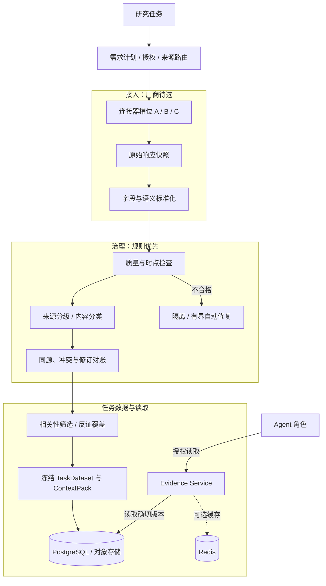
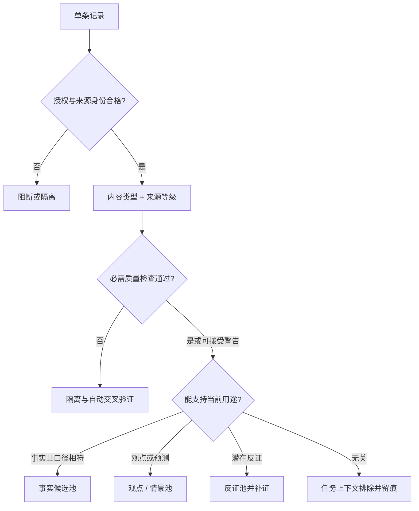
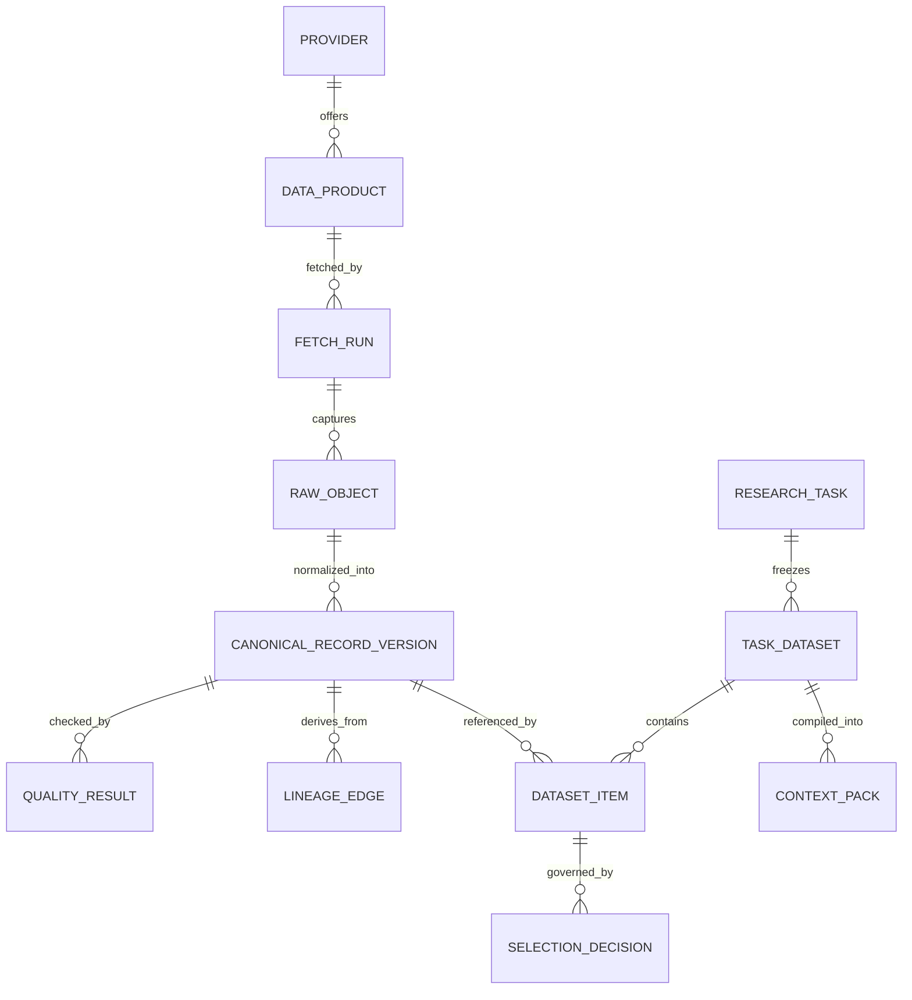
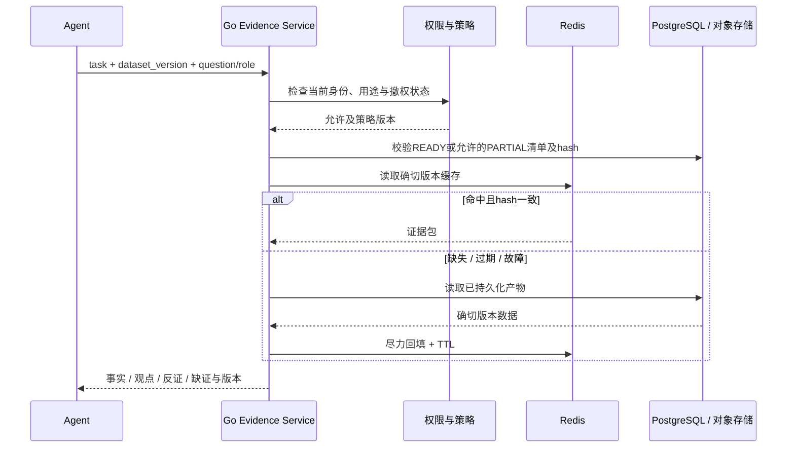
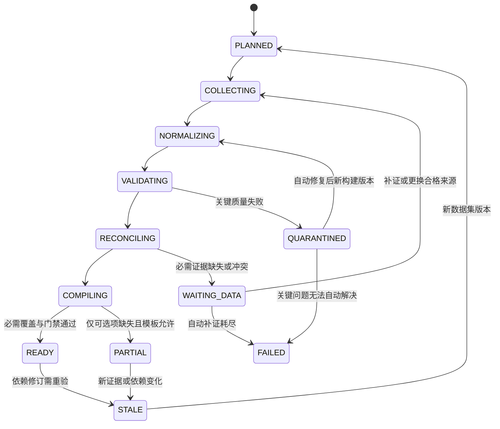
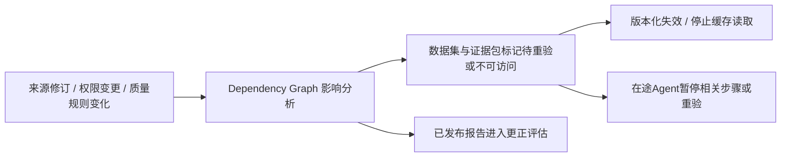

# 投研数据治理：多厂商适配、任务数据集、可信度分级与上下文筛选

> 范围更新：Vera 为金融投研 Agent，首版支持数据源覆盖的个股、行业及其他金融标的研究；年度财报仅为历史场景参考。当前规则见 [研究范围](../RESEARCH_SCOPE.md)。

> **历史研究档案**：完整保留原文供溯源。当前首版以 [SPEC](../../SPEC.md) 和 [已冻结决定](../decisions/0001-p0-baseline.md) 为准；旧待确认表、机构内部定位、模型价格及后续阶段不直接作为上线配置。

> 版本：0.4.0 · 修订：2026-11-05 · 状态：设计草案，待实现与验证\
> 范围：厂商适配、统一模型、来源分级、清洗算法与任务数据集。\
> [文档索引与统一约定](README.md)

## 阅读导航

| 关注点 | 章节 |
| --- | --- |
| 多厂商接入与统一格式 | 2–5 |
| 来源可信度与事实/观点区分 | 6–7 |
| 数据清洗、相关性、去噪算法及 AI 判断 | 8–10 |
| 数据库、Redis、任务快照及 Agent 访问 | 11–13 |
| Go 实现、性能、测试和落地 | 14–17 |
| 研究文献与官方依据 | 18 |

## 1. 核心设计决定

1. **多厂商输入，单一内部语义模型。** 不只是字段改名，还要统一主体、指标定义、单位、期间、交易场所、复权方式和数据修订语义。
2. **厂商身份与原始来源分开。** 一个厂商可能转发交易所行情、公司公告，也可能提供自有估值模型；同厂商不同产品不能统一赋予同一最高等级。
3. **来源、内容类型、质量和适用性分开。** 来源可信不等于结论真实，结构化不等于客观事实，相关度也不等于可信度。
4. **任务数据集持久化后再提供给 Agent。** PostgreSQL 管理规范化记录与版本，原始大文件存对象存储，Redis 缓存可重建的任务证据包。
5. **清洗以无损标准化、隔离和上下文排除为主。** 不静默修改原始值，不把负面信息、异常变化或反证当作噪声删除。
6. **规则与统计算法先行，AI 处理语义难题。** AI 不决定授权、时间真伪、数据来源身份，也不单独决定关键证据是否可信。
7. **新数据产生新版本。** 当前研讨读取冻结的任务数据集；补证、修订与撤权有明确的失效和重验流程。

本设计借鉴 W3C DQV 对质量维度与测量的描述，以及 PROV 的血缘建模，但不宣称遵循这些概念即可获得真实性认证。[R1][R2]

## 2. 全流程架构



图中实线表示处理或读取关系，虚线表示可选缓存访问。治理记录与筛选决定均需持久化；隔离分支的重试和终止条件见第 12 节。

分层含义：

| 层 | 内容 | 权威性 |
| --- | --- | --- |
| Raw | 供应商返回的原始字节、分页信息、请求语义与响应元数据 | 用于追溯输入，不意味着内容真实 |
| Canonical | 主体与指标标准化、单位与时间对齐后的记录 | 规范化数据，仍可能有质量问题 |
| Governed | 分级、质量、冲突、授权、血缘完整的版本化记录 | Agent 的候选证据池 |
| TaskDataset | 本任务全部候选记录及纳入/排除/隔离决定的清单 | 任务可复查的数据边界 |
| ContextPack | 某个角色/问题在 token 预算内的证据片段 | 模型上下文子集，不等于任务全部数据 |

“本次任务的所有数据写入”定义为：在许可允许范围内，原始响应可追溯，规范化候选记录可定位，所有筛选决定可审计；不是把每份原文全文复制进 Redis，也不是把全部候选数据塞给 LLM。

## 3. 厂商注册与连接器协议

### 3.1 厂商配置表：留空待选

| 槽位 | 厂商名称 | 产品/接口 | 基础地址 | 授权用途 | 配额 | 状态 |
| --- | --- | --- | --- | --- | --- | --- |
| MARKET_PRIMARY |  |  |  |  |  | 待选 |
| MARKET_SECONDARY |  |  |  |  |  | 待选 |
| FUNDAMENTALS_PRIMARY |  |  |  |  |  | 待选 |
| DISCLOSURE_PRIMARY |  |  |  |  |  | 待选 |
| NEWS_PRIMARY |  |  |  |  |  | 待选 |
| MACRO_PRIMARY |  |  |  |  |  | 待选 |

槽位是能力角色，不对应已选供应商；可由同一或不同厂商实现。所有槽位默认禁用，未配置时返回明确的能力缺失，不请求虚构地址。

```yaml
provider_id: null
provider_name: null
enabled: false
base_url: null
credential_ref: null
products: []
license_policy_ref: null
mapping_version: null
quota_policy_ref: null
```

密钥只能以服务端 secret 引用管理，不写进映射文件、数据库普通 JSON、日志或模型上下文。

### 3.2 产品级能力登记

每个厂商产品登记：数据类型、市场范围、频率、覆盖起点、更新延迟、是否实时/延迟、历史修订能力、分页机制、时间戳含义、单位、复权口径、原始来源链、授权范围、失败码和质量 SLA。

同一厂商的行情、新闻、研究观点、模型因子分别注册 `product_id`。来源可信度规则绑定产品和原始发布者，不仅绑定厂商名称。

### 3.3 Go 连接器接口

```go
// 概念契约；省略完整类型与错误枚举。
type ProviderAdapter interface {
    Describe() CapabilityManifest
    Fetch(ctx context.Context, req FetchRequest) (RawPage, error)
    Normalize(ctx context.Context, raw RawPage, mapping MappingSpec) (NormalizedBatch, error)
}
```

- Fetch 负责协议、分页和错误映射；Normalize 不进行联网，不使用 LLM 自动猜字段。
- 质量规则、分级与可信冲突裁决在独立治理层，不能由连接器自行声明“可信”。
- RawPage 包含请求指纹、分页游标、供应商 request ID、接收时间、状态码、响应哈希和对象引用；脱敏保存请求信息，不保存认证头。
- 返回可区分的 `RATE_LIMITED`、`AUTH_FAILED`、`SCHEMA_CHANGED`、`PARTIAL_PAGE`、`EMPTY_VALID`、`UPSTREAM_UNAVAILABLE`。
- 每页先持久化原始响应，再推进游标；重试按幂等键去重。页数、行数与预期覆盖不符时标记不完整。

### 3.4 调度与厂商回退

研究计划先生成“需要什么数据”，来源路由器再按授权、覆盖、时点能力、质量、延迟和成本选择连接器。主源失败可选择次源，但必须确认口径等价；不允许用次源预测值悄悄替换主源披露值。

相同请求可在许可和租户边界内合并：请求指纹至少含产品、规范化参数、时点模式、授权范围和数据版本要求。跨租户只共享合同明确允许的采集结果，不能复用用户私有凭证对应的数据。

采用已有 Temporal Activity 队列与全局配额控制；对每个供应商账户设并发、速率、日额度和熔断。多 Worker 不得把账户配额乘以副本数。HTTP 重试与 Activity 重试需明确主责任层，避免重复付费和请求风暴。

## 4. 统一数据模型：不只统一字段名

### 4.1 通用信封

| 字段组 | 必备信息 |
| --- | --- |
| 身份 | record_id、record_version、schema_version、record_type、tenant_scope |
| 来源 | provider_id、product_id、origin_publisher_id、origin_document_id、origin_group_id |
| 主体 | entity_id、instrument_id、venue_id、原始符号和映射版本 |
| 时间 | event_time、period_start/end、published_at、provider_available_at、ingested_at、available_at（本系统确认可用时间） |
| 修订 | revision_id、supersedes_ref、system_valid_from/to、源修订时间 |
| 溯源 | raw_object_ref、raw_hash、raw_locator、mapping_version、transform_run_id |
| 内容 | typed_payload、原始字段/值引用 |
| 治理 | source_tier、statement_kind、quality_state、quality_flags、governance_policy_version |
| 权限 | license_policy_ref、allowed_purposes、access_scope |

未知时间使用 null 和原因，不能用抓取时间假装原文发布时间。原始供应商 ID 与内部主体 ID 同时保留。

### 4.2 类型化载荷

| record_type | 主要字段 | 必须明确的口径 |
| --- | --- | --- |
| market_bar | OHLC、volume、turnover、bar_start/end | 交易场所、频率、币种、成交单位、是否复权、最终/临时行情 |
| market_quote | bid/ask/last、对应时间 | 行情类型、交易状态、延迟标记、来源场所 |
| financial_fact | metric_id、value、unit、period、dimensions | 合并/母公司、累计/单季、准则、审计状态、重述版本 |
| macro_observation | 指标、值、期间、地区 | 频率、季调、初值/修订值与发布版本 |
| corporate_action | 类型、公告日、除权日、生效日、比例 | 确定事件与拟议事件，现金与股份单位 |
| quantitative_feature | feature_id、value、input_refs | 公式版本、窗口、缺失处理、复权、样本范围、计算截止时点 |
| document | 标题、作者、正文、定位 | 原始发布者、发布时间、修订和引用关系 |
| statement | 原文片段、类型、主体、证据引用 | 是事实转述、判断、预测还是假设 |

数值用十进制字符串传输，PostgreSQL NUMERIC 按业务精度存储；计数/成交量也要定义精度和单位。不同频率与不同复权值是不同记录，不是“冲突后选一个”。

财务事实的主体、概念、期间、单位和维度建模参考 XBRL，而非宣称所有厂商接口均符合 XBRL。[R3]

### 4.3 指标字典

`MetricDefinition` 必须包含：业务定义、值类型、标准单位、允许维度、期间类型、可加总性、合法变换、缺失规则、容差和版本。

例如净利润必须区分归母、总净利润和扣非；营收累计值不能直接当单季值；ROE、PE、EBITDA 等名称相同也可能有不同公式。公式不明时保留供应商指标命名空间，不强行合并到标准指标。

### 4.4 字段映射示例：模拟契约，非真实厂商

| 语义 | 模拟响应 A | 模拟响应 B | Canonical |
| --- | --- | --- | --- |
| 收盘价 | `close_price = "12.30"`，单位元 | `close_minor = 1230`，契约明确单位分 | `close = "12.30"`、currency=CNY |
| 成交量 | `volume_lots = 100`，契约明确定义每手100股 | `volume_shares = 10000` | `volume = "10000"`、unit=share |
| 毛利率 | `gross_margin_pct = "31.5"` | `gross_margin_ratio = "0.315"` | `value = "0.315"`、unit=ratio |
| 营收 | `revenue_10k = "3200"` | `revenue_cny = "32000000"` | `value = "32000000"`、unit=CNY |

100 股/手仅用于该模拟产品契约，不是所有市场和品种的默认。不能通过数值看起来像 31.5 就猜测单位是百分比。

映射配置包含 source_path、目标字段、显式单位、变换算子、适用产品版本、必需性和测试样本。仅允许声明式白名单变换，不能执行厂商配置中的任意代码。

### 4.5 跨语言一致性

Go 实现字段映射、标准化和治理决策；Python 解析器输出带原文定位的候选事实，不直接写权威事实。跨语言契约测试覆盖 decimal、null、时间、空字符串、枚举和极值。

LLM 可在新增连接器开发时提出映射建议，但须在离线接入开发中验证语义、固定版本并通过测试后上线；这不是逐任务审核。生产发现未知字段不让模型自动更新映射规则。

## 5. 实体、时间与修订治理

### 5.1 主体与证券映射

公司主体、上市证券、不同交易场所和股份类别是不同实体。证券代码须和市场、有效时间一起使用；名称模糊匹配只提出候选，不自动合并同名主体。

顺序为：已确认外部 ID 映射 → 代码/市场/时间精确匹配 → 多字段候选匹配 → 规则/原始ID交叉核验。冲突或多候选时隔离并自动补查；仍无法唯一确定则排除该记录，必需数据受影响时返回证据不足，不等待人员确认，也不让 LLM 根据常识选择公司。映射历史和更名记录版本化。

### 5.2 双时间语义

```text
业务时间：事实发生/适用的期间、来源首次公开时间、来源修订公开时间
系统时间：本系统何时接收、确认、替换或撤销该版本
```

任务必须指定：

- `public_as_of`：在指定时点已公开可知；需要可靠发布时间证据，即使本系统较晚补采，也可用于回溯研究并明确此模式。
- `system_as_of`：本系统当时已经获得并可用；必须同时满足系统可用时间。

历史截止为 2026-06-30 时，不能使用 7 月重述的上一季度数据，仅因为数据 period_end 在 3 月。当前行情“新鲜”标准也不能套用年度财报：过期按数据类型、交易时段和任务用途判断。

### 5.3 修订、迟到与删除

- 修订追加版本，并关联被替代项；不覆盖原始值或原快照。
- 迟到数据入库后，已有冻结任务不自动变化；产生新候选 snapshot，通知依赖任务是否需要重验。
- 同一供应商记录重复到达时按源键、版本和响应哈希处理；同源相同内容可去重，变化内容保留。
- 许可到期、撤权或依法删除走独立治理流程；“不可变版本”不等于永久无条件保留。可保留允许的审计元数据和删除标记，但不能继续展示/处理已撤销内容。

## 6. 五级来源可信度与内容类型

### 6.1 分级不是概率

推荐采用 L1–L5，**L1 最高**。等级是来源与溯源资格，不是“95% 真实”的概率。身份认证、链路完整性、授权和单条质量必须同时满足，才能按相应等级使用。

| 等级 | 默认来源资格 | 典型用途 | 不能推导的结论 |
| --- | --- | --- | --- |
| L1 一手正式来源 | 可核验的交易场所原始记录、正式披露、官方统计 | 该范围的事实依据 | 发布者说出的预测或估计必然正确 |
| L2 可追溯专业数据 | 授权专业数据产品，能追溯上游及处理口径；可复算指标 | 结构化事实核验与量化输入 | JSON 格式或厂商品牌自动保证正确 |
| L3 具名可靠二手信息 | 有编辑责任与来源说明的权威资讯、新闻转述 | 事件发现、背景、经核验后的辅助证据 | 文章里的判断可以替代原始事实 |
| L4 未独立核验的观点/线索来源 | 来源链有限的评论、市场讨论等 | 经许可的自动补证线索池 | 能独立支撑财务事实或投资判断 |
| L5 未知或不可接受来源 | 无法核验、伪造、污染来源或来源缺失 | 隔离、溯源、修复 | 可直接进入正式模型证据上下文 |

授权失败是一票否决，不只是降到 L5；L1 数据也可能因质量失败或越权被隔离。

量化数据的高等级条件是“输入可追溯 + 公式可复算 + 时点正确”。交易所原始成交记录可为 L1；基于它计算的收益率通常属于 L2 的计算结果。厂商黑箱因子、预测分数、回测收益不因为结构化而自动成为 L1/L2 客观事实，应保留方法披露程度和验证状态。

### 6.2 内容类型独立分类

| statement_kind | 含义 | 示例 |
| --- | --- | --- |
| observed_fact | 对特定事件/观测的记录 | 指定场所某日正式收盘价 |
| reported_fact | 发布主体正式披露的事实或账面值 | 财报披露收入；不保证会计估计无不确定性 |
| derived_measure | 从明确输入和公式推导 | 复算同比增速 |
| attributed_statement | 可核验“某人说过某话” | 管理层在发布会上表示…… |
| opinion | 解释、判断或观点 | 作者认为需求正在改善 |
| forecast | 对未来的预测 | 预计明年利润增长 |
| assumption | 为分析设定的条件 | 假设汇率保持不变 |
| unknown | 暂不能确定 | 缺上下文的断句 |

一篇权威新闻可同时包含 reported_fact、attributed_statement、opinion 和 forecast，必须按段落/原子陈述分类。“管理层表示明年增长20%”可以是高可信的发言记录，但增长20%本身仍是预测。

同理，公司公告中的预测保留 L1 来源身份，内容标 forecast；不能为了简化分级把整篇公告当作高可信历史事实，也不能把权威新闻整篇当成主观判断。

### 6.3 单条质量与用途状态

`quality_state`：PASS / WARN / QUARANTINED / REJECTED。质量维度至少包含完整性、精确性验证状态、口径一致性、时效性、来源可追溯性、解析可靠性、跨源一致性和可复算性。

“精确性未被核验”与“精确性失败”不同；未知不能默认为满分。为每个维度保存测量方法、规则版本、观察值、阈值、结果和评估时间，借鉴 DQV 的质量测量结构。[R1]

任务用途状态独立：`FACT_SUPPORT`、`CONTEXT_ONLY`、`COUNTER_EVIDENCE`、`LEAD_ONLY`、`EXCLUDED`。观点可以作为分析材料或反证线索，但不能作为某个历史数值的直接支撑。

### 6.4 分级与处理决策图



### 6.5 派生与转载的等级传播

- 数据供应商身份与原始发布者分别保留：能核对一手原文不等于供应商自身升级为一手发布者。
- 计算输出的血缘包括所有输入，默认来源等级不优于最弱关键输入，且推导结果最高按 L2 管理；输入冲突/未知则输出不得 PASS。
- 机器摘要、翻译、抽取保留原始 source tier，同时记录 transform quality；需要原文自动定位与交叉验证后才可用于关键事实，不可用模型生成文本伪装原始证据。
- 多个厂商转发同一公告属于一个 origin_group；独立核验可以增加质量证据，但不靠转述数量升级来源等级。
- 等级由版本化策略自动计算；离线配置调整必须有依据、范围、有效期与变更记录，不能用一次正确表现永久升级整个产品。

## 7. 冲突对账与“可信但不一致”

### 7.1 可比较键

先判断记录是否可比较，再判断冲突：

```text
主体 / 证券 / 场所 / 指标定义版本 / 期间
/ 币种 / 单位 / 合并范围 / 会计准则 / 维度
/ 复权方式 / 行情频率 / 修订与可用时点
```

例如 A 给累计营收、B 给单季营收，不构成数值冲突；先做明确转换或保持不同指标。场所不同的报价也不能直接取平均当“真实价格”。

### 7.2 对账算法

1. 使用已确认实体映射与语义键归组。
2. 对相同口径按绝对和相对容差比较：`abs(a-b) <= max(abs_tol, rel_tol × max(abs(a), abs(b)))`。容差按指标/精度配置，零值、极小值与舍入需专门处理。
3. 检查是否修订时点、单位缩放、币种、复权、交易状态或会计范围造成差异。
4. 可解释差异保留解释及转换血缘；不可解释差异创建 ConflictSet。
5. 根据原始一手来源、版本、完整性和任务时点选择首选候选，保存其他值和理由；不是永久删除少数值。
6. 重大未解冲突使相关必需证据不满足 READY；可以提供范围或不确定性说明，但不得静默选最高票数值。

数值集合的中位数可用于发现异常，不作为所有金融指标的“真值修复”。不能把不同厂商的估值、预测、价格口径混合平均后登记为事实。

### 7.3 不把矛盾材料当噪声

可信反证、风险提示、会计保留意见、重述通知和异常行情都应优先保留。需要排除的是无关、重复或不可安全使用的内容，不是与当前 Agent 假设不一致的内容。[P1]

## 8. 清洗与异常检测算法

### 8.1 规则分层

| 类别 | 算法或检查 | 结果动作 | AI 是否必要 |
| --- | --- | --- | --- |
| 协议/格式 | JSON Schema、字段类型、必需项、编码、日期合法性 | 失败隔离；不猜填 | 否 |
| 单位与口径 | 显式转换、指标字典、复权/期间检查 | 生成规范化值与变换记录 | 否 |
| 数值一致性 | OHLC 约束、会计关系、比例/计数约束 | 规则允许范围内报警或隔离 | 否 |
| 完整性 | 页数、行数、时间网格、必需指标覆盖 | 标缺失，按交易日历解释 | 否 |
| 精确重复 | 响应哈希、规范化内容哈希、源唯一键 | 合并存储引用，保留来源关系 | 否 |
| 近重复文本 | SimHash 或 MinHash+LSH 候选，再做关键数值/日期差异比对 | 聚类同源候选，不直接删除 | 通常否 |
| 数值异常 | 稳健统计、变化点、跨源差异 | 标记后自动交叉核验，不默认纠正 | 通常否 |
| 新闻实体/事件分类 | 词典、轻量分类器、必要时 LLM | 结构化标签与 unknown | 可选 |
| 观点/预测与限定词 | 规则初筛 + 分类模型/LLM | 分类建议，关键项自动交叉验证；离线抽检评测 | 可选 |
| 原文支持关系 | NLI/LLM + 明确数值和时点规则 | 支持/反驳/不足 | 可选，非真实性裁决 |
| 注入与污染 | 非执行解析、模式检查、可选语义分类 | 安全隔离、有限提取 | AI 不能作为唯一防线 |

### 8.2 数值规则的适用条件

- OHLC 的 high/low 关系适用于同一有效 bar；缺成交、停牌或供应商占位记录先识别状态。
- 数值正负和区间按资产/指标定义配置，不对所有价格或利率统一要求大于零。
- 财务勾稽需要相同范围与舍入容差，不能对不同报表口径强行平衡。
- 累计值转单季只在相邻累计期间、同口径、同修订基准下相减；缺前期或口径变化时返回未知。
- 前复权、后复权和原始行情分别存储；公司行为与复权因子可修订，必须保留版本及可用时间。
- 不对正式研报引用值默认 winsorize、插值或前向填充；如量化模型需要，应生成单独 derived_measure 并标记插补方法。

### 8.3 稳健异常检测

采用滚动窗口中位数与 MAD 的候选方案：

```text
MAD = median(abs(x_i - median(x)))
modified_z = 0.6745 × (x - median(x)) / MAD
```

阈值需要按指标、频率和历史波动校准，不统一将某个常用阈值视为金融错误判定。MAD=0 或样本不足时跳过该统计规则或使用事先登记的替代方法，并记录原因。NIST 将这类方法用于潜在离群点识别，本文将其限定为自动核验线索。[R4]

价格更适合在可解释的收益率/变动序列上检测，并先排除拆股、分红、币种和交易场所差异；收益率分布有厚尾，真实极端事件不得自动清除。Isolation Forest 等多变量算法作为后续候选，必须在人工标注异常上证明增益后再启用。

### 8.4 去重与版本区分

SimHash/MinHash 用于减少全量两两比较，候选生成后仍需检查：数字、否定词、日期、主体、修订标记和原文出处。仅变化一个数字的修订财报可能文本相似度极高，不能合并成完全重复。近重复算法参考网页去重研究，不直接照搬其阈值到中文财报。[P2]

HTML 导航、广告和重复页眉可从模型视图排除，但原始文件及正文定位仍保留。PDF 页眉移除后须维持到原始页码/字符区间的映射，不能破坏引用可核查性。

## 9. 相关性检索与上下文筛选

### 9.1 筛选顺序与保留条件

处理顺序：**硬性检查 → 必需证据覆盖 → 相关性召回 → 去重与多样性 → 语义重排 → token 预算编排**。授权、时点、主体或关键质量失败不可用相关性高分抵消。

将数据用途分为：

- 必需事实：报告模板要求的指标、期间与原始出处。
- 支持解释：可能解释变动的相关材料。
- 反证与限制：与候选解释冲突或削弱其成立条件的材料。
- 背景：必要行业或宏观上下文。
- 当前无关：本次任务无需，但可在允许的存储范围内保留。

### 9.2 推荐算法组合

1. 结构化过滤：entity/instrument、period、as_of、主题、许可、质量状态。
2. 双路召回：关键词/BM25 类排序与向量检索；厂商结构化值优先 SQL 查询。
3. RRF 合并不同检索排序，避免直接相加未校准的相似度分数：[P3]

```text
RRF(d) = Σ 1 / (k + rank_i(d))
```

`k` 和候选数通过本地评测设定，缺失于某路结果不贡献分数。RRF 仅组合相关度排序，不估计真实性。

4. 对候选采用 cross-encoder 或轻量语义模型重排；首版候选集有界，避免让 LLM 判断全部原始数据。
5. 使用多样性惩罚去掉同源重复占位：兼顾问题相关度、信息增量及与已选片段的冗余；独立反证与必需脚注设置保留约束。
6. 按“必需事实/反证/解释/背景”配额组装 ContextPack。配额因模板调整，不强行凑对立材料，也不为了短文本牺牲关键证据。

### 9.3 不能只按 L1→L5 截取

低等级新闻可能包含尚未出现在结构化接口的风险线索；应隔离为线索并请求原始证据，而不是永久丢弃。高等级但与研究问题无关的数据不必进入上下文。

关键词、向量和分类器的过滤阈值需优先保障关键证据召回；相关性不确定时保留候选或触发补检，不将 false negative 隐藏成“已清洗”。

### 9.4 筛选决定持久化

每条记录写 `SelectionDecision`：task_dataset_version、record_ref、disposition、reason_codes、rule/model_version、score_components、validation_status、decided_at。

reason_codes 示例：`WRONG_ENTITY`、`AFTER_AS_OF`、`EXACT_DUPLICATE`、`LOW_RELEVANCE`、`MISSING_UNIT`、`UNKNOWN_ORIGIN`、`CONTRADICTION_RETAINED`、`INJECTION_SUSPECTED`、`LICENSE_DENIED`。

EXCLUDED 表示不进入该任务或该角色上下文，不等于从全局原始库删除；删除必须由单独的数据保留与许可策略执行。

## 10. AI 是否需要：职责与评测边界

### 10.1 默认采用混合方案

| 环节 | 首版方案 | AI 触发条件 | 输出限制 |
| --- | --- | --- | --- |
| 字段映射 | 已离线验证并发布的 Go 声明式配置 | 仅离线辅助新接口接入 | 不能自动发布映射 |
| 来源身份和等级 | 登记表、来源链、策略规则 | 仅建议溯源线索 | 不能仅凭措辞判断来源身份 |
| 主体映射 | ID 与时效映射、精确匹配 | 候选解释可辅助自动交叉匹配 | 不能独立合并高风险实体 |
| 新闻主题、事实/观点 | 词典与轻量模型优先 | 语义复杂或规则不能判断 | typed label + 原文 span + unknown |
| 相关性重排 | 检索 + cross-encoder 候选 | 长文或多跳关系难题 | 不直接覆盖硬性检查 |
| 矛盾与支持关系 | 数值/期间规则 + NLI/LLM | 同口径但语义冲突 | 输出候选冲突和依据，不定义真值 |
| 污染识别 | 安全解析与权限隔离 | 模式不能识别的疑似注入 | 仅辅助手段，不授权工具 |
| 摘要与压缩 | 优先抽取式压缩 | 内容过长且保留原文引用 | 检查数字、否定词、预测限定语 |

只需要规则和统计检查即可覆盖的大量结构化数据，不应逐行调用模型。AI 的主要收益集中在非结构化文本分类与相关性判断，且要计入延迟、费用和漏判代价。

### 10.2 受限分类器契约示例

```json
{
  "record_ref": "DOC-example@1#span-3",
  "statement_kind": "forecast",
  "topic_tags": ["revenue_outlook"],
  "entity_candidates": ["entity-example"],
  "support_relation": "insufficient",
  "source_span": {"start": 120, "end": 170},
  "uncertainty_reason": "未来增速缺少已发生事实支撑",
  "model_policy_version": "classifier-v1"
}
```

LLM 输出由 Go 验证 span 是否存在、标签是否允许、实体是否为授权候选。模型自报置信度默认不用于硬删除；若要用于阈值，必须校准并记录分任务类别的漏判率。

Jev 或其他类型化判断模型可作为分类/支持关系候选实现，遵循多 Agent 文档的独立评测要求；“只输出结构化数字”不等于判断正确。

### 10.3 分类与验证的交叉检查

- 数据治理分类器与最终验证器尽可能使用不同验证证据和规则；评测不能只用同一个模型自评。
- 对来源等级、数值标准化、时间截止和授权执行确定性规则，降低模型共同幻觉的影响。
- 主体、否定词、重要数值、风险提示、反证删除属于高风险变更，执行自动差异与覆盖检查；无法证明不损失关键证据时保留或隔离，不等待人员复核。
- AI 判断 unknown 时进入保守流程；不能为了提高“自动清洗率”减少保留。

### 10.4 注入与恶意内容

安全解析去除脚本执行能力、限制 URL 获取与文件解压，模型只接收数据片段。供应商文本里的“忽略规则、发送密钥”等内容不具有指令权限；检测器可标注污染，但真正的防护是工具白名单、最小权限、数据/指令分离和出站控制。OWASP 也强调过滤不能替代权限边界。[R9]

含疑似注入的原文进入隔离；必要时由无工具权限的解析器提取安全片段，并仍需核验完整性，不能声称已彻底清除所有注入。

## 11. 存储方案：PostgreSQL 主库 + 对象存储 + Redis 热层

### 11.1 推荐选择

| 方案 | 优点 | 限制 | 决策 |
| --- | --- | --- | --- |
| 仅 PostgreSQL + 对象存储 | 权威状态清晰、可审计、运维较少 | 高频相同 pack 读取需优化 | 首版基础路径 |
| 上述方案 + Redis | 降低热门任务证据包读取延迟 | 失效、容量和权限版本管理增加复杂度 | 预留并按压测启用 |
| 仅 Redis 保存任务数据 | 读写延迟低、实现看似直接 | 淘汰/过期/故障与审计恢复风险，难以追溯完整原始链 | 不作为本产品推荐生产方案 |

Redis 可以配置持久化，但不因此自动满足本平台的版本追溯、事务和灾难恢复要求；其内存淘汰也独立于业务证据保存期限。[R5][R6]

### 11.2 数据实体与关系



图省略授权、实体映射、冲突和修订等关联。LINEAGE_EDGE 实际同时引用父与子版本，并保存变换活动；不能只保存一个方向。

<a id="evidence-contract"></a>

证据引用契约：

```text
Evidence
  evidence_id, version, source_id, origin_group_id
  source_uri, snapshot_uri, content_hash
  locator: page / paragraph / table / cell
  entity_id, metric, value, unit, period_end
  published_at, available_at, ingested_at
  extraction_method, parser_version, quality_flags
  license_policy_id, access_level
  revision_id, supersedes_id
  source_tier, statement_kind, quality_state, governance_policy_version
```

`supersedes_id` 为 Evidence 的旧版本关联；CanonicalRecord 使用 `supersedes_ref`，转换时必须解析为同一确切版本，不能凭字段名称直接混用。

### 11.3 建议表与索引

| 表 | 职责 | 索引/约束重点 |
| --- | --- | --- |
| providers / data_products | 厂商、产品和来源链 | 配置版本；未登记产品不可采集 |
| metric_definitions / entity_aliases | 指标语义与主体历史映射 | 外部标识 + 市场 + 有效区间 |
| mapping_specs | 厂商字段映射和离线配置发布记录 | 产品版本唯一，禁止覆盖已使用版本 |
| fetch_runs / raw_objects | 请求、分页、快照与内容哈希 | 幂等键；不得以哈希替代授权关系 |
| canonical_record_versions | 通用版本信封与 payload 引用 | 稳定 ID + 版本；tenant_scope；时点索引 |
| market_bars / financial_facts / statements | 类型化高频字段 | 常用查询用显式列；避免全部塞 JSONB |
| quality_results / trust_assessments | 各检查项和等级依据 | 记录版本 + 规则/模型版本 |
| conflict_sets / conflict_members | 多源矛盾与处置 | 可比较语义键 + task as_of |
| task_datasets / dataset_items | 任务版本及候选清单 | tenant/task/version；不可变发布清单 |
| selection_decisions | 纳入/排除/隔离依据 | dataset/item/角色范围 |
| context_packs / pack_items | 模型上下文产物与引用 | pack hash、manifest、角色与策略版本 |
| dependency_edges / outbox | 数据修订影响与缓存/任务通知 | 事件幂等、消费者去重 |

大规模行情可按市场/日期分区，先以查询和维护成本实测决定；不要按每个用户建立数据库表。原始响应、大型文本、Parquet 和 pack 文件存对象存储，数据库存不可变引用、哈希和必要可检索字段。

### 11.4 Redis Key 与读取流程

```text
ctx:{tenant:task:datasetVersion}:policyVersion:role:packHash
manifest:{tenant:task:datasetVersion}:manifestHash
```

示例花括号可作为 Redis Cluster hash tag；若单任务成为热点，应调整分片与对象粒度，不能把大任务全部塞一个超大 key。pack 内的实际授权范围、as_of、模型相关编译策略仍在哈希与 manifest 中体现。



manifest/权限查询本身可做受控短缓存，但需明确定义撤权生效时限。高敏或即时撤权场景每次检查权威状态；不能因缓存命中绕过权限。

- Redis 采用 cache-aside，可丢失可重建。TTL 按任务活跃度和缓存容量设定，不能用 TTL 代替研究时点检查或许可期限。
- DB 事务提交版本与 Outbox 后才填缓存；缓存失败不回滚已成功发布的数据集，不把 Redis 成功写入当 DB 已提交。
- 使用版本化 key 和内容哈希，避免新值覆盖旧数据集；任务终止可缩短缓存生命周期。
- 每个 pack 尺寸有上限，按主题分块；不缓存所有原始 API 响应和全市场行情。
- singleflight 只能合并本进程回源；跨副本回源按任务租约和并发限额控制，缓存击穿时不压垮主库。
- 缓存实例允许适当淘汰；保存配额/锁等控制状态的 Redis 应隔离部署/内存策略，不能与可任意淘汰的 pack 混用。
- 缓存失效通知用持久化 Outbox，Redis Pub/Sub 和过期通知仅作优化，不作为可靠业务事件来源。[R7]

## 12. 任务数据集的构建与一致性

### 12.1 DataRequirement 计划

每个研究任务固定：标的、研究问题、报告类型、截止时点、时点模式、必需指标/文档、允许来源等级、最低覆盖、质量规则、用途授权和预算。

计划还需指定 `cross_check_policy`：哪些关键指标需要次源核对、要求多少独立原始来源、不可获得时如何处理。多厂商接入不意味着每条数据机械请求两个接口，同源转载也不满足独立验证要求。

记录 `required` 与 `optional` 数据项；用户提出的研究问题由模板和 Agent 提议拆解，但 Go 校验计划边界后才执行采集。计划变更增加版本，不能在途中悄悄减少必需项来宣称完整。

年度点评的具体 required/optional 清单与“未披露/不可用”判定见 [首版模板](financial-research-mvp-report-spec.md#evidence-matrix)。通用治理只执行被冻结的模板要求，不另外维护一份指标清单。

### 12.2 构建状态机

图展示构建阶段及自动补证循环；取消、授权失败和不可恢复错误的通用出口列在图后。状态属于构建过程，冻结清单的内容保持不变。



任意构建态可因取消进入 CANCELLED、不可恢复错误进入 FAILED；授权不允许时进入 BLOCKED。WAITING_DATA 和 QUARANTINED 只允许自动补源、规则修复、重试或回退，必须有次数/时间预算；耗尽后排除可选项或将构建终结为 FAILED/BLOCKED，并把原因返回任务服务，不创建人工工单作为继续条件。READY/PARTIAL 的 manifest 本身不修改，失效/撤销是另外的状态元数据。PARTIAL 不是关键数据缺失的放行口，必须携带缺失清单和模板允许依据。

### 12.3 冻结清单

```json
{
  "task_id": "task-example",
  "dataset_version": 1,
  "tenant_id": "tenant-example",
  "as_of": "2026-11-03T09:00:00+08:00",
  "as_of_mode": "public_as_of",
  "requirement_version": "req-v1",
  "schema_version": "canonical-v1",
  "mapping_versions": [],
  "governance_policy_version": "gov-v1",
  "items_manifest_ref": "<immutable-object-ref>",
  "items_manifest_hash": "<sha256>",
  "required_coverage": {"satisfied": 12, "total": 12},
  "optional_missing": [],
  "unresolved_critical_conflicts": 0,
  "status": "READY"
}
```

这是虚构结构示例；生产 mapping_versions 必须列出实际使用的版本，未使用映射的值也需明确理由。

### 12.4 原子发布与跨存储一致性

1. 原始响应、治理产物与清单先写不可变对象键并校验哈希；未发布对象不对 Agent 可见。
2. 确认必需数据覆盖、关键冲突和所有对象存在。
3. 在短事务中写 dataset/items/质量结果引用、冻结 manifest 并更新状态，同时写 Outbox；采用 expected_revision 防止并发构建覆盖。
4. 多次查询收集版本时使用一致性快照或明确的不可变版本列表；不能在 READ COMMITTED 下多次查询 `latest` 后就称为同一快照。[R8]
5. 数据库提交成功后，Evidence Service 才允许读取；缓存随后异步填充。
6. 对象写成功但事务失败产生孤儿对象，按保留期清理；事务已提交但缓存失败可回源。
7. 不在等待厂商 API、LLM 或大文件上传期间持有数据库事务。

即使 PostgreSQL 使用一致性快照，也不能保证多个供应商在现实中同时产生数据；manifest 必须记录各数据的 event_time/available_at 和缺失情况，必要时按统一 watermark 截止。

<a id="context-pack-contract"></a>

### 12.5 ContextPack 契约与读取

本节是上下文包字段的唯一维护位置。ContextPack 是业务名称，EvidencePack 是既有类型别名；两者使用同一 schema，RPC 只返回其不可变引用。

Agent 通过 Go Evidence Service 提交 `task_id + dataset_version + question/role + allowed_purpose`，读取指定版本，不直接访问 Redis 或任意业务表。身份和用途按当前授权检查；缓存读取流程见 §11.4。

```json
{
  "schema_version": "evidence_pack.v2",
  "pack_id": "EP-example",
  "tenant_id": "tenant-example",
  "task_dataset_ref": "task-example@dataset-1",
  "governance_policy_version": "gov-v1",
  "research_as_of": "2026-11-03T09:00:00+08:00",
  "question_id": "Q-margin",
  "policy_version": "policy-v1",
  "facts": [{
    "evidence_ref": "E1@2",
    "entity_id": "issuer-example",
    "metric": "gross_margin",
    "value": "0.315",
    "unit": "ratio",
    "period": "2026Q3",
    "scope": "consolidated",
    "source_tier": "L1",
    "statement_kind": "reported_fact",
    "quality_state": "PASS",
    "locator": {"page": 12, "table": "T2", "cell": "R4C3"}
  }],
  "derived_measures": [],
  "opinions": [],
  "forecasts": [],
  "counter_evidence_refs": ["E2@1"],
  "conflicts": [],
  "required_evidence_missing": [],
  "optional_evidence_missing": [],
  "calculation_refs": ["CALC1@1"],
  "source_origin_groups": ["disclosure-example"],
  "manifest_hash": "<sha256>"
}
```

以上为虚构结构示例。生产 pack 还需包含必要原文摘录、指标定义、发布时间、质量标记与授权可用范围；不能只给事实表而丢掉限定条件。

v2 契约增加治理与数据集字段；实际部署按后端的双版本兼容规则迁移，序列化名称仍为 `evidence_pack.v2`。


| 字段或字段组 | 约束 |
| --- | --- |
| `pack_id`、`tenant_id`、`task_dataset_ref` | 标识包、租户和确切数据集版本 |
| `question_id`、角色读取参数 | 固定问题与角色可见范围；角色范围参与产物哈希，不能跨角色错用缓存 |
| `research_as_of` | 与 TaskDataset 的截止时点一致；时点模式从对应 manifest 读取 |
| `policy_version`、`governance_policy_version` | 分别绑定访问/用途策略与治理策略；不替代访问时的撤权检查 |
| `facts`、`derived_measures`、`opinions`、`forecasts` | 分别承载事实、派生值、观点和预测；条目均携带证据引用和必要限定条件 |
| `counter_evidence_refs`、`conflicts` | 保存反证及冲突；事实和反证可引用同一条数据的不同作用关系 |
| `required_evidence_missing`、`optional_evidence_missing` | 分开记录必需和可选缺证；不得再创建含义重复的 `missing_requirements` 载荷字段 |
| `calculation_refs`、`source_origin_groups` | 固定计算版本与原始来源分组 |
| `manifest_hash` | 绑定数据集清单；包自身的 `content_hash` 由产物记录及读取响应返回，避免自引用哈希 |

所有证据引用必须在授权数据集中可解析。包只有在必需证据覆盖、关键质量检查通过时才能供对应研究步骤使用；PARTIAL 仅允许缺少模板认可的可选项。表中规则补充示例约束，正式 JSON Schema 在实施时生成并测试。

### 12.6 上下文编译与补证

编译顺序与算法由 §9 维护，另须满足：

- 按主题、主体、期间、内容类型与质量组织材料，不能以“利好/利空”决定保留。
- 表格片段带表头、单位、期间和脚注；摘要保留原文定位，不能替代唯一证据。
- 必需事实、反证和限定条件超出 token 预算时拆分问题或返回缺证，不静默截断。
- 补证工具提交 DataRequirement 增量，治理完成后创建新 dataset/pack 版本；旧消息保留旧引用，不通过覆盖缓存偷换历史上下文。

角色可见性、单步预算及更新后哪些 Claim 重跑，由 [Agent 设计 §4](financial-research-multi-agent-design.md#agent-context) 维护。

## 13. 生命周期、撤权与报告影响



修订发现不等于所有历史分析错误：判断该任务时点应使用哪个版本，保留当时有效记录。相反，发现原始来源伪造或授权被撤销时，即使历史版本存在也需要限制访问与使用。

数据保留策略分别设置原始文件、规范化记录、模型上下文、缓存、审计记录和导出报告。用户删除任务与供应商许可终止的处理不同；实际期限由合同与适用政策确认，不在本文虚构统一期限。

向模型发送之后无法保证撤回供应商已处理的数据，需预先确认供应商留存和使用条款；撤权主要限制后续访问和新增处理，并保留必要的处置记录。

## 14. Go 实现与并发性能

### 14.1 模块拆分

| 组件 | 主要职责 | 技术 |
| --- | --- | --- |
| DataPlanner | 任务需求与增量计划 | Go 模板/规则 |
| ProviderRegistry/Router | 厂商能力、授权、配额与回退 | Go + PostgreSQL |
| FetchWorker | 并行拉取、分页、快照与幂等 | Go HTTP + Temporal |
| Canonicalizer | 字段、单位、主体与时间标准化 | Go + 版本化映射 |
| QualityEngine | schema、语义、统计和完整性检查 | Go；复杂统计可 Python Activity |
| TrustPolicyEngine | 来源等级、内容类型及用途门禁 | Go 规则；AI 仅提供候选标签 |
| Reconciler | 同源、冲突与修订处理 | Go + 索引查询 |
| RelevancePipeline | 结构化/全文/向量召回与重排 | Go + pgvector + 可选模型适配 |
| DatasetBuilder | 冻结任务数据集与证据包 | Go + 对象存储 + 事务 |
| EvidenceService | Agent 受控读取与缓存回源 | Go + PostgreSQL + 可选 Redis |

### 14.2 性能策略

- 公共标准化层可按许可预采集复用，任务层只保存版本引用，避免每个用户全量复制相同财报。
- 拉取按来源、主题和时间段有界并行；主体/指标依赖不满足时不盲目 fan-out。
- 规则批量执行、预编译 schema、批量写库，避免逐行 SQL/LLM；每批大小受内存和事务时长约束。
- 文本去重先哈希与索引候选，再做昂贵语义判断；不全库两两比较。
- 重排仅处理有限召回候选；模型抽取按文档/片段变更哈希缓存，保留权限和模型版本。
- 通过 source watermark、增量游标和修订回补窗口捕捉更新；没有可靠增量接口时配置定期对账，不能只依赖上次最大时间戳。
- 各供应商队列不必一源一进程，但配额和熔断必须独立；隔离慢源，避免阻塞全部任务。
- 冻结 pack 可预热 Redis；仅必要证据准备完成才能启动对应 Agent 分支，其余独立主题可并行准备。

### 14.3 容量度量

至少测量每任务候选记录数、原始字节数、治理后字节数、context token、缓存命中率、vendor latency、治理 CPU/RSS、冲突率与质量拦截率。

```text
每秒原始数据入口 ≈ 每秒任务数 × 每任务未复用请求数 × 平均响应字节
缓存预算 ≈ 同时活跃任务数 × 每任务热pack总字节 × 实测内存放大系数
```

内存放大系数来自实际 Redis key/value、序列化和复制开销，不按原文大小直接估算。按数据库、对象存储、Redis、模型分类器分别做稳态和突发压测。

### 14.4 服务接口与治理配置发布

| 接口能力 | 目的与守卫 |
| --- | --- |
| `POST /research-tasks/{id}/data-requirements` | 提交需求增量，检查任务 revision 与预算 |
| `GET /research-tasks/{id}/datasets/{version}` | 返回冻结 manifest、覆盖与冲突，不默认返回受限原文 |
| `POST /research-tasks/{id}/datasets/build` | 幂等触发构建，返回 build_id，异步执行 |
| `GET /governance/issues` | 按权限查看质量、冲突和隔离项 |
| `POST /internal/governance/issues/{id}/reprocess` | 工作流服务按固定策略自动重处理，记录依据并触发新版本；非人工裁决接口 |
| `GET /evidence-packs/{id}` | 鉴权后读取指定数据集/角色证据包 |

映射、指标字典、分级政策、质量规则、模型分类器和筛选策略分别版本化，通过 fixtures、回归和影子对照后发布；禁止运维直接改历史规则记录。分级变更评估受影响数据集，不只清 Redis 就认为完成治理。真实厂商 schema 漂移时暂停受影响产品的自动入库，其他独立产品可以继续。

## 15. 算法评测与验收

### 15.1 基准数据

在厂商尚未选择时先构建匿名模拟契约与授权允许的样例：单位差异、时间戳偏移、同名主体、修订、财务口径差异、重复新闻、相反观点、缺页、异常行情、注入和供应商 schema 漂移。

厂商确定后用真实样本补充金标准，分产品与历史时期留出测试；中文财经实体、观点/事实分类不能仅用通用文本基准验收。

### 15.2 对照实验

| 组 | 处理 | 验证问题 |
| --- | --- | --- |
| G0 | 仅格式标准化 | 基础错误与上下文成本 |
| G1 | G0 + 质量规则 + 来源/类型分离 | 硬规则增益 |
| G2 | G1 + 去重 + 混合检索 | 降噪与召回改善 |
| G3 | G2 + 轻量分类/重排 | 是否值得新增推理成本 |
| G4 | G3 + 选择性 LLM/Jev 判断 | 复杂语义增益及新增漏判 |

所有组保留相同安全/授权门禁；对照不等于在生产允许无授权数据。分别测下游 Agent 的事实正确率、反证保留、token 成本与报告质量，不能仅以压缩率衡量治理成功。

### 15.3 主要指标

- 字段语义映射正确率，单位/期间/主体重大错误率。
- 必需证据覆盖率、独立反证召回率、脚注与限定条件保留率。
- 去重精确率与修订误合并率。
- 冲突检测精确率/召回率，未解决关键冲突错误放行率。
- 观点误判为事实的比例，unknown 使用率与分类校准。
- 异常误删率、真实异常事件保留率、时间泄漏率。
- 每条数据治理成本、AI 调用比例、上下文 token 节省、端到端 P95。
- Redis 回源成功率、缓存撤权时延、数据集可复现率。

门限在评测前登记，按风险分别设置；模型分数高或数据压缩多不代表通过。

### 15.4 验收清单

- [ ] DG-01：厂商配置留空时禁用连接器，不连接虚构地址。
- [ ] DG-02：不同模拟字段可映射同一语义；单位未知时隔离而非猜测。
- [ ] DG-03：市场、主体、期间或复权不同的数据不会误合并。
- [ ] DG-04：每条规范化值可追溯原始响应、映射版本与变换过程。
- [ ] DG-05：历史查询不读取截止时间之后的披露/重述。
- [ ] DG-06：L1 原始行情、L2 派生指标与 L3 新闻按条件分级，观点/预测独立标记。
- [ ] DG-07：黑箱量化预测不因数值格式被标为已验证客观事实。
- [ ] DG-08：重大跨源冲突不会通过平均或多数票静默修复。
- [ ] DG-09：同源转载不重复计作独立证据，修订数字不被近重复算法吞掉。
- [ ] DG-10：反证、风险提示、否定词、脚注和真实极端行情不会无痕删除。
- [ ] DG-11：所有纳入/排除/隔离决定可定位规则或模型版本与原因。
- [ ] DG-12：只有持久化且必需检查通过的数据集可供 Agent 使用。
- [ ] DG-13：Redis 清空、淘汰或不可用后可读取同一确切版本；不能切换到 latest。
- [ ] DG-14：多租户与权限撤销在缓存命中时仍执行，跨租户数据不可泄漏。
- [ ] DG-15：补证生成新版本，依赖 Claim 和报告进入相应重验。
- [ ] DG-16：AI 分类 unknown 不默认为可信，关键高风险分类经自动交叉验证；unknown 进入有界补证或自动排除，不进入人工队列。
- [ ] DG-17：任务与缓存恢复后，原始证据、manifest 和报告引用保持一致。
- [ ] DG-18：模型上下文缩减在质量与反证召回不退化的条件下才算收益。
- [ ] DG-19：实体歧义、缺证与隔离状态有自动补查上限；耗尽后排除可选项或返回失败，不依赖人员裁决。

## 16. 分阶段实现

DQ0–DQ4 的范围、退出条件与产品阶段映射见 [统一实施计划](financial-research-decisions.md#phases)。厂商未定时可实现契约和模拟适配，真实上线前必须完成对应真实来源验收。

## 17. 决策与文档联动

统一填写 [决策表](financial-research-decisions.md#decisions)：Q-01、Q-03、Q-05、Q-07、Q-10–Q-11、Q-19、Q-21–Q-24。覆盖来源、时点、质量、保留、分类预算、PARTIAL 条件及缓存。

本文件维护数据字段、来源资格、治理算法及 ContextPack；角色读取与研讨由 Agent 专项维护。来源等级不能直接成为未经校准的投票权重。

## 18. 研究资料与适用范围

### 18.1 标准与官方工程资料

| 编号 | 来源 | 本文使用方式 |
| --- | --- | --- |
| R1 | [W3C Data Quality Vocabulary](https://www.w3.org/TR/vocab-dqv/) | 质量维度、测量与适用性描述；它是 Working Group Note，不是金融真实性认证标准 |
| R2 | [W3C PROV-DM](https://www.w3.org/TR/prov-dm/) | 输入、变换、责任主体和派生关系建模 |
| R3 | [XBRL JSON 教程](https://www.xbrl.org/guidance/xbrl-json-tutorial/) | concept、entity、period、unit、dimensions 的财务语义 |
| R4 | [NIST 异常值检测](https://www.itl.nist.gov/div898/handbook/eda/section3/eda35h.htm) | MAD 等统计检测；仅识别潜在异常，不自动判错 |
| R5 | [Redis Persistence](https://redis.io/docs/latest/operate/oss_and_stack/management/persistence/) | 持久化方案与故障恢复取舍 |
| R6 | [Redis Key Eviction](https://redis.io/docs/latest/develop/reference/eviction/) | 内存限制与淘汰；缓存不作为证据唯一保存位置 |
| R7 | [Redis Keyspace Notifications](https://redis.io/docs/latest/develop/pubsub/keyspace-notifications/) | 通知不代替可靠业务事件和失效台账 |
| R8 | [PostgreSQL Transaction Isolation](https://www.postgresql.org/docs/current/transaction-iso.html) | 多次查询与数据集冻结的一致性边界 |
| R9 | [OWASP LLM Prompt Injection Prevention](https://cheatsheetseries.owasp.org/cheatsheets/LLM_Prompt_Injection_Prevention_Cheat_Sheet.html) | 过滤结合权限与执行隔离，不能只依赖文本检测 |

Redis、PostgreSQL 是技术组件，不是本文件待采购的金融数据厂商。资料内容可能更新，实施时锁定版本并复核。

### 18.2 论文

**P1. Why So Gullible? Enhancing the Robustness of Retrieval-Augmented Models against Counterfactual Noise**

- Giwon Hong、Jeonghwan Kim、Junmo Kang、Sung-Hyon Myaeng、Joyce Jiyoung Whang；Findings of NAACL 2024。
- [论文页面](https://aclanthology.org/2024.findings-naacl.159/) · [PDF](https://aclanthology.org/2024.findings-naacl.159.pdf)
- 支持的判断：相关材料也可能含误导与事实冲突；需区分相关性与可靠性。
- 局限：不是中文金融治理的生产效果证明，不能直接移植其阈值或收益。

**P2. Detecting near-duplicates for web crawling**

- Gurmeet Singh Manku、Arvind Jain、Anish Das Sarma；WWW 2007，141–150。
- [作者机构论文页](https://research.google/pubs/detecting-near-duplicates-for-web-crawling/) · [PDF](https://research.google.com/pubs/archive/33026.pdf)
- 支持的设计：近重复候选筛选降低比较成本。
- 局限：财报数字修订需要额外精确比对，不能将近重复等同于可删除。

**P3. Reciprocal Rank Fusion outperforms Condorcet and individual Rank Learning Methods**

- Gordon V. Cormack、Charles L. A. Clarke、Stefan Büttcher；SIGIR 2009。
- [DOI](https://doi.org/10.1145/1571941.1572114) · [作者提供的论文](https://cormack.uwaterloo.ca/cormacksigir09-rrf)
- 支持的设计：融合多个检索结果排名。
- 局限：融合检索不判断事实真伪，不保证金融反证召回。

本轮核查主要依据官方文档、论文入口与公开研究描述；未复现论文实验。质量等级、架构、规则、阈值选择与落地计划是本项目的设计建议，不是上述来源直接规定的金融标准。

### 18.3 文档维护记录

版本与文档检查统一见 [变更记录](CHANGELOG.md)；业务效果验收按本文实验与验收章节执行。
