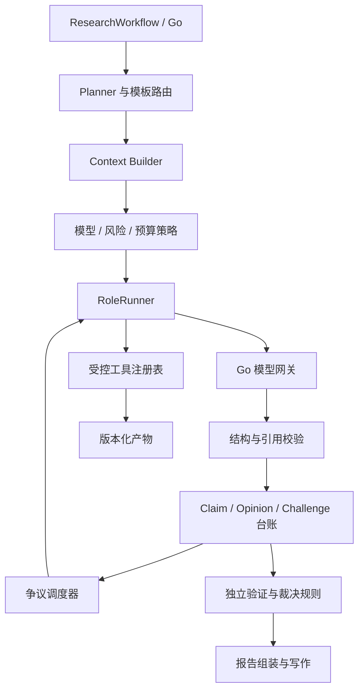
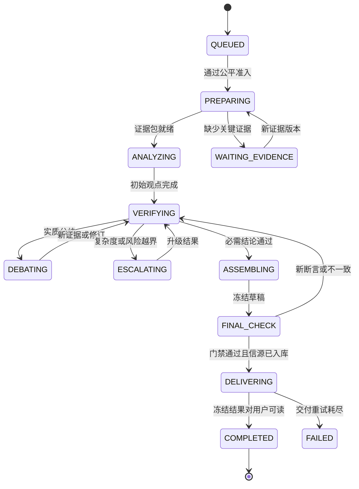
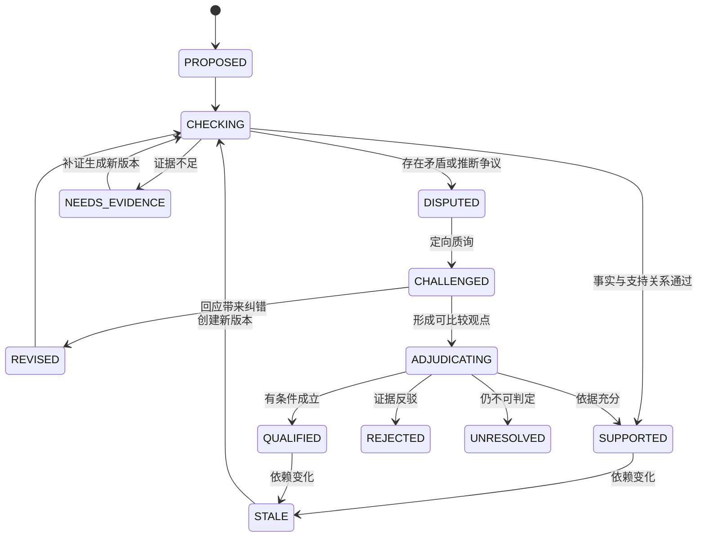
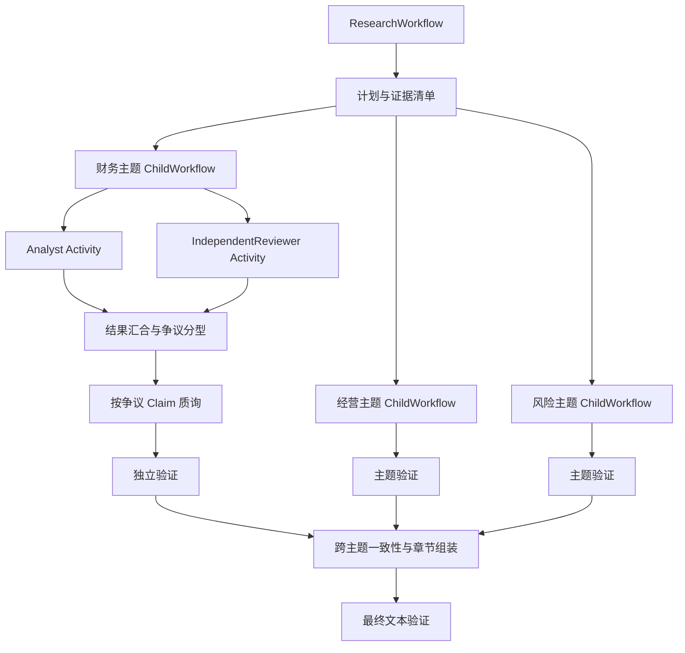
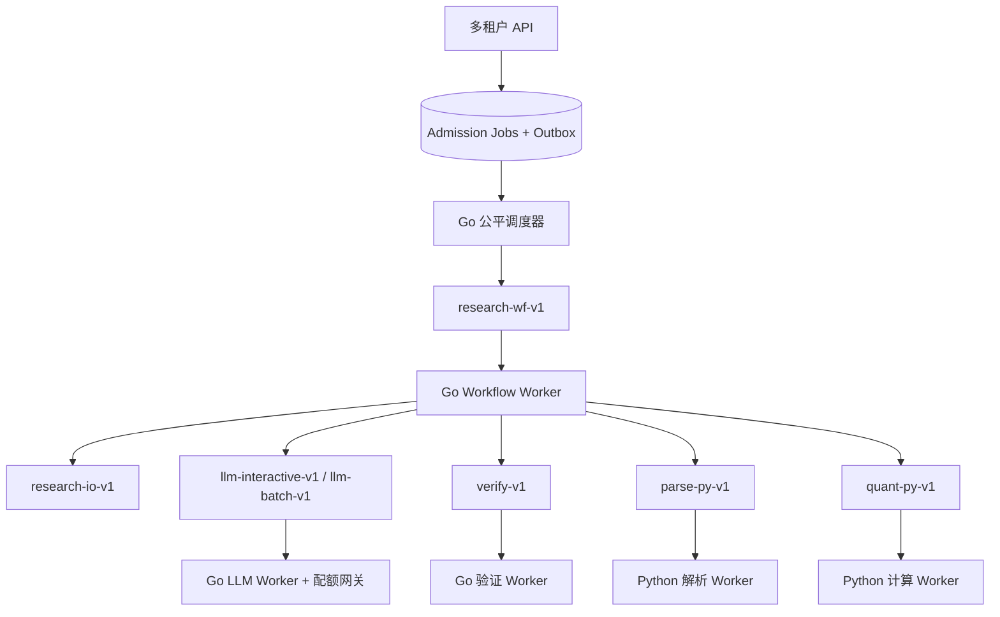
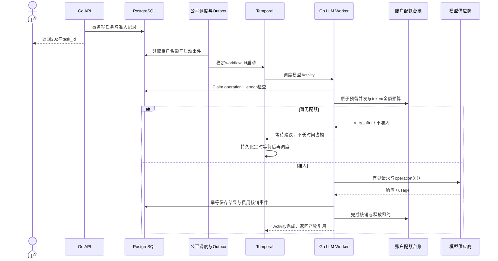
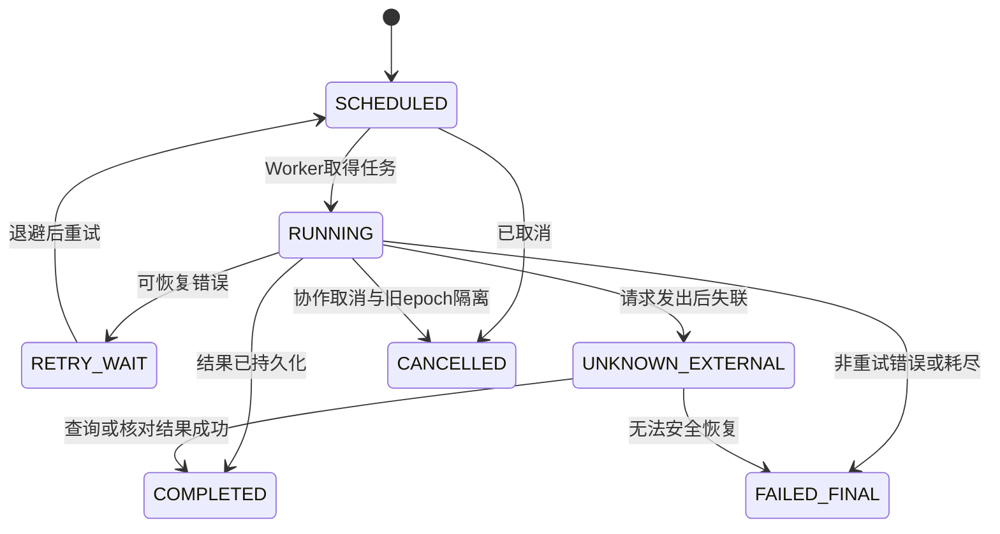

# 可信投研 Agent：研讨协议、异步执行与低成本模型可行性研究

> 范围更新（ADR-0003，2026-11-06）：首版为研报生成、个股分析、资金动向与自选股，由自建 Harness 在已接入数据上执行，调度使用 River。本文中的 Temporal、多角色研讨/投票、T2 路由、gRPC、Redis、向量检索、K8s 等设计均不是首版任务。当前规则见 [SPEC](../../SPEC.md)、[HARNESS](../HARNESS.md)、[DATA_SERVICE](../DATA_SERVICE.md) 与 [ADR-0003](../decisions/0003-product-harness-runtime.md)。

> **历史研究档案**：完整保留原文供溯源。当前首版以 [SPEC](../../SPEC.md) 和 [已冻结决定](../decisions/0001-p0-baseline.md) 为准；旧待确认表、机构内部定位、模型价格及后续阶段不直接作为上线配置。

> 版本：0.5.0 · 修订：2026-11-04 · 状态：设计草案，待实现与验证\
> 范围：Agent 协议、状态机、异步执行、多租户调度与模型成本实验。\
> [文档索引与统一约定](README.md)

## 阅读导航

| 研究问题 | 对应章节 |
| --- | --- |
| Flash 级模型承担多数任务是否可行 | 1–3、13–15 |
| 高质量数据如何进入上下文 | 4 |
| Agent 如何实现与研讨 | 5–8 |
| 状态机如何恢复、取消与处理分歧 | 6–9 |
| 消息队列、并行、多用户公平调度 | 9–12 |
| 研发与性能验收 | 15–16 |
| 采用的论文与官方文档 | 17–18 |

## 1. 结论与待验证假设

**建议采用“高质量证据包 + 确定性工具 + Flash 级模型为主 + 按争议触发研讨 + 按风险升级”的方案。** 可行性较高的部分是事实抽取、标准财务解读、引用组织和限定模板写作；复杂会计判断、跨行业因果推断、开放式预测和高风险合规判断需自动升级模型；仍不能解决时输出明确限制或弃权。

这是一项系统工程假设，不是“多个较便宜模型一定等于一个更强模型”的结论。数据治理降低知识检索与上下文理解负担，工具替代算术，状态机降低规划难度；研讨只有在产生新证据、发现错误或补充替代解释时才可能带来额外收益。[P1][P2][P3][P4]

“多数任务”必须同时报告以下指标，不能靠大量简单调用冲高比例：

- `flash_call_share`：Flash 级调用数 / 全部模型调用数。
- `flash_only_report_share`：无需更高能力模型即可完成的报告数 / 全部进入研究流程的报告数。
- `eligible_task_success_rate`：预定义适用任务中达到质量要求的任务比例。
- 另行报告强模型升级率、弃权率、自动修订率和最终错误率。

可以将“适用任务中 70%–85% 无需强模型升级”设置为产品假设，但不能当作现有证据支持的预测。是否成立由生产任务分布和第 15 节实验决定；若质量不达标，应降低覆盖率，不能放宽证据要求。

## 2. 研究证据与局限

| 研究发现 | 工程启示 | 不可外推的结论 |
| --- | --- | --- |
| 多 Agent 的收益有时主要来自独立采样和投票，而不是讨论本身。[P1] | 必须把“独立多样本”和“有讨论”分开做实验 | 不能据此断言所有研讨无效 |
| 竞争与追求共识可能诱发误导或过早一致，协议设计影响结果。[P2] | 只奖励证据与纠错，不奖励说服其他 Agent | 不能承诺改协议即消除幻觉 |
| 模型路由和级联具有成本优化潜力。[P3][P4] | 先用便宜模型，对难例升级 | 通用任务节省比例不能套用到 A 股研报 |
| 金融 RAG 的检索与重排质量影响回答效果。[P5] | 优先优化证据召回、口径与定位 | RAG QA 的结果不代表长篇研报合格 |
| 金融数值题需要表格、文本及计算程序。[P6] | 将数值推理转为可验证工具调用 | 工具计算正确不代表模型选对公式和输入 |
| 长上下文中的信息位置可能影响模型利用效果。[P7] | 控制上下文、保留关键注释并做排序消融 | 早期模型现象需在当前模型重新验证 |

未发现可直接证明“本系统 + DeepSeek-V4.1-Flash 可稳定完成大多数生产研报”的独立证据。本文提供支持该方向的机制与可复现实验，不给未经测量的准确率、吞吐或降本承诺。

## 3. DeepSeek-V4.1-Flash 基准与模型选择

### 3.1 官方资料快照

2026-11-03 的研究快照记录：`deepseek-flash` 对应 **DeepSeek-V4.1-Flash-1017**，支持结构化输出与工具调用。以下为该日美元/百万 token 标价快照，不是合同价格：[D1]

| Flash 计费项 | 非高峰 | 高峰 |
| --- | --- | --- |
| 输入缓存命中 | 0.003 | 0.006 |
| 输入缓存未命中 | 0.15 | 0.30 |
| 输出 | 0.60 | 1.20 |

官方限流文档按账户统计并发，而非每个 API Key 独立计数；`user_id` 可用于用户隔离，但不会自动增加账户总并发额度。容量设计使用实测可用配额和合同条件，不能直接把官方上限当成本服务可持续吞吐。[D2]

官方发布说明与当前价格页对 Pro 的服务映射存在时间性差异：发布说明曾描述 Pro 请求转到 Flash，而价格页仍列有 Pro 版本。**不能仅根据 `pro` 名称把它当作更强或独立的升级模型。** 应记录请求别名、响应模型字段、供应商版本信息及评测日期；如无法固定版本，标记 `provider_alias_unpinned` 并做漂移检测。[D1][D3]

“Flash 级”是基于本地金融评测的能力与成本等级，不等于小参数模型，也不意味着便宜模型适合所有任务。未核验的供应商宣传分数不进入本产品质量承诺。

### 3.2 模型层级

| 层级 | 实现 | 适用场景 | 升级条件 |
| --- | --- | --- | --- |
| T0 | Go SQL、模板、规则与计算 | 指标读取、比率、引用存在性、时点检查 | 需语义理解时转 T1 |
| T1 | 经本地评测的 Flash 级模型 | 证据抽取、标准解读、短文本写作、限定质询 | 证据充分但推理反复失败，或风险/复杂度越界 |
| T2 | 经评测确有增益的更高能力模型 | 多跳解释、会计口径争议、复杂反证与裁决 | 仍缺依据或风险不可接受时自动受限输出、弃权或阻断 |

缺数据先补证，解析失败先修数据，计算失败先修工具；不能把所有错误都送给更强模型。即使全部 Agent 同意，重大证据缺失仍阻断。

<a id="agent-context"></a>

## 4. 角色上下文与证据更新

### 4.1 读取契约

ContextBuilder 消费治理服务已冻结的 TaskDataset。字段、示例、编译和缺证规则统一见 [ContextPack 契约](financial-research-data-governance-design.md#context-pack-contract)，缓存和权限读取见数据治理 §11.4。角色输出只引用已有证据版本，新增材料先进入治理流程。

### 4.2 角色可见性与更新

1. 根据当前 Claim 或子问题请求证据包，不默认读取全部财报和研讨历史。
2. 角色共享必需事实与关键反证，并保留独立检索空间；初始轮无法读取其他角色的答案。
3. 角色发现缺证时提交需求增量。新 pack 就绪后，仅重跑依赖变化的 Claim；最终仍检查跨 Claim 和跨章节一致性。
4. 保留每次角色运行使用的 pack 引用、哈希、提示和模型版本，支持核查独立提交与后续修订。

### 4.3 上下文预算建议

以下为首轮实验配置，不是模型能力上限：普通 Claim/章节输入目标 4k–12k token、结构化输出上限 0.5k–1.5k；写作按章节单独设限。使用目标模型 tokenizer 或供应商 usage 校准估计值，不能用中文字数代替 token 数。生产参数在决策表 Q-19 登记。

提示结构：稳定的安全与角色约束 → 任务格式 → 证据及口径 → 本轮问题与增量。独立性要求优先于缓存复用，不为命中缓存拼入其他 Agent 的初始答案。

## 5. Agent 模块内部实现



### 5.1 Go 组件职责

| 组件 | 输入与输出 | 实现边界 |
| --- | --- | --- |
| Planner | 问题 → 模板、子问题 DAG、必需证据 | 标准任务先规则匹配；仅复杂任务调用 LLM 规划，计划需 Go 校验 |
| ContextBuilder | 子问题 + 访问策略 → EvidencePackRef | 无任意外网权限；执行第 4 节规则 |
| RoleRunner | AgentStep → Opinion/ToolRequest | 角色是配置与函数，不是永久独占进程 |
| ModelGateway | ModelRequest → 结构化结果、usage、版本 | 超时、全局配额、预算预留、审计；普通模型请求用 Go HTTP |
| ToolRegistry | tool_id + schema + arguments | 允许列表；租户、用途、时点及预算校验；禁止模型生成任意 SQL |
| DebateCoordinator | ClaimSet → 争议簇、质询任务 | 只调度存在实质分歧的 Claim |
| DecisionPolicy | 已验证证据与 Opinions → Verdict | Go 执行硬性检查；LLM 仅提出判定建议 |
| ClaimStore | 版本化 Claim/Opinion/Challenge | 追加版本、幂等提交与审计；不互相覆盖角色答案 |

建议接口形态（设计示例，不是可直接编译的完整实现）：

```go
// Activity 内的领域接口；Workflow 不直接调用数据库或模型。
type RoleRunner interface {
    Run(ctx context.Context, step AgentStep) (AgentStepResult, error)
}
type ModelGateway interface {
    Generate(ctx context.Context, req ModelRequest) (ModelResult, error)
}
type DecisionPolicy interface {
    Evaluate(snapshot VerifiedClaimSnapshot) Verdict
}
```

### 5.2 角色与可见性

| 角色 | 默认层级 | 初始可见信息 | 输出 |
| --- | --- | --- | --- |
| Analyst | T1 | 公共事实包、自有检索 | 原子 Claim、证据、假设、反例条件 |
| IndependentReviewer | T1 | 同一问题与证据；不可见 Analyst 初稿 | 独立结论与缺证清单 |
| CounterEvidence | T1 + 检索工具 | 独立轮后可见待质询 Claim | 具体反例、竞争解释、补证请求 |
| QuantTool | T0 / Python 适配 | 预审模板和输入版本 | 计算结果、容差与运行记录，不投观点票 |
| Adjudicator | T1 或 T2 | 已验证观点、证据差异 | 接受/修订/弃权建议，不直接放行 |
| Writer | T1 | 已通过自动校验的 Claim 及其限定词 | 带 Claim 映射的章节 |
| Verifier | T0 + 经评测的语义模型/Jev | 最终文本与原始证据 | 独立检查结果，不参与共识激励 |

相同模型扮演不同角色只形成不同提示条件，不构成统计独立。高风险争议优先考虑不同模型家族、独立证据和自动复算/交叉验证，而不是复制相同 Agent 增加票数。

### 5.3 角色运行循环与路由契约

一个角色步骤按以下有限循环执行：构建角色输入 → 获取模型配额 → 调用模型 → 校验响应 → 如需工具则校验工具参数并提交独立工具 Activity → 使用工具产物引用构建下一步 → 返回最终 Opinion。模型单次输出结束不意味着角色已完成，出现 `tool_call` 或输出截断时不能把中间响应当最终结论。

- 示例 `max_tool_steps=3`、`max_format_repairs=1`，与总 token/费用/时限共同生效；生产值由实验确定。
- 模型只能请求登记的只读检索、指标和预审计算模板。工具调用 ID 纳入 operation 关联，工具结果未经校验不能写入事实包。
- 每次模型调用是独立 Activity 步骤，工具调用由 Workflow/Go 调度，避免把无法恢复的无限工具循环隐藏在一个长 Activity 中。
- RoleRunner 的 system 模板规定证据边界、未知时弃权、输出 schema 和引用要求；角色提示、工具 schema、模型模式与路由版本一并冻结。
- 模型路由输入包含任务类别、风险等级、证据完整度、口径冲突数、必需推理步骤、历史同类失败率与剩余预算；不得只根据自报置信度路由。
- 首版路由采用可审计规则；积累人工标注后再评估学习式路由。训练/评估数据分离，记录每次升级原因。
- 降级到其他供应商前重查数据处理许可。供应商更换不意味着更强模型；更强层级须以该任务类型的盲测增益定义。

## 6. 研究任务状态机

图展示正常路径与可恢复循环；取消、权限失败、预算耗尽等通用出口集中列在 §6.1，避免从每个节点重复画线。

任务状态、Claim 状态和 Activity 尝试状态分开，避免把“API 请求成功”误当作“研报可发布”。任务状态由 Go 命令校验器和 Temporal 协调；数据库提供可查询投影，事件序号与 task revision 保证单调更新。



`DELIVERING` 自动执行后端交付操作，`COMPLETED` 表示结果已供授权用户读取。交付类型为 full 或 limited；limited 只允许模板明确可缺失的可选项，必需结论缺证必须弃权。通知送达单独记录，不阻塞已可读取结果。

### 6.1 转移守卫与异常出口

| 当前状态 / 事件 | 守卫与动作 | 下一状态 |
| --- | --- | --- |
| QUEUED / admit | 原子预留租户在途任务名额及预算；生成 execution epoch | PREPARING |
| PREPARING / missing | 记录缺证与可补充来源，不调用模型猜测 | WAITING_EVIDENCE |
| WAITING_EVIDENCE / deadline | 到达已配置研究时限 | ABSTAINED，保留诊断草稿 |
| ANALYZING / role_finished | 必需角色全部完成或达到预定义降级条件；角色技术失败不当作弃权票 | VERIFYING 或 FAILED（自动返回原因） |
| VERIFYING / conflict | 至少一条可定位证据或解释冲突；存在轮次与预算 | DEBATING |
| VERIFYING / budget_limit | 不再启动模型调用，固化已有结果 | BUDGET_EXHAUSTED |
| DEBATING / no_progress | 没有新证据、纠错或可验证替代解释 | ESCALATING 或 ABSTAINED |
| FINAL_CHECK / passed | 必需 Claim 通过，引用、权限、版本有效且来源/门禁已入库 | DELIVERING |
| DELIVERING / committed | 幂等交付事务提交，结果对授权用户可读 | COMPLETED |
| DELIVERING / exhausted | 自动交付重试耗尽 | FAILED，返回交付失败原因 |
| 任意活动态 / cancel | 撤销 epoch 的提交资格、取消子任务、回收资源 | CANCEL_REQUESTED → CANCELLED |
| 任意活动态 / deadline | 停止新增操作，保留已核验产物并标记研究时限耗尽 | ABSTAINED |
| 任意活动态 / policy_violation | 数据授权失效、越权工具请求等 | BLOCKED |
| 任意活动态 / retry_exhausted | 系统错误重试耗尽，记录原因 | FAILED |

终态包括 COMPLETED、ABSTAINED、BUDGET_EXHAUSTED、CANCELLED、BLOCKED、FAILED。自动修复或用户主动发起的新任务通过新 revision/执行 epoch 记录，不能悄悄改写已结束运行。部分非关键 Claim 缺失可按模板输出明确“未覆盖”，关键 Claim 缺失不能进入 DELIVERING。

### 6.2 事件与并发控制

- 每个事件有 `event_id`、`task_id`、`expected_revision`、`epoch`、`event_type`、`payload_ref`、`occurred_at`。
- 外部取消和新增研究请求通过 Go API 鉴权；系统补证与门禁事件用服务身份鉴权，以事务写事件与 Outbox，再通知 Workflow；重复信号按事件 ID 去重。
- 不用 Temporal Query 修改状态，也不直接相信客户端提交的“验证通过”。
- 同一任务只允许当前 epoch 提交权威结果；数据库条件更新检查 revision/epoch，拒绝过期完成消息。
- Activity 成功但 Workflow 尚未收到结果时，重试读取已完成的幂等结果并返回；恢复不重做所有工作。
- 权限变化在取证、每次外部发送和发布前重查；旧权限快照用于审计，不能绕过撤权。

## 7. 多 Agent 研讨与 Claim 状态机

### 7.1 三条执行路径

| 路径 | 触发 | 流程 | 预算策略 |
| --- | --- | --- | --- |
| FAST | 已通过离线测试的低复杂度模板、证据齐全 | Analyst → 确定性检查 → 独立语义核验 → 写作 | 不强制辩论；关键结论仍自动校验 |
| STANDARD | 需要分析推断，存在替代解释 | 两个独立观点并行 → 对齐 → 只质询争议 → 裁决 | 示例最多 2 轮定向研讨 |
| DEEP | 高风险、复杂口径或 STANDARD 未解决 | 重新补证/复算 → T2 定向判断；仍无解则自动弃权 | 单独预算与较长时限，不能无限循环 |

一份报告可混合三种路径。稳定财务事实直接 FAST，只有盈利驱动或估值假设等争议 Claim 进入 STANDARD/DEEP。



预算、取消或任务终止时，未完成 Claim 标记 UNRESOLVED 并记录原因；不能因为其他 Claim 通过而自动通过。SUPPORTED 表示当前证据支持，不是未来结果已被证明；预测使用 QUALIFIED 并包含情景与失效条件。

<a id="claim-contract"></a>

Claim 契约示例：

```json
{
  "claim_id": "C123",
  "version": 1,
  "type": "inference",
  "text": "利润率改善可能主要来自产品结构变化",
  "as_of": "2026-11-03T00:00:00+08:00",
  "supporting_evidence": ["E101@1", "E102@1"],
  "opposing_evidence": ["E108@1"],
  "assumptions": ["产品分类口径保持一致"],
  "invalidation_conditions": ["产品分类发生重大调整"],
  "calculation_run_ids": ["R31"],
  "status": "CHECKING"
}
```

上例是虚构结构示例，不代表真实公司分析。类型至少包含 `fact`、`calculation`、`inference`、`forecast`。

### 7.2 研讨消息契约

```json
{
  "schema_version": "debate_message.v1",
  "message_id": "MSG-example",
  "task_id": "TASK-example",
  "epoch": 1,
  "claim_ref": "C-margin@1",
  "round": 1,
  "author_role": "counter_evidence",
  "kind": "challenge",
  "target_message_id": "OPINION-example",
  "stance": "insufficient",
  "evidence_refs": ["E2@1"],
  "calculation_refs": [],
  "issue_code": "CAUSAL_ATTRIBUTION_UNSUPPORTED",
  "rationale": "现有证据不足以排除原材料成本变化的影响。",
  "requested_action": "retrieve_cost_disclosure",
  "model_run_id": "RUN-example"
}
```

- `kind` 限定为 proposal/challenge/response/revision/verdict；`stance` 为 support/refute/insufficient/conditional。
- 简明理由必须绑定证据或明确的缺证项；纯修辞不触发新一轮。
- 提交前校验 evidence_ref 在当前授权证据集中，且引用版本与 Claim 一致。
- 记录可审计的判断依据，不要求模型披露隐藏内部推理链。

### 7.3 轮次协议与终止条件

1. **R0 独立提交**：Analyst 与 IndependentReviewer 并行；直到各自提交完成，不能互看输出。
2. **Claim 对齐**：Go 按主体、指标、期间和类型对齐；语义模型只建议匹配，无法可靠对齐时保留为不同 Claim。
3. **分歧分型**：事实冲突送数据服务；数值冲突送计算；解释冲突进入研讨；风险规则冲突送独立自动策略校验。
4. **R1 定向质询**：CounterEvidence 只收到争议点及必要上下文，提出可验证问题；不让所有 Agent 阅读全量聊天。
5. **补证与回应**：工具生成新证据版本，角色仅更新受影响观点；保留原始意见。
6. **裁决**：先执行硬性检查，再处理权重与限定条件；事实冲突未解不能通过。
7. **R2 可选**：仅在新证据或新反例带来信息增量时继续；否则升级或弃权。
8. **停止**：已解决、无信息增量、达到轮次/token/金额/时限、取消、权限失效，任一满足即停止对应路径。

“观点越来越一致”不构成信息增量；同源证据换措辞不构成新增证据。对核心结论的反证未解决时，即使大多数票赞成也不能接受。

### 7.4 权重聚合的可实施方案

事实与计算不投票。推断的加权意见仅作为裁决辅助，权重配置来自同类任务的留出评测，而非 Agent 自报置信度。

```text
对 Claim c：
  group = 已识别的模型家族与证据依赖组
  base_weight_i = 角色在该任务类型的校准可靠性 × 证据适配质量
  adjusted_weight_i = base_weight_i 经相关组上限归一化
  support_ratio = Σ支持意见 adjusted_weight / Σ有效意见 adjusted_weight
```

- 相同模型家族与同源证据分别设上限；仅按两者组合分组会漏掉跨组相关性，因此同时检查两种相关轴。相关性无法完全消除，最终比例不是正确概率。
- `insufficient` 计入弃权/覆盖统计，不伪装成反对票或消失；需要最小有效覆盖及关键反证处理要求。
- `conditional` 不折算成无条件支持，转为带条件结论。
- 权重不足、无历史校准样本时，使用显式证据裁决与自动交叉验证；不足时弃权，不输出虚假精确分数。
- 少数意见附高等级反证时触发确定性交叉验证；任何数值比例不能覆盖引用错误、计算失败或合规阻断。

### 7.5 工作示例

若 Analyst 判断“毛利率提升主要由高端产品占比增长驱动”，独立 Reviewer 指出同期材料价格下降，则系统先确认两期毛利率和产品结构，再定向查找成本与价格披露。若无法识别两者贡献，最终写为“产品结构变化和成本因素可能共同影响毛利率，现有披露不足以分离贡献”，而不是以 2:1 投票写成确定因果结论。

## 8. Workflow 拆分与并行 DAG



- ChildWorkflow 按有限主题/章节拆分，不为每个句子创建一个工作流；Claim 以内存中可重放的有界任务集和持久化引用管理。
- 同一轮无依赖角色可并行；依赖前轮证据的回应必须等待，不为并发而破坏先后关系。
- `workflow.ExecuteActivity` 先提交一组 Future，再通过确定性 Selector/有界窗口等待；不能在循环内每提交一个立即 Get，导致意外串行。
- Go Workflow 使用 SDK 的确定性并发与时钟；网络、数据库、随机数、tokenization 和真实模型调用放 Activities。
- `max_parallel_topics`、`max_parallel_roles_per_task` 和全局配额共同限流；工作流内部上限不等于全局上限。
- 必需分支失败：重试/补证/终止；可选分支失败：明确降级说明。Fan-in 收齐预期分支状态，不能把超时省略为成功。
- 角色 Activity 不共享可变会话；持久化按 `(task, epoch, topic, role, round, input_hash)` 幂等。
- 全文生成只在已验证主题上执行；不同章节之间的估值、单位、日期与限定词最后再对齐。
- 大型产物存对象存储，仅引用进 History。控制事件量，按主题边界规划 Continue-As-New；等待中的子工作流、信号和去重游标需先正确收束/传递，不自动跨 run 延续。
- 自动研究完成且门禁通过后直接调用交付 Activity。数据库中的可读结果与外部通知分离，通知重试不占用模型配额。

<a id="async-execution"></a>

## 9. 消息队列与异步任务协议

### 9.1 各类“队列”的职责

| 机制 | 职责 | 不承担的职责 |
| --- | --- | --- |
| PostgreSQL `admission_jobs` | 多租户准入、公平等待、优先级、预算与截止时间 | 不代替模型执行或 Workflow History |
| Transactional Outbox | 数据库提交与启动/通知 Workflow 的可靠桥接 | 不承诺外部消息恰好一次送达 |
| Temporal Workflow Task Queue | 调度短时、可重放的工作流决策 | 不运行耗时模型调用 |
| Temporal Activity Task Queue | 分发可重试的模型、计算、解析任务 | 不自动保证业务幂等或租户公平 |
| `failed_operations` 业务表 | 重试耗尽、非重试失败、自动重跑与故障诊断索引 | 不假装是 Temporal 通用死信队列 |
| 可选 Kafka 等 | 后续跨系统领域事件广播 | 首版不用于重复承载研究任务 |

Temporal Worker 通过轮询获取任务并向服务报告完成/失败。应用不自行实现 RabbitMQ 风格 ACK；应使用 SDK 的 Activity 完成协议，持久化业务副作用后再返回成功。[D5][D6]

### 9.2 队列拓扑

本节定义持久化异步调度。拆分服务之间的短请求另按 [RPC 契约](financial-research-rpc-contract.md) 实现。



`v1` 表示契约族，不是每次构建版本；Worker 构建升级使用既有版本管理策略。不同技能/语言的 Worker 只轮询自身完整注册的队列。队列按工作类型和有限服务等级划分，不按每个用户创建无限队列。涉及多个队列的同供应商请求仍共用账户配额。

### 9.3 调度时序



配额预留不能跨长事务等待外部 API；取得请求执行资格后尽快发起调用。预留租约到期与调用结果未知的特殊处理见第 10 节。

### 9.4 业务 Operation 状态与可靠性



这是业务 Operation 状态投影，不是逐字复制 Temporal SDK 内部枚举。Temporal 的 Activity 重试与业务 operation 保持关联；未知外部结果不能随意映射为“未调用”。

### 9.5 超时与重试规则

| 情况 | 处理 |
| --- | --- |
| Schedule-To-Start 过长 | 表示排队压力；监控并准入限流。该超时不靠原队列自动重试解决，不设置成极短值制造失败 |
| Start-To-Close 超时 | 单次执行上限；大于供应商 HTTP 总时限并留结果落库时间 |
| Schedule-To-Close 超时 | 整个 Activity 含排队和重试的总预算；不得突破任务剩余 deadline |
| Heartbeat 超时 | 长任务进度与故障检测；从已确认检查点恢复，不代表模型调用本身可以断点续传 |
| 429 / 可恢复 5xx | 尊重 Retry-After，有限退避并抖动；高压时由 Workflow Timer 等待而非 Worker 长睡眠 |
| 400 / 权限 / 无授权 | 非重试失败或阻断，不能换密钥绕过限制 |
| JSON/引用不合法 | 先本地验证；最多一次定向修复作为新模型步骤，不能用网络重试无限生成 |
| 模型内容错误 | 补证、复算、质询或升级，属于业务决策，不是基础设施重试 |
| 取消后响应到达 | 允许记录费用和诊断，但旧 epoch 无权提交有效 Claim 或恢复任务 |

超时含义参考 Temporal 官方说明；具体秒数根据输出长度和实测 P99 设置。[D7] 网络客户端与 Temporal 重试只保留一个主要重试责任层，避免 HTTP 三次 × SDK 三次 × Workflow 三次的放大。

<a id="operations"></a>

## 10. 幂等、外部请求不确定性与资源回收

### 10.1 Operation 台账

```text
AgentOperation
  operation_id, task_id, epoch, tenant_id, role, topic, round
  input_hash, evidence_pack_hash, policy_version, prompt_version
  model_route, request_alias, observed_model_version
  state, attempt, lease_owner, lease_expires_at, fencing_token
  provider_request_id, output_ref, output_hash
  usage_status, reserved_cost, actual_cost, error_class
```

唯一业务键包含 task/epoch/role/topic/round/input_hash；变更证据或模型策略必须产生新操作版本。已有完成结果可返回幂等缓存，不能重复记账。

### 10.2 关键故障窗口

| 崩溃位置 | 恢复策略 |
| --- | --- |
| 预留后、未发请求 | 经确定未发送后释放预留；过期租约由回收器处理 |
| 请求已发送、尚未获得响应 | 标记 UNKNOWN_EXTERNAL；优先供应商 request ID 查询；不默认立即重发 |
| 已有响应、结果未入库 | 若无法恢复响应，按配置允许有上限的重新调用，并计入潜在重复费用；不承诺远端恰好一次 |
| 结果已入库、Activity 完成通知丢失 | 重试读取同 operation_id 的结果并返回，不再次调用模型 |
| 租约过期但旧执行仍在运行 | 新执行使用递增 fencing_token；旧执行只能记诊断/费用，不能覆盖权威结果 |

模型供应商不提供幂等请求或结果查询时，系统只能保证业务提交幂等，不能保证只产生一次模型费用。对于已发出但状态不明的连接，保留不确定并发和费用预留到已知最大请求时长及安全缓冲后再核对；本地 HTTP 取消不必然终止远端计算。

每个模型尝试分别记录预留与核销，成功业务结果去重和实际外部费用核销使用不同键，避免将重复付费误删成“幂等零费用”。

租约获取/续租/释放原子执行。应用级 fencing 防止数据库旧写入，不能阻止供应商继续执行旧请求；因此要为未知外部调用预留容量余量并暴露监控。

### 10.3 停机与恢复

先移除 readiness 并停止接收新任务，Worker 停止轮询后在宽限期内完成短请求；长解析/计算记录心跳、取消子进程或交还任务。重启后校验台账与 Workflow 状态，回收孤儿产物与租约。终态任务的迟到结果不参与汇总。

<a id="fairness"></a>

## 11. 多租户公平调度与背压

### 11.1 两层公平性

1. **报告准入层**：每租户限制排队数、在途任务数与日预算；同一租户大批上传不能占满所有工作流。
2. **模型调用层**：每角色调用还需获得共享供应商并发、token/金额预算与租户配额。仅报告层公平不足以约束单报告大量 fan-out。

初版可用 PostgreSQL 保存准入队列与短租约；扩展后将高频配额放 Redis 原子脚本，但持久化账本、预算核销和审计保留数据库。Redis 故障时按策略暂停或保守降级，不绕过额度。

### 11.2 调度算法建议

采用按租户的加权 Deficit Round Robin：

- 每轮增加由服务等级决定的有限 credit，以预计调用成本/占用时间估算 job cost。
- 先选可运行租户，再选租户内截止时间与等待时间合适的任务；维护最大等待时间和 aging，防止批处理永久饥饿。
- 超大任务拆为有界主题批次，设置最大 job cost；不要等待积累无法达到的 credit。
- 活动租户占用借用空闲额度，但不能侵占其他租户已保留的最小份额；额度回收在下一个调度边界执行。
- 调度器多副本按租户分片或短租约选主，使用事务锁/版本检查防止重复分配；`SKIP LOCKED` 只是防竞争手段，本身不是公平算法。
- 调用层无额度时返回 `not_before` 并通过 Workflow Timer/去重通知等待；不在成千上万 Activity 中高频轮询配额。

交互任务与离线任务队列分开，并保留可配置批处理容量；允许非紧急任务选择低价时间，但不得擅自延后用户要求即时完成的任务。

### 11.3 扩容约束

```text
实际模型并发上限 = min(
  账户与服务合同允许并发,
  平台模型调用配额,
  所有副本可用Activity槽位,
  网络与连接容量,
  费用和token预算所允许的运行量
)
```

SDK 单 Worker 的并发参数只限制本进程，队列调度速率也不等于跨队列账户并发。配置 Worker 槽位、poller、任务速率时需使用所锁 SDK 的公开 `worker.Options`；不要直接 import SDK internal 包。优先监控 schedule-to-start 与全局 quota wait，区分“缺 Worker”和“供应商已满”。[D5][D8]

过载策略顺序：限制新准入 → 延后低优先级任务 → 缩减可选研讨 → 关闭不必要工具调用 → 明确拒绝或延迟；不跳过验证、权限、必要反证或自动检查。

## 12. 容量估算与性能优化

### 12.1 示例容量模型

下面数字仅演示估算：峰值新任务到达率 λ=1 份/秒，每份平均 8 次模型调用，每次平均占用 12 秒；模型调用的平均在途需求为：

```text
C_model ≈ λ × calls_per_report × average_call_seconds = 1 × 8 × 12 = 96
若按 70% 目标利用率规划：所需槽位 ≈ 96 / 0.70 = 138
每个 Go LLM Worker 上限 32 个槽位：至少 ceil(138 / 32) = 5 个副本
```

这只估算模型调用层，尚未计入重试、T2、检索、供应商抖动及相关峰值。假设平台允许 160 个模型在途调用，按 70% 利用率计算的稳定任务吞吐约 `160 × 0.7 / (8 × 12) = 1.17 份/秒`。不能据此承诺 1.17 份/秒实际研报产能。

若平均研究等待与执行时间为 90 秒，Little 定律下平均在途研究任务约 90 份；这不等于 90 个注册用户，也不等于 API 能承接的浏览连接数。分别压测登录/浏览、任务提交、研究执行和供应商调用。

报告关键路径近似为：

```text
准入等待 + 取证时间 + Σ各依赖阶段最大并行分支耗时
+ 分支排队 + 研讨串行轮次 + 最终验证/组装
```

并行可以缩短同轮墙钟时间，但不会自动减少 token 或总费用；供应商额度不足时，增加并行甚至加重尾延迟。

### 12.2 优化优先级

| 优先级 | 优化 | 正确性约束 |
| --- | --- | --- |
| 1 | 公共数据预采集、指标 SQL 化、同版本证据复用 | 使用时重新验证访问与截止时点 |
| 2 | 按问题构建短证据包与固定计算模板 | 不删除关键脚注和反证 |
| 3 | 只重算变更依赖、只研讨争议 Claim | 最后检查跨章节一致性 |
| 4 | 同轮独立角色并行、角色数与输出上限有界 | 不泄漏初始观点影响独立性 |
| 5 | 取消过期操作、复用 HTTP 连接、限制 JSON/文件内存 | 费用和迟到结果仍留痕 |
| 6 | 模型级联、前缀缓存、离线错峰 | 授权隔离、真实命中率、非紧急任务限定 |
| 7 | Go CPU/RSS/GC profiling、按队列扩容 | 无瓶颈证据时不做复杂微优化 |

不能跨租户复用未经授权的证据包、模型答案或 Agent 记忆。应用缓存键至少包含 tenant/access-policy/as_of/evidence-hash/prompt/model-policy；权限撤销时失效。共享公开原文存储可去重，但逻辑授权必须独立。

### 12.3 观测指标

- 各阶段排队时间与执行 P50/P95/P99、在途任务、旧任务年龄。
- 每租户等待分布、饥饿事件、预算拒绝与配额等待。
- 每模型真实版本、TTFT、完整响应时间、输入/输出/缓存 token、失败重试和金额。
- 每 Claim 研讨轮次、信息增量、升级原因、意见变化与反证解决情况。
- Worker 活跃槽位、goroutine、CPU/RSS、数据库池等待、对象传输量。
- 单位合格报告成本，包含失败/弃权任务摊销；不能只看成功调用 token 单价。

指标标签避免 tenant_id/task_id/claim_id 等无界高基数；详细维度进入访问受控的日志/分析表。跨语言 trace 使用受控关联 ID，不把完整财报或用户私密提示写入普通日志。

## 13. Token、缓存与成本模型

### 13.1 成本公式

```text
每次模型费用 = (未命中输入token × 输入价
              + 命中输入token × 缓存价
              + 输出计费token × 输出价) / 1,000,000
每份任务费用 = 所有尝试模型费用 + 检索/重排/解析/计算费用
              + 数据许可摊销 + 运行维护摊销
单位合格报告成本 = 全部研究任务成本 / 达到质量要求的报告数
```

输出计费按供应商实际 usage，包含其规则下的推理 token；不要只统计最终展示文本。金额、币种、价格版本、调用时间和未知费用分别留存。

### 13.2 纯 token 算例

使用第 3 节 Flash 高峰价格、假设全部输入未命中缓存，以下工作量是假设，不是实测：

| 工作流 | 整个任务累计输入 | 累计输出 | 模型费用 |
| --- | --- | --- | --- |
| 单 Agent 基线 | 24,000 | 4,000 | 0.012 美元 |
| 结构化证据 + 按需检查 | 16,000 | 3,000 | 0.0084 美元 |
| 对所有 Claim 全量研讨 | 48,000 | 7,000 | 0.0228 美元 |

第二行相对第一行少 30% 模型费用，第三行比第一行多 90%；这些只说明算术与预算关系，不能证明真实系统降本或质量持平。还需计入重排、额外验证、升级和失败重试。

### 13.3 升级模型的盈亏条件

设 Flash 路径平均成本为 `C_F`，升级后的新增成本为 `C_E`，升级概率为 `p`，路由与验证成本为 `C_R`：

```text
E[C_cascade] = C_F + p × C_E + C_R
比直接强模型路径 C_S 更便宜的条件：
    C_F + p × C_E + C_R < C_S
```

实际质量需同时满足门禁；高升级率会同时增加串行耗时和成本。T2 应只重做困难 Claim，并复用已验证产物，但必须给足上下文，不能因省 token 隐去争议。

### 13.4 缓存策略

稳定公共提示和同任务证据包前缀有利于供应商缓存，但缓存命中依赖已持久化前缀和匹配规则。并行首轮不保证互相命中，预算按未命中预留，再按 usage 核销。[D4]

应用结果缓存与供应商 KV 缓存分别统计。不能为了命中而保留无关长历史、弱化隐私隔离或使用过期证据。供应商的用户隔离参数采用不可逆业务标识，不携带手机号等个人信息，并核验隔离行为。[D2]

非思考模式、思考模式与不同输出限额应独立评测。适合抽取的模式未必适合因果归因；不要将统一“关闭思考”作为默认降本手段。

## 14. 可行性分层评估

| 任务类别 | Flash 级适用判断 | 前提 | 主要风险与升级信号 |
| --- | --- | --- | --- |
| 已知指标查询 | 高；大量可直接 T0 | 主体、期间与单位确定 | 口径缺失、重述冲突 |
| 标准财报摘要与同比解读 | 较高，待本地验证 | 证据表和模板、数值工具 | 将关联写成原因、遗漏限定条件 |
| 单文档事实抽取与引用 | 较高，待解析质量验证 | 原文定位、结构化校验 | OCR 错误、表格脚注遗漏 |
| 跨期经营变化解释 | 中等 | 结构化对比、反证与限定词 | 证据不充分、复杂会计调整 |
| 行业比较与估值假设 | 中等或偏低 | 同口径可比样本、情景工具 | 可比性差、隐含因果与假设敏感 |
| 复杂资本结构、跨市场政策解读 | 低至不确定 | 专家知识与专门规则 | 多跳规则冲突、重大误判风险 |
| 投资评级、开放式预测 | 不宜仅靠 Flash 级共识 | 明确假设与失效条件，无法验证时自动限定或弃权 | 未来不确定性不能用投票消除 |
| 输出策略门禁 | Go 服务自动执行，不由模型单独放行 | 已配置规则、用途权限与信源入库状态 | 不满足或无法判定时自动阻断，不进入人员批准流程 |

可降低的是开放式检索、算术、长文定位和全局规划要求；仍无法消除证据选择偏差、因果识别、跨领域知识以及判断“不知道”的要求。高质量证据包如果漏掉关键反证，反而可能让所有模型一致地得出错误结论。

## 15. 验证“多数任务用 Flash”的实验方案

### 15.1 数据集与标注

使用公开金融 QA 数据集作为辅助基准，主验收使用获得授权的中文 A 股真实任务。FinQA 可测试表格/文本数值推理，但不代表本地研报完整质量。[P6]

按主体、披露时间、行业与报告类型划分训练/调参/盲测集，避免同公告切片跨集合。标注 Claim 事实、支持/反证位置、计算程序、是否应弃权和任务风险；关键案例由至少两名合格评审独立标注，记录分歧与裁决。规模由目标错误率和置信区间需求决定，不凭固定样本数宣称充分。

加入：财报重述、相似公司混淆、累计/单季混淆、单位错误、缺脚注、同源转载、时点泄漏、提示注入、无解任务、强反证，以及“多个角色都犯同一错误”的案例。

### 15.2 对照与消融

| 组别 | 配置 | 目的 |
| --- | --- | --- |
| A | T2 单 Agent + 原始检索 + 相同安全检查 | 建立当前较强路径参考，不作为唯一金标准 |
| B | T1 单 Agent + 原始检索 + 相同门禁 | 测模型层级差距 |
| C | T1 + 高质量证据包 + 确定性工具 | 测数据与工具的主要收益 |
| D | C + 独立多样本聚合、不讨论 | 分离集成收益 |
| E | C + 本文按需研讨 | 测讨论的额外收益 |
| F | E + T2 定向升级 | 测质量覆盖与总成本折中 |
| G | T2 + 与 C 相同证据包和工具 | 防止用差检索强模型制造不公平比较 |

同时做等金额预算和等延迟预算比较；记录实际调用数与 token，不能只用“相同 Agent 数”声称公平。单独消融反证保留、上下文长度、模型家族多样性、缓存、思考模式与 Jev，避免把所有收益归到多 Agent。

### 15.3 质量、速度与成本联合门禁

- 关键事实错误率、引用真实支持率、计算正确率与时间泄漏率。
- 风险加权错误放行率、应弃权任务识别率、覆盖率—风险曲线。
- 报告级 Flash-only 比例、升级比例、自动修订量。
- 端到端 P95/P99、等待时间、单份合格报告成本及重试摊销。
- 按任务类型、行业、难度分别报告，防止整体均值掩盖高风险失败。

预先定义相对于质量目标的非劣界限 `δ`，并报告统计置信区间。若想验证非常低的错误率，零错误也不等于零风险：独立同分布近似下，n 次试验零失败的 95% 上界约为 `3/n`；金融同公司/同模板样本相关，应按公司/报告聚类估计，不能把同报告数十条 Claim 当作独立样本。

T2 输出不是真值；关键质量评分以证据核查和人工标注为准。模型评审可做辅助，不能只由同一个模型家族给自己打分。

### 15.4 上线步骤

离线盲测 → 影子运行（不改变正式输出）→ 小范围内部使用 → 按任务类型灰度扩大。先开放证据清楚的模板任务，全自动验证并留证后直接交付；模型别名漂移、数据源更改或错误放行上升触发回归和路由回退。

只有在预定义质量要求通过、合格报告成本下降且覆盖率达到目标后，才宣布“多数适用任务可使用 Flash 级模型”。否则调整适用范围或提高模型层级，不以降低自动质量标准达成比例。

## 16. 实施拆解与验收

A1–A5 的交付和产品阶段映射见 [统一实施计划](financial-research-decisions.md#phases)。基本预算、台账、恢复和上线压测属于 P0；研讨和模型优化按 P1 实验启用。以下保留模块验收清单。

### 16.1 验收清单

- [ ] AG-01：初始独立角色无法读取彼此草稿，研讨阶段才开放指定消息。
- [ ] AG-02：事实冲突不由投票解决；关键反证未处理时不能通过。
- [ ] AG-03：轮次、调用数、token、金额和 wall-clock 均有上限。
- [ ] AG-04：角色技术失败不计作有效弃权或默许票。
- [ ] AG-05：无进展自动升级或弃权，不循环复述。
- [ ] AG-06：取消后迟到响应无法恢复任务或覆盖有效 Claim。
- [ ] AG-07：Activity 在结果落库后崩溃，重试不会重复调用已完成模型操作。
- [ ] AG-08：外部调用未知时显式记录不确定费用，不虚报恰好一次。
- [ ] AG-09：同租户洪峰不导致其他租户长期饥饿；多副本预算不超售。
- [ ] AG-10：全局账户配额不因多个 API Key、队列或 Worker 副本而突破。
- [ ] AG-11：模型 429、慢 SQL、对象存储故障与 Worker 重启时背压和恢复有效。
- [ ] AG-12：证据更新只重跑必要依赖，但最终跨章节检查仍执行。
- [ ] AG-13：写作新增断言重新验证，信源和门禁入库后直接交付；不存在人员等待状态。
- [ ] AG-14：模型切换、旧 Workflow 重放、Go/Python 契约升级通过 CI。
- [ ] AG-15：所有模型调用记录版本、输入摘要、实际 usage、价格版本及策略版本。
- [ ] AG-16：公平调度、延迟、吞吐、资源、成本与风险指标均在实际目标负载下验证。
- [ ] AG-17：Flash-only 比例在盲测任务分布上报告，并同时披露错误、弃权和升级情况。
- [ ] AG-18：全流程不需要人工 signal；验证通过自动交付，补证/升级耗尽自动弃权，所有等待态有 deadline 与终态出口。

并发测试至少包含稳态、突发、持续运行、单租户滥占、供应商限流与节点故障；测试使用模拟供应商验证系统极限，再用受控真实 API 测量模型服务尾延迟，不能将二者混为生产容量。

## 17. 论文参考与阅读建议

以下列出实际用于本方案判断的论文。前序研究已核对入口页、作者与摘要状态；本文不是对所有论文实验代码的复现，也不声称已完整审查所有补充材料。建议阅读顺序：P1/P2 → P3/P4 → P5/P6/P7。

### P1. Debate or Vote: Which Yields Better Decisions in Multi-Agent Large Language Models?

- 作者：Hyeong Kyu Choi、Xiaojin Zhu、Sharon Li。
- 年份/状态：2025；页面标注 NeurIPS 2025 Spotlight，arXiv v2。
- [论文页面](https://arxiv.org/abs/2508.17536) · [PDF](https://arxiv.org/pdf/2508.17536)
- 用途：将独立投票与讨论分开评估，支持 D/E 消融组。
- 局限：其基准和理论条件不等于金融研报；不据此证明所有讨论无效。

### P2. When and Why Does Multi-Agent Debate Fail and Does It Really Underperform?

- 作者：Yongqiang Chen、Gang Niu、James Cheng、Bo Han、Masashi Sugiyama。
- 年份/状态：2025 首发，2026-07-14 v2；页面注明预印本、持续研究。
- [论文页面](https://arxiv.org/abs/2510.20963) · [PDF](https://arxiv.org/pdf/2510.20963)
- 用途：设计围绕证据和纠错的协作协议，避免竞争式胜负与强制共识。
- 局限：协议改进仍需在本地数据验证；不直接采用其收益百分比做产品预测。

### P3. RouteLLM: Learning to Route LLMs with Preference Data

- 作者：Isaac Ong、Amjad Almahairi、Vincent Wu、Wei-Lin Chiang、Tianhao Wu、Joseph E. Gonzalez、M Waleed Kadous、Ion Stoica。
- 年份/状态：2024 首发，2025-02-23 v4。
- [论文页面](https://arxiv.org/abs/2406.18665) · [PDF](https://arxiv.org/pdf/2406.18665)
- 用途：按任务选择模型层级，优化质量与成本折中。
- 局限：人类偏好与金融事实正确性不是同一目标，需要重新标注和校准路由。

### P4. FrugalGPT: How to Use Large Language Models While Reducing Cost and Improving Performance

- 作者：Lingjiao Chen、Matei Zaharia、James Zou。
- 年份/状态：2023，arXiv 论文。
- [论文页面](https://arxiv.org/abs/2305.05176) · [PDF](https://arxiv.org/pdf/2305.05176)
- 用途：提示优化与模型级联的基本思路，建立升级成本公式。
- 局限：使用较早模型与价格，论文最大降本结果不适用于当前系统估算。

### P5. Enhancing Financial Report Question-Answering: A Retrieval-Augmented Generation System with Reranking Analysis

- 作者：Zhiyuan Cheng、Longying Lai、Yue Liu、Kai Cheng、Xiaoxi Qi。
- 年份/状态：2026；页面标注 Accepted to ICECET 2026，arXiv v2。
- [论文页面](https://arxiv.org/abs/2603.16877) · [PDF](https://arxiv.org/pdf/2603.16877)
- 用途：金融文档混合检索和重排的效果依据。
- 局限：金融 QA 与打分口径不等于长篇研报可靠性，也没有验证本文 Flash 工作流。

### P6. FinQA: A Dataset of Numerical Reasoning over Financial Data

- 作者：Zhiyu Chen、Wenhu Chen、Charese Smiley、Sameena Shah、Iana Borova、Dylan Langdon、Reema Moussa、Matt Beane、Ting-Hao Huang、Bryan Routledge、William Yang Wang。
- 年份/状态：EMNLP 2021，3697–3711。
- [论文页面](https://aclanthology.org/2021.emnlp-main.300/) · [PDF](https://aclanthology.org/2021.emnlp-main.300.pdf) · [数据与代码](https://github.com/czyssrs/FinQA)
- 用途：数值推理与程序化计算评测设计。
- 局限：公开英语数据、较早披露材料，不能替代中文 A 股与时间安全测试。

### P7. Lost in the Middle: How Language Models Use Long Contexts

- 作者：Nelson F. Liu、Kevin Lin、John Hewitt、Ashwin Paranjape、Michele Bevilacqua、Fabio Petroni、Percy Liang。
- 年份/状态：TACL 2024，12:157–173。
- [论文页面](https://aclanthology.org/2024.tacl-1.9/) · [PDF](https://aclanthology.org/2024.tacl-1.9.pdf)
- 用途：短证据包、顺序测试和上下文长度消融。
- 局限：不能直接推断当前 Flash 的相同衰减程度；需对新模型复测。

### X1. 已撤稿，排除为效果证据

- 标题：Agentic Retrieval-Augmented Generation for Financial Document Question Answering。
- 作者：Yang Shu、Yingmin Liu、Zequn Xie。
- [撤稿记录](https://arxiv.org/abs/2605.05409)：页面注明 2026-07-05 因重大实验方法错误撤稿，结论不再得到支持。
- 本文不使用其准确率、降本比例或其他实验结论；仅保留此项，避免后续开发或研究重新误引搜索摘要。

## 18. 官方工程参考与待确认项

### 18.1 官方参考

| 编号 | 文档 | 对应设计 |
| --- | --- | --- |
| D1 | [DeepSeek Models & Pricing](https://api-docs.deepseek.com/quick_start/pricing/) | 模型版本与计费快照；上线前复核 |
| D2 | [DeepSeek Rate Limit & Isolation](https://api-docs.deepseek.com/quick_start/rate_limit/) | 账户并发、用户隔离和长连接 |
| D3 | [DeepSeek-V4.1-Flash 发布说明](https://api-docs.deepseek.com/news/news260910/) | 别名及服务映射变化；与当前价格页存在需核对的信息 |
| D4 | [DeepSeek Context Caching](https://api-docs.deepseek.com/guides/kv_cache/) | 前缀缓存与命中条件 |
| D5 | [Temporal Task Queues](https://docs.temporal.io/task-queue) | Workflow/Activity 队列与 Worker 轮询 |
| D6 | [Temporal Tasks](https://docs.temporal.io/tasks) | 任务调度与 Activity 尝试 |
| D7 | [Temporal Detecting Activity Failures](https://docs.temporal.io/encyclopedia/detecting-activity-failures) | 排队、执行、总时限及心跳 |
| D8 | [Temporal Go SDK](https://docs.temporal.io/develop/go) · [Worker 性能](https://docs.temporal.io/develop/worker-performance) | Go 编排和并发参数 |
| D9 | [Temporal Data Conversion](https://docs.temporal.io/dataconversion) | Go/Python 跨语言载荷契约 |

### 18.2 决策与实验依赖

统一填写 [决策表](financial-research-decisions.md#decisions)：Q-03、Q-06–Q-07、Q-09–Q-10、Q-17–Q-22。覆盖报告分布、模型、质量、供应商配额、预算、公平调度、必需结论与评测。

### 18.3 文档维护记录

版本与文档检查统一见 [变更记录](CHANGELOG.md)；业务效果验收按本文实验与验收章节执行。
