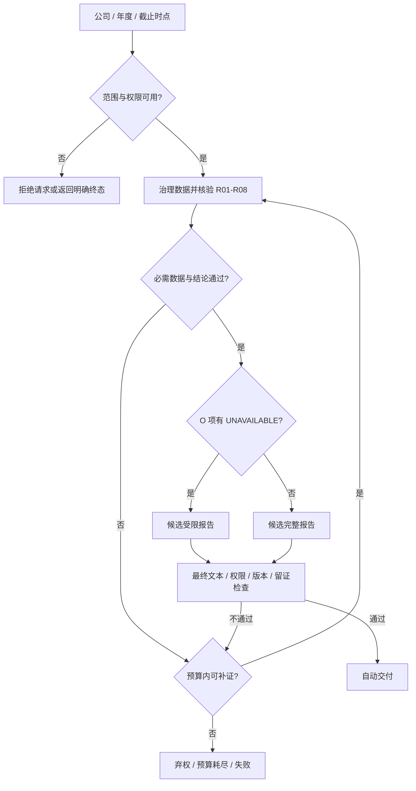

# 首版业务范围与财报点评模板

> **历史研究档案**：完整保留原文供溯源。当前首版以 [SPEC](../../SPEC.md) 和 [已冻结决定](../decisions/0001-p0-baseline.md) 为准；旧待确认表、机构内部定位、模型价格及后续阶段不直接作为上线配置。

> 版本：0.1.0 · 修订：2026-11-05 · 状态：可用于开发拆解的建议基线，业务适用范围待确认\
> [文档索引](README.md) · [决策登记](financial-research-decisions.md#decisions) · [模拟报告与证据样例](financial-research-mvp-report-example.md)

## 1. 首版交付什么

首版提供一个明确任务：**用户选择一家公司和一个已披露的年度，系统生成有原文引用、可复算指标及明确限制的年度财报点评。** 报告解释已披露业绩与财务变化，不生成投资评级、目标价或未来盈利预测。

建议先支持 A 股非金融企业，以采用公历年度、人民币列报、具有合并财务报表及可比上年数据的制造业企业作为首批验证范围。银行、保险、证券、投资控股等需要不同指标体系的主体，以及非公历年度、外币列报、无合并报表的主体，首版返回不支持；行业可用范围由版本化白名单确定，不由 LLM 猜测。亏损企业不因亏损被排除。

该收敛是本轮设计建议，不代表用户已确认 Q-01–Q-04；厂商仍留空，数据许可也不由本文推定。开发可按本建议制作模板和测试，真实上线前在决策表确认适用范围。

### 1.1 用户问题与输出

| 用户想知道 | 首版给出的答案 | 不越过的边界 |
| --- | --- | --- |
| 本年收入和利润怎样变化？ | 两期数值、金额变动及可解释的同比 | 不将业绩增长等同于投资价值提升 |
| 毛利率如何变化？ | 同口径营业收入/成本计算的毛利率及百分点变化 | 不无证据归因为产品结构、价格或成本 |
| 经营现金流与利润是否出现差异？ | 两期经营净现金流、合并净利润与差额 | 不仅凭比值判断利润造假或“盈利质量优良” |
| 财务结构发生什么变化？ | 年末总资产、总负债、资产负债率变化 | 不据此直接断言偿债安全或财务困境 |
| 管理层怎样解释变化？有哪些限制？ | 归属明确的管理层说法、审计意见及与本报告相关的限制 | “管理层称”不自动升级为独立证实的因果结论 |

### 1.2 功能边界

| 首版必须具备 | 后续再做 |
| --- | --- |
| 单公司、单年度与上年可比数据 | 多公司比较、行业综述、组合分析 |
| 指定年度，不自动选择或切换报告期 | “最新一期”自动选择、季度与半年度模板 |
| 已配置来源采集、原文定位与修订识别 | 用户上传任意文件、开放网页研究 |
| 固定章节、结构化指标、受控文字解释 | 自定义章节、开放式长研报与多轮问答 |
| 单研究角色 + 确定性计算 + 独立自动验证 | 全量多角色辩论、自适应复杂路由 |
| 创建/查询/取消任务、报告阅读、证据侧栏、历史版本 | 复杂争议可视化、协作编辑、批量任务 |
| 站内交付与可查询终态 | 邮件/外部渠道、PDF 导出可后置 |

首版仍完整执行权限、预算、版本、留证和交付检查。Jev 是否接入由其评测决定，不能成为固定供应商依赖；独立语义核验可用已经验证的适配器。降低功能范围不意味着去掉最终验证。

## 2. 用户输入与任务范围

<a id="task-input"></a>

### 2.1 输入契约

以下是创建研究任务的业务载荷示例；幂等键和身份认证沿用现有 API 契约，不重复定义。

```json
{
  "template_id": "annual_financial_review",
  "template_version": "1.0.0",
  "entity_id": "DEMO-ISSUER-001",
  "report_year": 2025,
  "research_as_of": "2026-04-30T23:59:59+08:00",
  "as_of_mode": "public_as_of",
  "purpose": "internal_research",
  "locale": "zh-CN"
}
```

- 用户通过主体选择器确定公司；代码和市场用于搜索，后台落稳定 entity_id。歧义必须在提交前解决，不能自动选相似名称。
- `report_year` 指财务年度，不是文件披露年份。首版按 1 月 1 日至 12 月 31 日处理；年度结束晚于截止时点时拒绝请求。年度已结束但截止时点尚未披露完整年报时，按必需证据不足处理。
- 用户指定研究截止时点；界面可默认当前服务端时间，提交后固定。界面展示“以该时点已公开披露的信息研究”，不使用隐藏的当前时间更新旧任务。
- 首版界面开放 `public_as_of`。底层保留其他时点模式；收到不支持的模式返回明确错误，不静默换模式。
- 请求额外指定季度、多公司或任意研究指令时明确拒绝，不通过忽略字段把请求变成年度点评。
- 模板、locale、用途在服务端校验；用户不能自行设置来源等级、验证阈值、必需项、模型放行结果或无限预算。
- 任务冻结模板版本、需求版本与规则版本。中途模板变更不影响在途任务。

### 2.2 预检查与拒绝

| 情况 | 行为 |
| --- | --- |
| 不支持的行业、会计年度、列报币种或模板 | 返回 `UNSUPPORTED_SCOPE`；不运行完整研究 |
| 未知主体或候选不唯一 | 返回 `INVALID_ENTITY`；不猜测公司 |
| 截止时间在未来、年度参数不合法 | 返回 `INVALID_RESEARCH_TIME` |
| 缺少任务创建权限或用途许可 | 返回权限错误，避免泄漏资源存在性 |
| 厂商槽位未配置，已知缺少必需采集能力 | 返回 `CAPABILITY_UNAVAILABLE`；不展示假报告 |
| 配额/队列容量不足 | 按准入策略拒绝或排队；不能提前承诺完成时间 |

预检查能同步确定的错误不创建研究运行。只有采集后才能发现的缺证、口径冲突与未披露情况按 §6 收敛到已有任务终态，不另造人员等待状态。

## 3. 报告章节与写作模板

<a id="report-template"></a>

模板 ID 为 `annual_financial_review`，版本 `1.0.0`。章节顺序固定，正文目标约 800–1,500 中文字（不含表格与引用），用于约束首轮实验；不因凑字数增造结论，不因字数限制删除关键限定。

| 章节 ID | 标题与内容 | 必须显示 | 允许的 Claim |
| --- | --- | --- | --- |
| S0 | 报告信息 | 公司、年度、截止时点、合并/人民币口径、报告版本、完整/受限状态、是否模拟 | 元数据 |
| S1 | 主要结论 | 3–5 条来自后续章节的结论，至少覆盖收入利润、毛利率、现金流；有实质审计限制时优先展示 | 已通过的事实与计算；可带限定推断 |
| S2 | 业绩与盈利变化 | 核心指标表、同比/金额变化、毛利率变化；缺乏归因证据时明确无法分离贡献 | 事实、计算、可选的归属陈述 |
| S3 | 经营现金流 | 两期现金流与合并净利润、差额、适用时的比值；解释不足时明确限制 | 事实与计算 |
| S4 | 财务结构 | 两期年末资产、负债及比例；提示资产负债率不等于有息债务率 | 事实与计算 |
| S5 | 审计、可比性与研究限制 | 审计意见、重述/会计口径变化、未解决的非关键问题、缺失的可选内容 | 可核验的披露事实与限制 |
| S6 | 证据与计算 | 逐条引用入口、文件版本/位置、计算输入与公式；来源时间和许可控制 | 只展示可访问的材料 |

每条数值及解释必须关联 Claim；S1 复用后文 Claim，不能重新生成独立事实。金额显示单位统一并显式标注；内部保持原精度，引用侧栏显示原值。报告标题建议：`{公司名称} {年度}年度财报点评｜截至{截止日期}`。

前端正文使用可读引用序号，如 `[1]`，关联确切 evidence_ref 和 locator；计算引用同时打开输入来源与 CalculationRun。用户无需理解 operation_id、epoch 或内部队列名称。

## 4. 必需证据矩阵

<a id="evidence-matrix"></a>

R 为必需需求，O 为固定可选需求，ID 在同一模板版本内稳定。所有“有数据”都指已经通过当前授权、主体、期间、单位、版本和质量检查的数据，不能只检查字段非空。

| 需求 ID | 内容与覆盖 | 支持章节 | 缺失或不合格时 |
| --- | --- | --- | --- |
| R01 | 当前年度完整正式年报、主体身份、披露时间、版本/更正链；关键证据能回到原文 | S0、S5、S6 | 补证耗尽后弃权；不能以新闻或业绩预告代替 |
| R02 | 本年与上年同口径营业收入、营业成本 | S1、S2 | 无法得到两期可比值则弃权 |
| R03 | 本年与上年合并净利润、归属于母公司股东的净利润，分别标明口径 | S1–S3 | 缺证或混用无法修复则弃权 |
| R04 | 两期经营活动产生的现金流量净额 | S1、S3 | 缺证则弃权；缺失不转成零 |
| R05 | 本年末和上年末总资产、总负债 | S4 | 缺证或口径无法对齐则弃权 |
| R06 | 币种、单位、合并范围、会计政策/重述等影响可比性的说明；记录实际检查范围 | 全文 | 关键口径未知或比较无效则弃权 |
| R07 | 本年审计报告意见及相关段落；有强调事项、持续经营或其他相关说明时保留 | S1、S5 | 意见类型/相关限制无法可靠提取则弃权 |
| R08 | 对已使用指标和解释相关的附注、风险与反证完成检查，保存检查位置及结果 | S1–S5 | 相关关键原文无法访问或重大矛盾未解则弃权 |
| O01 | 本年与上年可比的分产品/业务收入及必要口径 | S2 | 不可得则省略拆分分析并记录状态 |
| O02 | 管理层对收入、毛利率或利润变化的明确解释及上下文 | S2、S5 | 不可得则只描述变化，禁止补造原因 |

R06/R08 要求可核查的检查记录，不要求模型证明“没有任何风险”。结果只能表述“在列明材料和检查范围内未发现某类问题”，不能输出“无风险”。已披露但仍存在重大不确定性时，按受影响 Claim 判断，不因来源正式就忽略限制。

### 4.1 可比数据与修订选择

- 优先使用截止时点可用的当前年报及其更正版本中列示的本年、上年比较数；比较数被重述时使用该年报列示的重述口径，并标明。
- 当前年报未给足比较值时，可补采当时可用的上年年报，但必须证明口径相容；不能拼接不同修订基准形成同比。
- 后续更正不进入较早截止任务；发现源记录伪造或授权撤销时按治理规则阻断，历史时点不豁免权限。
- 年度时段数据和年末时点数据分别存储；指标定义参考 XBRL 的主体、期间、单位和维度设计。[R1]

### 4.2 来源与交叉核验

正式披露证据要求可验证的一手原文及版本。结构化 API 可以提供候选值，但 R02–R05 的数值必须与原文对应位置对账。无法取得可核验原文时，不用结构化值替代该模板的必需留证。

首版不要求每个值机械请求两家厂商；“API 值对账原文”用于检查提取和转化，不声称得到两份独立经济事实。来源相同的转载只计一个 origin_group。厂商身份、来源等级和授权规则沿用数据治理文档。

## 5. 指标、公式与结论约束

所有公式由确定性计算服务执行，LLM 选择已登记公式并组织文字。以下是模板专用公式，注册版本必须和报告一起冻结。

| 公式 ID | 计算 | 展示规则 |
| --- | --- | --- |
| F01 amount_change | 本期值 − 上期值 | 金额变化，保留同单位输入 |
| F02 yoy_positive_base | `(本期 / 上期 − 1) × 100%` | 仅上期 > 0 且两期可比时使用；符号变化同时用文字说明 |
| F03 gross_margin | `(营业收入 − 营业成本) / 营业收入 × 100%` | 收入 > 0，且收入口径与成本一致；不截断负毛利率 |
| F04 percentage_point_change | 本期百分率 − 上期百分率 | 单位为“个百分点”，不是百分比增长 |
| F05 cash_profit_gap | 经营净现金流 − 合并净利润 | 不与归母净利润混用；差额不自动解释为操纵利润 |
| F06 cash_profit_ratio | 经营净现金流 / 合并净利润 | 仅合并净利润 > 0 时展示；单一比值不能证明盈利质量 |
| F07 liability_asset_ratio | 总负债 / 总资产 × 100% | 总资产 > 0；负债包括非有息负债，不称为有息负债率 |
| F08 segment_revenue_share | 分产品收入 / 同期营业收入 × 100% | 可选；总收入 > 0，主体、币种、期间与范围一致，分部合计对账总额 |

同比基数为零或负数时，显示金额变化和“由亏转盈/亏损扩大/亏损收窄”等基于符号的描述，不显示误导的增长率。比值分母接近零时保留原值和“小基数”说明，是否屏蔽比值的数值阈值在 Q-22 校准；未配置阈值时不自行发明数值门限。

输入为合法但不适用计算的值时，计算结果为 `NOT_APPLICABLE`，附原因；与 `MISSING_INPUT`、`CONFLICT` 区分。关键毛利率/资产负债率因收入或资产分母不满足正值条件而无法计算时，本模板不具备完整核心能力，返回弃权；同比和现金利润比值不适用但原值与金额变化完整时，可正常完成。

展示层默认金额两位小数、百分率两位小数、比值两位小数；在最终展示时舍入，计算不得以已舍入的显示值作为输入。正式精度与舍入实现由指标字典规定。

### 5.1 必需结论与可选解释

| Claim 组 | 必需内容 | 允许的表达 | 禁止的表达 |
| --- | --- | --- | --- |
| C01 收入与利润 | R02/R03 原值、F01、可用的 F02 | 收入增长、利润下降；注明归母或合并 | 自动等同于竞争力增强或投资机会 |
| C02 毛利率 | R02、F03/F04 | 毛利率上升 X 个百分点 | 无证据写成某因素“主要驱动” |
| C03 现金流 | R03/R04、F01/F05，可用的 F06 | 现金流与合并净利润的差额扩大/缩小 | 仅凭差额判定利润真实性 |
| C04 财务结构 | R05、F01/F07/F04 | 资产、负债与比例变化 | 直接判定安全、危机或违约 |
| C05 限制 | R06–R08 及可选覆盖状态 | 审计/可比性及研究覆盖限制 | 把未发现写成不存在 |
| C06 可选解释 | O01/O02、相关反证 | “管理层表示……”；可验证的分部算术贡献 | 把归属陈述写成独立证实的因果 |

盈利和现金流是相关但不同的概念；该区分参考财务报表阅读资料。[R2] 首版不自行预测未来现金流，不从利润变化直接推出股价方向。

## 6. 完整、受限与不交付的判定

<a id="delivery-policy"></a>

可选需求状态使用 `SATISFIED`、`NOT_DISCLOSED`、`NOT_APPLICABLE`、`UNAVAILABLE`。`NOT_DISCLOSED` 必须能证明指定原文相关范围已检查且未披露；原文取不到不能冒充未披露。`NOT_APPLICABLE` 需模板规则依据。状态与理由写入 SelectionDecision / requirement 结果，不修改既有 TaskDataset 或任务状态枚举。

| 条件 | 数据集与任务结果 | 用户看到什么 |
| --- | --- | --- |
| R01–R08 满足，C01–C05 通过，O 项满足或经验证不披露/不适用，最终检查通过 | READY；COMPLETED，result_kind=full | 完整模板报告；仍展示客观限制 |
| 所有必需项通过，至少一个 O 项因抓取、解析或校验问题 UNAVAILABLE，最终检查通过 | PARTIAL；COMPLETED，result_kind=limited | 同一报告结构 + 缺失的可选项、影响与未作出的解释 |
| 必需证据缺失、不可比、关键公式不适用或关键反证未解，补证耗尽 | 不发布可用数据集或阻止相关结论；ABSTAINED | 证据不足原因、缺失需求 ID 与可重试建议，不交付诊断草稿 |
| 金额/token 预算耗尽且报告尚未验证完成 | BUDGET_EXHAUSTED | 预算耗尽说明；不跳过检查抢先交付 |
| 授权/用途失败 | BLOCKED | 脱敏原因，不泄漏受限材料 |
| 基础设施或交付重试耗尽 | FAILED | 可追踪错误与重试入口 |
| 用户取消生效 | CANCELLED | 已取消；费用和迟到结果仍按既有规则记录 |

O 项经验证为 NOT_DISCLOSED/NOT_APPLICABLE 时，表示该项覆盖检查已经完成，并非数据抓取成功；其状态和依据必须随报告展示。R 项不接受用这两个状态替代必需数据。

上述为业务判定，状态迁移、竞争和提交以现有工作流/事务契约为准。系统错误尚未恢复时不伪装成“资料未披露”；等待均受 Q-19/Q-22 的时限限制。

审计意见非标准无保留时必须展示原意见与涉及范围。若其影响必需指标可信性且无法解决，则弃权；只有不影响必需结论的限定事项才可带限制交付。不能仅按审计意见名称自动放行或一律丢弃。

“完整”表示模板检查覆盖完整，不表示事实绝对正确或所有未来风险已排除；无法证明原因本身不构成失败，首版核心任务是对已披露变化做有依据的点评。



## 7. 首版页面与输出契约

最小页面为任务列表、创建页、报告页。报告页内提供证据侧栏及版本入口；未交付报告不显示可复制的完整草稿。

| 场景 | 页面行为 |
| --- | --- |
| 创建 | 选择公司与年度，展示模板范围、截止时点及用途；不提供开放式“任意研究”入口 |
| 执行 | 展示排队/准备数据/分析/验证/交付阶段；使用真实阶段，不伪造精确进度 |
| 完整交付 | 展示固定章节、数据时点、引用、计算及限制 |
| 受限交付 | 顶部列明 O 项缺失及影响；与完整报告采用同等证据访问权限 |
| 弃权或失败 | 展示 reason_code 对应的用户说明；重新提交创建新运行，不改写旧结果 |
| 取消 | 展示取消请求状态，服务端终态确定后更新；浏览器关闭不等同于取消 |

报告读取 DTO 复用 ReportVersion，并补充模板元数据和覆盖信息：`template_id/version`、`task_dataset_ref`、`result_kind`、`sections`、`requirement_results`、`limitations`、`claim_refs`、`calculation_refs`。不在此复制 Claim 和 ContextPack schema。诊断结果使用任务错误字段，不将 `abstained` 填入仅允许 full/limited 的 result_kind。

## 8. 开发切分与验收

| 工作包 | 可验证结果 | 前置条件 |
| --- | --- | --- |
| MVP-A 模板与模拟样本 | 固定章节、公式、覆盖判定、完整/受限/弃权三类渲染 | 本文与样例；可不连接厂商 |
| MVP-B 单路径研究 | 生成 Claim、引用检查、独立验证、自动交付与取消 | 已有后端和 Agent 基础契约 |
| MVP-C 真实来源 | 首批年报和结构化值对账，脚注及重述测试 | Q-05 许可与真实适配完成 |
| MVP-D 上线验证 | 租户隔离、预算、恢复、目标负载、报告质量通过 | 既有 AC/AG/DG/DIST 和 RPC 检查 |

新增模板验收项不替代系统验收：

- [ ] MVP-01：季度、多公司和不支持行业请求明确拒绝，不静默改为年度任务。
- [ ] MVP-02：指定年度与截止时点固定，未来更正不泄漏到旧任务。
- [ ] MVP-03：R01–R08 任意必需缺证不能变成 limited 交付。
- [ ] MVP-04：O 项未披露与无法获取分开；只有经过检查才能标 NOT_DISCLOSED。
- [ ] MVP-05：原值、单位、公式及舍入可复算；同比负基数、零基数与现金利润比值分别测试。
- [ ] MVP-06：毛利率百分点变化不会写成百分比增长，现金流不与归母口径混算。
- [ ] MVP-07：缺乏原因证据时保留数值结论并说明归因限制，不补造解释。
- [ ] MVP-08：审计、重述与相关反证影响关键结论时无法自动通过。
- [ ] MVP-09：摘要只复用已验证 Claim；完整和受限输出都经过最终检查。
- [ ] MVP-10：所有正式引用定位真实授权证据；模拟 ID、数据和报告与生产隔离。
- [ ] MVP-11：无法交付时仅返回终态和原因，未验证草稿不作为报告显示。
- [ ] MVP-12：样例的 full 基线、缺 O01 的 limited、缺 R04 的 abstained 均按确定规则生成；缺 R04 的例子以前提为补证已耗尽。

## 9. 决策与参考

业务范围对应 Q-01–Q-04，必需/可选要求对应 Q-21，样例与评测对应 Q-17。这些条目的建议值链接到本文，确认状态只在决策表维护；性能、预算及质量阈值继续沿用原待定项，不在模板里另设一套上线参数。

- R1：[XBRL JSON 教程](https://www.xbrl.org/guidance/xbrl-json-tutorial/)：参考主体、期间、单位和维度表达，未要求所有厂商使用 XBRL。
- R2：[SEC 财务报表阅读指南](https://www.sec.gov/about/reports-publications/investorpubsbegfinstmtguide)：参考财务报表及现金流与净利润的区别；不作为 A 股法规依据，也不构成数据厂商选型。

本文的范围、必需项与放行政策是工程与产品建议，不是上述资料规定的监管要求。完整验证器实现、法律适用性及真实模型效果不由本轮模板设计代替。
