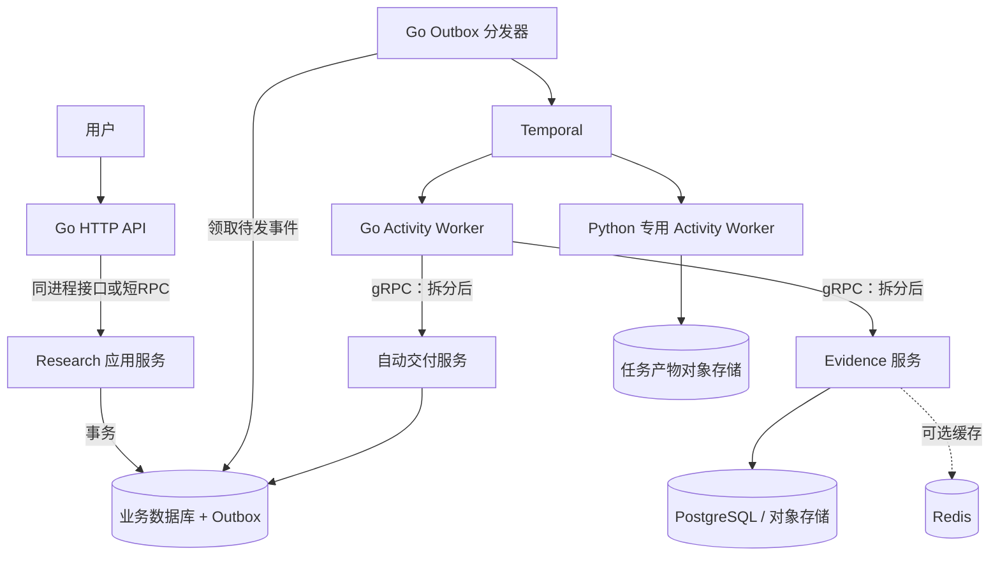

# 服务间通信与 RPC 契约

> 范围更新（ADR-0003，2026-11-06）：首版为研报生成、个股分析、资金动向与自选股，由自建 Harness 在已接入数据上执行，调度使用 River。本文中的 Temporal、多角色研讨/投票、T2 路由、gRPC、Redis、向量检索、K8s 等设计均不是首版任务。当前规则见 [SPEC](../../SPEC.md)、[HARNESS](../HARNESS.md)、[DATA_SERVICE](../DATA_SERVICE.md) 与 [ADR-0003](../decisions/0003-product-harness-runtime.md)。

> **历史研究档案**：完整保留原文供溯源。当前首版以 [SPEC](../../SPEC.md) 和 [已冻结决定](../decisions/0001-p0-baseline.md) 为准；旧待确认表、机构内部定位、模型价格及后续阶段不直接作为上线配置。

> 版本：0.3.0 · 修订：2026-11-04 · 状态：设计草案，待实现与验证\
> 范围：服务拆分后的 RPC 契约、鉴权、超时、幂等与兼容性。\
> [文档索引与统一约定](README.md)

## 1. 默认通信决策

首版仍是模块化 Go 后端与独立 Worker，不强制每个业务模块成为微服务。**同进程用 Go 接口，跨服务短请求默认 gRPC + Protobuf，长任务和恢复流程用 Temporal。** 浏览器使用 HTTP/JSON，任务进度使用查询或 SSE；不直接连接内部 gRPC。

调用失败按既定预算重试、补证或返回终态；处理规则与研究工作流一致。

| 场景 | 协议 | 原因 |
| --- | --- | --- |
| 同一 Go 进程内模块协作 | 类型化 Go 接口 | 避免无收益的网络调用 |
| 已拆分 Go 服务间短查询/命令 | gRPC/HTTP2 + Protobuf | 明确契约、deadline、状态码、代码生成 |
| 分页检索、获取指定版本证据包 | 有界 unary gRPC | 请求与内存可控；大文件只传引用 |
| 研究、模型调用、解析、计算、导出 | Temporal Workflow/Activity | 需要持久化、重试、取消和进度恢复 |
| Go 调 Python 解析/科学计算 | Temporal 独立 Activity 队列 | 沿用既有跨语言 JSON Schema 契约，不为每个工具新建 RPC 服务 |
| 数据库提交后通知/分发 | Outbox → Temporal 或指定消费者 | 防止提交与发送不一致 |
| 外部厂商/模型 | 厂商规定的 HTTPS 协议 | 由适配器封装；不要求外部供应商支持 gRPC |

Temporal SDK 本身与引擎的通信不等于业务服务 RPC。Protobuf 业务契约不替换既有 Temporal JSON Activity 契约；二者单独版本化并测试转换。

## 2. 调用拓扑与服务边界



图中可独立部署的服务首版允许共进程；拆分后通过 adapter 将本地接口换成 RPC client，领域层不依赖 grpc 类型。

| 调用方 → 目标 | 接口能力 | 语义 |
| --- | --- | --- |
| API → ResearchService | CreateResearchTask、GetTask、CancelTask | 创建返回 task_id；不等待完整研究 |
| Activity → EvidenceService | GetDatasetManifest、GetContextPack、SearchEvidence | 固定 dataset_version、权限和用途 |
| Activity → CalculationService（如独立） | SubmitCalculation、GetCalculation | Submit 只持久化并返回 operation_id；实际计算异步 |
| Activity → ValidationService（如独立） | GetValidation、SubmitValidation | 纯规则短检查可同步；含 LLM 检查异步 |
| Workflow 的交付 Activity → DeliveryService | DeliverReport、GetDelivery | 校验报告/证据哈希、epoch、门禁，幂等事务交付 |
| 研究服务 → GovernanceService（如独立） | RequestDatasetBuild、GetDatasetBuild | 请求治理后返回 build_id，不阻塞等待厂商 |

Workflow 函数不直接发 RPC；所有网络调用发生在 Activity 或 API 应用服务中。不能让服务层同步等待另一个长工作流完成，也不形成 A→B→A 的循环依赖。

拆分后的服务拥有自己的业务表写权限；其他服务通过契约访问。暂共用 PostgreSQL 实例也不得跨域任意写表。Evidence 服务负责数据权限，Delivery 服务负责交付权限，客户端声明不能代替服务端检查。

## 3. Protobuf 契约与生成

目录建议：`contracts/proto/research/{evidence,task,delivery}/v1/`。使用 `protoc`、`protoc-gen-go`、`protoc-gen-go-grpc`；可用 Buf 管理 lint、生成和 breaking-change 检查，版本固定到构建工具链。

以下是语义示例，go_package 待目标仓库确定，不是可直接发布的完整协议：

```proto
syntax = "proto3";
package research.evidence.v1;

service EvidenceService {
  rpc GetContextPack(GetContextPackRequest) returns (GetContextPackResponse);
}
message RequestContext {
  string request_id = 1;
  string tenant_id = 2;
  string task_id = 3;
  uint64 execution_epoch = 4;
  string allowed_purpose = 5;
}
message GetContextPackRequest {
  RequestContext context = 1;
  uint64 dataset_version = 2;
  string question_id = 3;
  string role = 4;
  string expected_manifest_hash = 5;
}
message GetContextPackResponse {
  string pack_id = 1;
  string manifest_hash = 2;
  string artifact_ref = 3;
  string content_hash = 4;
  string governance_policy_version = 5;
  repeated string missing_optional_requirements = 6;
}
```

- `artifact_ref` 是不可变逻辑引用，客户端须走授权对象访问路径；不能直接给任意内部文件路径或永久公开 URL。
- 金额/高精度数值使用 decimal string 或显式 coefficient/scale，不用 double；时间使用 Timestamp，业务日期/期间单独建模。
- 必需字段由服务端验证；proto3 默认零值不是业务合法值。区分缺失和零时使用 optional/oneof。
- 枚举零值为 UNSPECIFIED，未知值不能默认为通过；删除字段保留原编号和名称，不复用。
- v1 优先增量兼容；破坏性修改发布 v2，服务双版本并行到旧调用者及在途任务退出。
- 服务端生成代码、运行时字段校验和领域校验各有职责，生成成功不等于业务正确。

Protobuf 的字段演进与保留编号规则参见[官方指南](https://protobuf.dev/programming-guides/proto3/)和[最佳实践](https://protobuf.dev/programming-guides/dos-donts/)。

## 4. 鉴权与租户上下文

生产内部 RPC 使用 TLS；独立部署的工作负载默认采用 mTLS 校验服务身份，证书由组织 PKI/工作负载身份系统签发并轮换。部署可使用平台代理终止 mTLS 或应用直接处理，但必须明确可信边界，不能把明文公网端口当内部通信。

最终用户 OIDC token 在入口验证；跨服务使用短时、受众限定的委托凭证，或可验证的后台任务授权记录。后者用于持续时间超过用户 token 有效期的异步研究，且每次敏感访问重查当前授权。

`tenant_id`、role、purpose 等请求字段只是声明：接收服务必须与已认证主体、委托范围、任务归属和当前策略核对；禁止信任任意 metadata 里的租户头。缺凭证/租户不匹配时直接拒绝。

拦截器职责：服务认证 → 请求大小和速率限制 → 租户/用途授权 → schema/参数检查 → 观测与业务调用。Trace 上下文仅用于关联，不具有授权作用；日志不记录密钥、整份原文或完整用户 token。

内部方法按服务身份授权，`DeliverReport` 只对自动交付 Activity 身份开放；模型、Python 工具和用户不能直接放行。

<a id="rpc-retry"></a>

## 5. Deadline、取消和重试

每个 RPC 必须设置 deadline。下游时限取父调用剩余时间与本方法预算的较小值，并留出序列化/收尾时间；不在子服务重新启动更长计时。[gRPC Deadlines](https://grpc.io/docs/guides/deadlines/)

| 方法类别 | 初始实验预算 | 重试原则 |
| --- | --- | --- |
| manifest/状态查询 | 1–2 秒 | 瞬时不可用可在总时限内有限重试 |
| 有界证据检索/pack引用 | 3–5 秒 | 避免重复昂贵扫描；按预算重试 |
| 创建异步任务/交付事务 | 2–3 秒 | 必须带幂等键；超时先查询原操作 |
| 厂商/LLM/大文件工作 | 不纳入上述短 RPC | 使用独立 Activity 时限与重试策略 |

这些数值是压测起点，不是 SLO。上下文取消传递到 pgx、HTTP 与子 RPC；已提交的后台研究不因浏览器断开而取消，用户取消通过 CancelTask 命令执行。

- API 的短读 RPC 可采用配置化 gRPC retry；Temporal Activity 包装的写命令默认关闭应用配置重试，由 Activity 主导业务重试。仍按传输可能重复执行设计幂等，不能假设关闭配置就保证单次执行。
- 仅对已声明安全的方法重试 UNAVAILABLE，退避带抖动并受总 deadline 限制；429 类负载问题不能立即重试放大。
- 不对写操作启用 hedging；原调用超时不证明服务端未提交。
- 不在数据库事务内等待 RPC；跨服务不使用隐式分布式事务。

重试机制参见[gRPC Retry](https://grpc.io/docs/guides/retry/)。

## 6. 错误与幂等契约

| gRPC code | 业务含义 | 客户端动作 |
| --- | --- | --- |
| INVALID_ARGUMENT | 字段、单位、版本参数无效 | 不重试，返回结构化错误 |
| UNAUTHENTICATED / PERMISSION_DENIED | 身份或权限失败 | 不自动换身份绕过 |
| NOT_FOUND | 授权范围内目标不存在 | 返回缺失；注意不泄漏跨租户资源存在性 |
| FAILED_PRECONDITION | 数据集未就绪、门禁不通过、证据哈希不符 | 补证/重验或明确终止 |
| ABORTED | revision/epoch 并发冲突 | 读取当前状态，重新决定命令 |
| RESOURCE_EXHAUSTED | 租户配额、队列或内存上限 | 按 retry-after/策略排队或拒绝 |
| UNAVAILABLE | 瞬时依赖故障 | 在策略允许范围有限重试 |
| DEADLINE_EXCEEDED | 时限耗尽，写结果可能未知 | 使用 operation_id 查询，不盲目重发 |
| INTERNAL / DATA_LOSS | 不变量或数据完整性问题 | 终止当前自动放行，告警并返回失败 |

错误详情包含稳定 reason_code、operation_id、retryable、retry_after、缺证引用或版本信息；公开返回需脱敏。自动检查拒绝不是“系统崩溃”，应给出业务原因。[gRPC Status Codes](https://grpc.io/docs/guides/status-codes/)

写请求包含 `idempotency_key`、request_hash、expected_revision（如适用）和 epoch。幂等记录与业务写入同事务提交：同键同请求返回原结果，同键不同请求返回冲突。保留期覆盖调用方重试和工作流恢复窗口；交付唯一约束在记录清理后仍防止重复交付。

跨域操作采用本地事务 + Outbox + 幂等消费，整个研究任务不具备跨服务 ACID 语义。源数据/门禁状态更新后，交付服务通过版本与哈希核验；若存在跨服务授权失效窗口，明确一致性策略，高敏场景重新查询权威状态。

## 7. 服务发现、连接与流量治理

- 本地 Compose 使用服务名；Kubernetes 使用 Service DNS。P0 共进程不运行不必要的 RPC 服务。
- Go 客户端复用长生命周期 `grpc.ClientConn`，不每请求 Dial。HTTP/2 多路复用不等于并发无限，仍设 in-flight 上限。
- Kubernetes ClusterIP 常按连接选后端，长连接可能偏载。需要客户端按 Pod 均衡时采用 headless Service + DNS resolver + 经验证的 round_robin，或平台 L7 gRPC 负载均衡；不假设普通 DNS 名自动逐请求轮询。
- 标准 gRPC health service、应用 readiness 与 graceful shutdown 配合；先停止新流量，再限时 drain，超时终止可恢复操作。
- 客户端与服务端都设置收发消息上限、并发、限流和 keepalive 策略。大数据以分页或不可变对象引用传递，不把财报全文作为无限 protobuf 字段。
- 长流仅在确有需求时采用；需流量控制、客户端慢消费处理、断线恢复游标。首版内部优先 unary，用户进度由 API 的 SSE 承担。
- mTLS、证书轮换、负载均衡和健康检查需要集成测试；Service Mesh 不是首版必要依赖，采用时避免与客户端重复重试。

上述拓扑为推荐实现，具体发现和代理配置需结合部署平台验证。

## 8. CI/CD 与验收

1. `.proto` lint、代码生成无漂移、与上一个发布版本的 breaking-change 检查。
2. 服务端/客户端新旧版本互通，Go 与必要 Python 客户端的 decimal、时间和 enum 契约测试。
3. 真实 RPC/TLS 测试鉴权、跨租户拒绝、证书轮换和角色权限，不能全部使用 mock。
4. 模拟 deadline 后已提交、响应丢失、重复请求、epoch 过期，验证交付与费用副作用不重复。
5. 多副本负载均衡、连接复用、消息上限、超载、慢消费者、节点退出与重试放大压测。
6. metrics 记录 method、code、latency、in-flight、重试和拒绝率；task/tenant 放受控 trace 或日志，避免无限指标基数。
7. Provider 先支持兼容契约，Consumer 再升级；回滚核对 schema、RPC 契约、Activity 与在途 Workflow 版本。
8. 全部研究到交付调用无人工 signal；不可恢复故障在预算内自动返回终态。

本文件规定通信方式与实现要求；没有创建实际 `.proto`、服务端或部署配置。技术参数需在目标仓库实施并压测后固定。

版本与文档检查见 [变更记录](CHANGELOG.md)。
